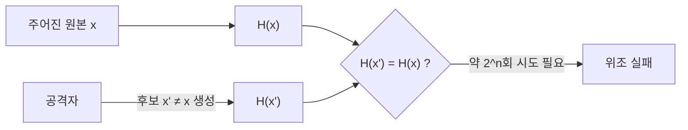

# 제2 역상 저항성 (Second Pre-image Resistance)

---

## I. 주어진 문서를 바꿔치기할 수 없게, 제2 역상 저항성의 개요

### 가. 정의

- 입력 $x$가 주어졌을 때 **$H(x') = H(x)$이면서 $x' \neq x$인 다른 입력 $x'$을 찾는 것이 계산상 불가능**한 성질 (약한 충돌 저항성)

### 나. 특징

| 구분 | 내용 |
| --- | --- |
| 표적 고정 | 공격자가 원본 $x$를 고를 수 없어 충돌 공격보다 어려움 |
| 공격 비용 | 일반 공격 약 $2^n$회 |
| 위조 방지 | 서명된 문서를 같은 해시의 다른 문서로 교체하는 공격 차단 |
| 포함 관계 | 충돌 저항성이 있으면 제2 역상 저항성도 성립 |

---

## II. 공격 구조 및 구성요소

### 가. 공격 구조

- 원본이 고정되어 있어 생일 공격을 쓸 수 없고, 대체 메시지를 찾으려면 출력 공간 전체를 탐색해야 함

### 나. 구성요소

| 구분 | 요소 | 설명 |
| --- | --- | --- |
| 공격 비용 | 전수 조사 | 평균 $2^{n-1}$회 |
| 구조적 약점 | 긴 메시지 공격 (Kelsey-Schneier) | MD 구조에서 $2^k$ 블록 메시지는 약 $k \cdot 2^{n/2+1} + 2^{n-k+1}$로 비용 감소 |
| 설계 개선 | HAIFA 구조 | 블록마다 카운터·솔트 투입으로 긴 메시지 공격 완화 (BLAKE 계열) |
| | 스펀지 구조 | SHA-3, 용량(c) 영역으로 내부 상태 보호 |
| 완화 기법 | 무작위 해싱·TCR | 서명 시 랜덤 값을 섞어 공격자가 사전에 표적을 분석하지 못하게 함 (NIST SP 800-106) |
| 양자 | Grover | 비용 $2^n$ → $2^{n/2}$ |
| 응용 | 해시 기반 서명 | SLH-DSA(FIPS 205)의 안전성 가정 일부 |

---

## III. 비교 및 동향

### 가. 해시 3대 안전성 비교

| 비교 항목 | [[제1 역상 저항성]] | 제2 역상 저항성 | 충돌 저항성 |
| --- | --- | --- | --- |
| 주어진 것 | 해시값 $y$ | 입력 $x$ | 없음 |
| 공격 목표 | $H(x)=y$인 $x$ | $H(x')=H(x)$인 $x'$ | $H(x)=H(x')$인 임의 쌍 |
| 고전 비용 | $2^n$ | $2^n$ | $2^{n/2}$ |
| 양자 비용 | $2^{n/2}$ | $2^{n/2}$ | 이론상 $2^{n/3}$ |
| 깨질 때 영향 | 패스워드 복원 | 기존 서명 문서·파일 바꿔치기 | 미리 준비한 쌍으로 인증서 위조 |

### 나. 동향

- **충돌과의 차이 실증**: MD5·SHA-1은 충돌은 깨졌지만 실용적 제2 역상 공격은 아직 없음, 그러나 서명 용도로는 사용 중단
- **장기 보호**: 양자 대비로 SHA-384 이상 또는 SHA-3 권고
- **해시 기반 PQC 서명**: SLH-DSA·LMS 구현에서 고속 해시 가속 필요

---

### 🔗 연관 토픽

- **소속 도메인**: [[00_보안_MOC|🛡️ 보안]]
- **세부 분류**: `2. 현대 암호학 & 키 관리 · 전자서명`
- **핵심 연관 토픽**:
  - [[제1 역상 저항성]]
  - [[해시 함수의 안전성]]
  - [[해시함수|해시함수(알고리즘 측면)]]
  - [[양자내성암호]]
  - [[MDC]]
