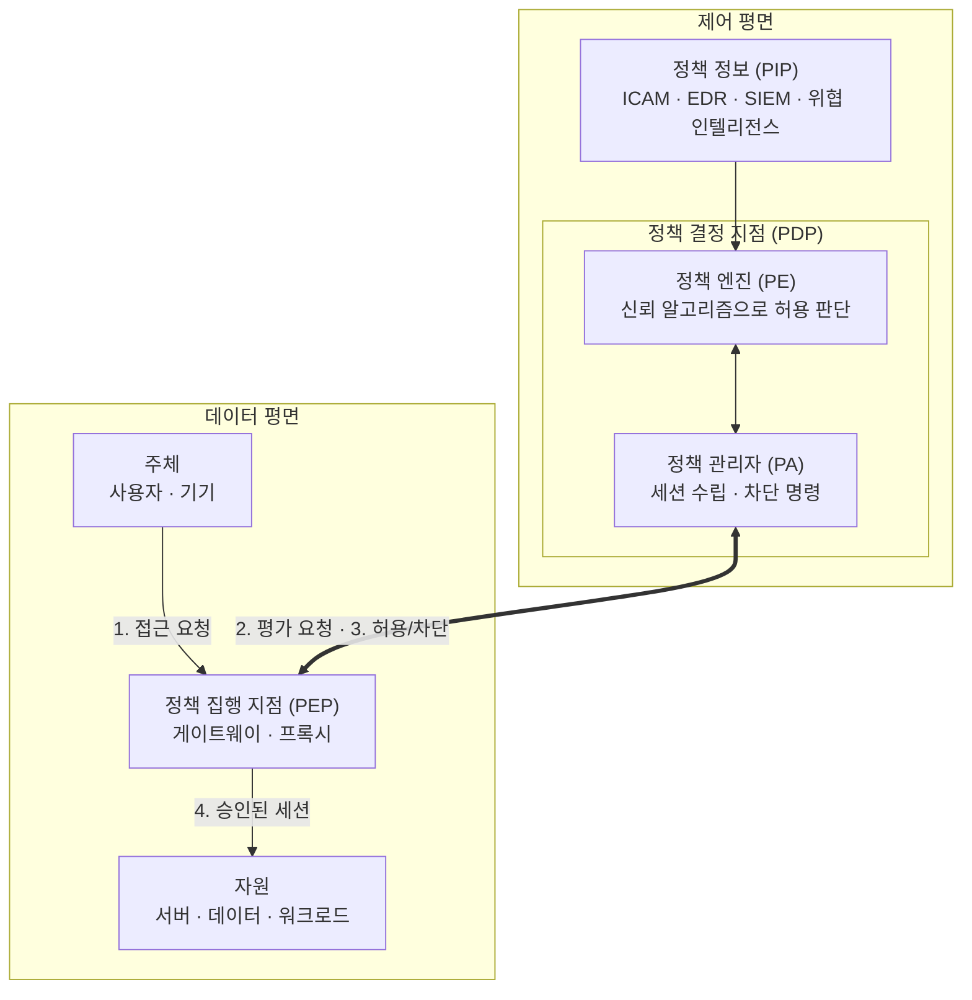

# 제로 트러스트 (Zero Trust)

---

## I. 경계가 사라진 환경의 보안, 제로 트러스트의 개요

### 가. 정의

- **"결코 신뢰하지 말고 항상 검증하라(Never Trust, Always Verify)"** 원칙에 따라 내부·외부 구분 없이 모든 사용자·기기·세션을 매번 검증하고 최소 권한만 부여하는 보안 모델 (NIST SP 800-207)

### 나. 등장 배경 및 원칙

| 구분 | 내용 |
| --- | --- |
| 경계 소멸 | 클라우드·원격근무로 내부망 기반 신뢰 모델 붕괴 |
| 횡적 이동 | 계정 탈취·APT 후 내부망에서 자유로운 확산 |
| 명시적 검증 | 신원·기기 상태·위치 등 모든 신호로 매 요청 검증 |
| 최소 권한 | JIT·JEA로 필요한 만큼만, 필요한 시간만 허용 |
| 침해 가정 | 이미 침해되었다고 보고 피해 범위(Blast Radius) 최소화 |
| 국내 핵심 기술 | 강화된 인증, 마이크로 [[세그멘테이션]], 소프트웨어 정의 경계(SDP) (과기정통부 가이드라인) |

---

## II. 참조 아키텍처 및 구성요소

### 가. NIST SP 800-207 논리 구조

- PEP가 모든 요청을 가로채고, PDP가 PIP의 실시간 맥락을 바탕으로 세션 단위 허용 여부를 결정

### 나. 구성요소

| 구분 | 요소 | 설명 |
| --- | --- | --- |
| 정책 | PE / PA (PDP) | 신뢰 점수 평가와 세션 제어 명령 |
| | PEP | 자원 앞단에서 정책 집행 |
| 신원 | ICAM·적응형 MFA | 위험 기반 인증, [[FIDO]] 패스워드리스 |
| 기기 | [[EDR(Endpoint Detection and Response)\|EDR]]·상태 점검 | 패치·감염 여부 확인 후 접근 허용 |
| 네트워크 | [[SDP(Software Defined Perimeter)\|SDP]]·ZTNA | 인증 후 접속, 서비스를 외부 스캔에서 은닉 |
| | 마이크로 세그멘테이션 | 워크로드 단위 분할로 횡적 이동 차단 |
| 클라우드 | [[SASE(Secure Access Service Edge)\|SASE]]·SSE | ZTNA·SWG·CASB·FWaaS 통합 서비스 |
| 가시성 | [[XDR]]·[[SIEM]]·[[SOAR (Security Orchestration, Automation and Response)\|SOAR]] | 텔레메트리 통합 분석과 자동 대응 |

---

## III. 비교 및 동향

### 가. 경계 기반 vs 제로 트러스트

| 비교 항목 | 경계 기반 보안 | 제로 트러스트 |
| --- | --- | --- |
| 철학 | 내부는 신뢰 (Trust but Verify) | 모두 불신 (Never Trust, Always Verify) |
| 신뢰 영역 | 내부망 vs 외부망 | 신뢰 영역 없음 |
| 인증 | 접속 시 1회 | 세션·요청 단위 지속 검증 |
| 통제 단위 | 서브넷, IP·포트 | 사용자·기기·맥락 |
| 침해 영향 | 내부 확산 용이 | 세그멘테이션으로 국소화 |
| 대표 기술 | [[VPN]], [[방화벽]], IPS | ZTNA, SDP, PDP/PEP, EDR |

### 나. 동향

- **CISA ZTMM 2.0(2023)**: 5대 기둥(신원·기기·네트워크·애플리케이션·데이터)과 3대 공통 역량, 4단계 성숙도(전통·초기·고급·최적)
- **국내 가이드라인**: 과기정통부·KISA [[제로트러스트 가이드라인 2.0]](2024.12)으로 성숙도 진단과 도입 절차 구체화
- **단계적 전환**: VPN을 ZTNA로 우선 대체한 뒤 세그멘테이션·데이터 보호로 확장

---

### 🔗 연관 토픽

- **소속 도메인**: [[00_보안_MOC|🛡️ 보안]]
- **세부 분류**: `1. 정보보안 원칙 & 거버넌스 · 인증`
- **핵심 연관 토픽**:
  - [[제로트러스트 가이드라인 2.0]]
  - [[SDP(Software Defined Perimeter)]]
  - [[SASE(Secure Access Service Edge)]]
  - [[VPN|VPN(Virtual Private Network)]]
  - [[IAM]]
