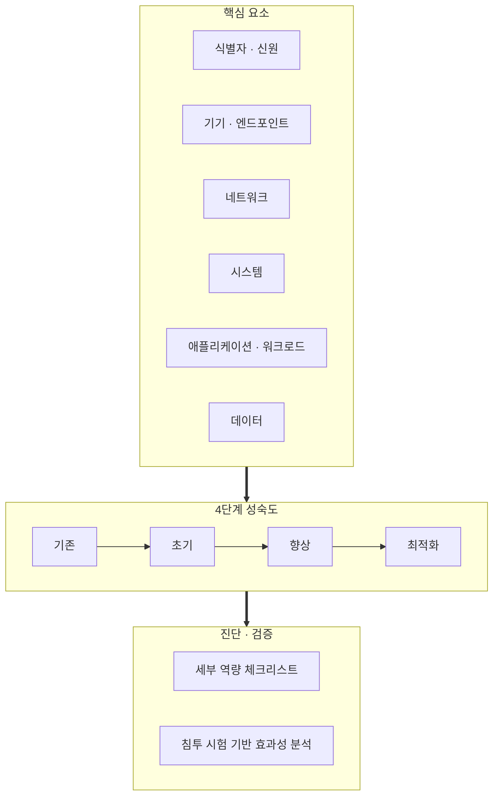

# 제로트러스트 가이드라인 2.0

---

## I. 개념에서 구현으로, 제로트러스트 가이드라인 2.0의 개요

### 가. 정의

- 과학기술정보통신부와 KISA가 **1.0(2023.7)의 개념 중심 안내를 실제 도입·진단 중심으로 확장**하여 2024년 12월 발표한 국내 제로트러스트 도입 지침 (성숙도 모델, 도입 절차, 효과성 검증 방법 제시)

### 나. 특징

| 구분 | 내용 |
| --- | --- |
| 실무 중심 | 기업이 현 수준을 진단하고 단계적으로 구축하도록 절차 제공 |
| 성숙도 세분화 | 3단계에서 '초기' 단계를 추가한 4단계로 개편 (CISA ZTMM 2.0과 정합) |
| 실증 반영 | 2023년 국내 제로트러스트 실증 사업 결과 반영 |
| 효과성 검증 | 체크리스트 진단과 침투 시험으로 도입 효과 확인 |

---

## II. 구성 체계

### 가. 가이드라인 구조

- 핵심 요소별 세부 역량을 4단계 성숙도로 진단하고, 도입 전후 침투 시험으로 공격 표면 축소와 횡적 이동 차단 효과를 검증

### 나. 구성요소

| 구분 | 요소 | 설명 |
| --- | --- | --- |
| 핵심 요소 | 6대 핵심 요소 | 식별자·신원, 기기·엔드포인트, 네트워크, 시스템, 애플리케이션·워크로드, 데이터 |
| | 공통 기능 | 가시성·분석, 자동화·오케스트레이션 등 요소 전반 지원 |
| 성숙도 | 기존 → 초기 → 향상 → 최적화 | 요소별 역량 수준을 단계화 |
| 도입 절차 | 준비 → 계획 → 구현 → 운영·개선 | 자산 식별·현황 진단부터 구축·운영까지 순환 |
| 진단 | 성숙도 체크리스트 | 현재(As-Is)와 목표(To-Be) 차이 분석 |
| 검증 | 침투 시험 | 공격 시나리오로 도입 효과 측정 |

---

## III. 비교 및 동향

### 가. 1.0 vs 2.0

| 비교 항목 | 1.0 (2023.7) | 2.0 (2024.12) |
| --- | --- | --- |
| 목적 | 개념·원칙 확산 | 실무 도입·진단 |
| 성숙도 | 3단계 (기존·향상·최적화) | 4단계 (초기 추가) |
| 내용 | 기본 철학, 핵심 요소, 핵심 기술 | 세부 역량, 도입 절차, 체크리스트 |
| 평가 | 정량 평가 방안 부족 | 침투 시험 기반 효과성 분석 |
| 근거 | NIST SP 800-207 등 해외 자료 중심 | 국내 실증 결과 반영 |

### 나. 동향

- **단계적 적용**: 외부 노출 접점에 ZTNA·[[SDP(Software Defined Perimeter)|SDP]]를 먼저 적용해 공격 표면을 줄이고 세그멘테이션으로 확장
- **공공 분야 연계**: [[국가 망 보안체계|국가 망 보안체계(N2SF)]] 등 망분리 개선 정책과 연계 검토
- **자동화**: [[XDR]]·[[SOAR (Security Orchestration, Automation and Response)|SOAR]]와 정책 결정 지점을 연동해 실시간 권한 회수

---

### 🔗 연관 토픽

- **소속 도메인**: [[00_보안_MOC|🛡️ 보안]]
- **세부 분류**: `1. 정보보안 원칙 & 거버넌스 · 인증`
- **핵심 연관 토픽**:
  - [[제로 트러스트 보안모델|제로 트러스트 (Zero Trust) 보안모델]]
  - [[SDP(Software Defined Perimeter)]]
  - [[국가 망 보안체계|국가 망 보안체계(N2SF)]]
  - [[SASE(Secure Access Service Edge)]]
  - [[XDR|XDR(eXtended Detection Response)]]
