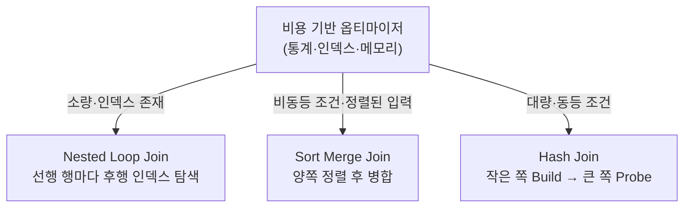

# 조인 (Join)

---

## I. 분리된 테이블의 재결합, 조인의 개요

### 가. 정의

- 두 개 이상의 릴레이션을 **공통 속성 조건(Join Predicate)으로 결합해 하나의 결과 집합을 만드는 관계 연산** (카티션 곱 + 선택)

### 나. 특징

| 구분 | 내용 |
| --- | --- |
| 정규화 보완 | 정규화로 분리된 테이블을 질의 시점에 결합 |
| 논리·물리 분리 | 논리 조인(Inner·Outer 등)과 물리 조인 알고리즘(NL·SM·Hash)을 구분 |
| 성능 핵심 | 조인 순서·방식이 [[OPTIMIZER\|옵티마이저]] 실행 계획 비용을 좌우 |
| 조건 | 동등(=) 조인, 비동등(<, >, BETWEEN) 조인 |

---

## II. 조인 유형 및 물리 알고리즘

### 가. 물리 조인 선택

- 옵티마이저가 카디널리티·인덱스·메모리를 보고 세 알고리즘 중 비용이 가장 낮은 것을 선택

### 나. 구성요소

| 구분 | 요소 | 설명 |
| --- | --- | --- |
| 논리 조인 | Inner Join | 조건을 만족하는 행만 결합 (Equi, Natural, Theta) |
| | Outer Join | 한쪽(Left·Right) 또는 양쪽(Full)에 일치하지 않는 행도 NULL로 포함 |
| | Cross·Self·Semi·Anti | 카티션 곱, 자기 자신과 결합, EXISTS·NOT EXISTS 형태 |
| 물리 조인 | Nested Loop | 선행(Driving) 테이블 각 행마다 후행 테이블 탐색, [[OLTP]] 부분 범위 처리에 유리 |
| | Sort Merge | 조인 키로 정렬 후 병합, 비동등 조건과 정렬된 대량 입력에 유리 |
| | Hash | 작은 입력으로 해시 테이블 생성 후 큰 입력으로 탐색, 동등 조인 전용 |
| 분산 조인 | Broadcast Join | 작은 테이블을 모든 노드에 복제해 셔플 제거 (Spark, Trino) |
| | Shuffle Join | 조인 키 해시로 양쪽을 재분배 후 결합 |
| 최적화 | Adaptive Join | 실행 중 행 수에 따라 NL·Hash 전환 (SQL Server, Oracle) |
| | Bloom Filter·DPP | 조인 키 필터를 스캔 단계에 전달해 불필요한 I/O 제거 |

---

## III. 비교 및 동향

### 가. 물리 조인 알고리즘 비교

| 비교 항목 | Nested Loop | Sort Merge | Hash |
| --- | --- | --- | --- |
| 비용 | O(M×N), 인덱스 사용 시 O(M log N) | O(M log M + N log N) | O(M + N) |
| 조인 조건 | 모든 조건 | 동등·비동등 | 동등만 |
| 인덱스 | 후행 테이블 인덱스 중요 | 불필요 (정렬된 경우 정렬 생략) | 불필요 |
| 메모리 | 적음 | 정렬 영역 | 해시 영역 (PGA·work_mem) |
| 적합 환경 | OLTP, 소량 결과 | 정렬된 대량 데이터 | [[OLAP]]·DW 대량 처리 |

### 나. 동향

- **MySQL Hash Join**: 8.0.18에서 해시 조인 도입, 8.0.20부터 Block Nested Loop를 해시 조인으로 대체
- **벡터화 실행**: DuckDB·ClickHouse 등 컬럼형 엔진이 SIMD로 해시 조인 가속
- **레이크하우스 조인 최적화**: Spark AQE가 실행 중 Broadcast 전환·스큐 조인 분할 수행 ([[데이터 레이크하우스]])

---

### 🔗 연관 토픽

- **소속 도메인**: [[00_데이터베이스_MOC|🗄️ 데이터베이스]]
- **세부 분류**: `1. 데이터 모델링 & 관계형 DB 설계`
- **핵심 연관 토픽**:
  - [[관계대수]]
  - [[OPTIMIZER]]
  - [[RDBMS 인덱스(index)]]
  - [[데이터베이스 정규화|데이터베이스 정규화(Normalization)]]
  - [[데이터베이스 반정규화|데이터베이스 반정규화(De-Normalization)]]
