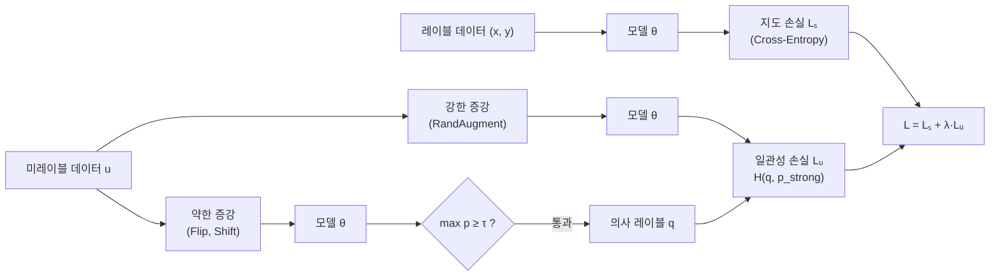

# 준지도학습 (Semi-supervised Learning)

---

## I. 적은 레이블과 많은 미레이블 데이터, 준지도학습의 개요

### 가. 정의

- **소량의 레이블 데이터 $D_L$과 대량의 미레이블 데이터 $D_U$를 함께 학습**해 레이블링 비용을 줄이면서 일반화 성능을 높이는 기계학습 방식

### 나. 등장 배경 및 기본 가정

| 구분 | 내용 |
| --- | --- |
| 배경 | 원시 데이터 수집은 쉽지만 전문가 레이블링은 비싸고 느림 |
| 평활성 가정 | 가까운 입력은 같은 레이블일 가능성이 높음 |
| 군집 가정 | 결정 경계는 데이터 밀도가 낮은 영역을 지남 |
| 매니폴드 가정 | 고차원 데이터는 저차원 매니폴드 위에 놓임 |

---

## II. 동작 구조 및 핵심 기술

### 가. FixMatch 동작 구조

- 약한 증강 예측이 임계값 τ 이상이면 의사 레이블로 삼고, 강한 증강 예측이 이를 맞히도록 학습

### 나. 핵심 기술

| 구분 | 요소 | 설명 |
| --- | --- | --- |
| 의사 레이블 | Self-Training | 모델의 고신뢰 예측을 레이블로 삼아 재학습 |
| 일관성 정규화 | Π-Model·UDA | 서로 다른 증강·섭동에도 예측이 같도록 학습 |
| 교사-학생 | Mean Teacher | 학생 가중치의 지수이동평균(EMA)인 교사 모델 예측을 목표로 사용 |
| 혼합 기법 | MixMatch | 증강 평균 예측 + 샤프닝 + MixUp 결합 |
| | FixMatch | 약한 증강 의사 레이블 + 강한 증강 일관성, 고정 임계값 |
| 동적 임계값 | FlexMatch·FreeMatch | 클래스별 학습 상태에 따라 임계값 조정 (커리큘럼 의사 레이블) |
| 그래프 기반 | 레이블 전파 | 유사도 그래프로 레이블을 이웃 노드에 전파 |
| 손실 | 통합 손실 | 지도 손실 + 가중치 λ(점진 증가) × 비지도 손실 |

---

## III. 비교 및 동향

### 가. 학습 방식 비교

| 비교 항목 | [[지도학습]] | 준지도학습 | [[비지도 학습]] |
| --- | --- | --- | --- |
| 데이터 | $D_L$ | $D_L$(소량) + $D_U$(대량) | $D_U$ |
| 레이블 비용 | 높음 | 낮음 | 없음 |
| 메커니즘 | 정답 오차 최소화 | 의사 레이블 + 일관성 정규화 | 구조·분포 학습 |
| 한계 | 레이블 병목 | 잘못된 의사 레이블이 누적되는 확증 편향 | 직접 분류 불가, 평가 어려움 |
| 적용 | 정형 데이터 분류 | 의료 영상, 결함 검사, 보안 로그 | 군집화, [[차원 축소]], 이상 탐지 |

### 나. 동향

- **사전학습 결합**: [[자기지도학습]](MAE, 대조 학습)으로 표현을 먼저 학습하고 소량 레이블로 미세조정하는 방식이 준지도의 주류가 됨
- **능동학습 결합**: 불확실성이 큰 표본만 사람이 레이블링하고 나머지는 준지도로 활용 ([[Active Learning]])
- **LLM 기반 레이블링**: LLM이 만든 약한 레이블을 사람이 검수해 학습 데이터로 쓰는 방식 확산 ([[데이터 라벨링과 어노테이션]])

---

### 🔗 연관 토픽

- **소속 도메인**: [[00_인공지능_MOC|🤖 인공지능]]
- **세부 분류**: `1. 수학 · 통계학 & 데이터 전처리`
- **핵심 연관 토픽**:
  - [[지도학습]]
  - [[비지도 학습]]
  - [[자기지도학습]]
  - [[Active Learning]]
  - [[데이터 라벨링과 어노테이션]]
