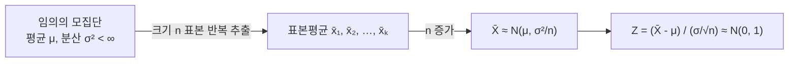

# 중심극한정리 (Central Limit Theorem)

---

## I. 표본평균은 정규분포로 간다, 중심극한정리의 개요

### 가. 정의

- 평균 $\mu$, 유한 분산 $\sigma^2$인 모집단에서 i.i.d. 표본을 뽑으면, **모집단 분포와 무관하게 $n$이 커질수록 표본평균의 분포가 $N(\mu, \sigma^2/n)$에 근사**한다는 정리

### 나. 필요성 및 특징

| 구분 | 내용 |
| --- | --- |
| 추론 근거 | 모집단 분포를 몰라도 표본평균 기반 신뢰구간·[[Z-검정]] 가능 |
| 표준오차 | $SE = \sigma/\sqrt{n}$, 표본을 4배 늘리면 오차는 절반 |
| 분포 무관성 | 균등·지수·이항 등 다양한 분포에서 성립 |
| 전제 | 독립성, 유한 분산 |

---

## II. 수렴 구조 및 구성요소

### 가. 개념도

- 모집단이 치우쳐 있어도 표본평균들은 $\mu$ 중심의 정규분포로 모이고, 퍼짐은 $1/\sqrt{n}$로 줄어듦

### 나. 구성요소

| 구분 | 요소 | 설명 |
| --- | --- | --- |
| 전제 | i.i.d. | 독립·동일 분포 (린데베르그-레비 CLT) |
| | 유한 분산 | 코시 분포, 꼬리지수 α ≤ 2인 파레토 분포 등은 불성립 |
| 표본 크기 | $n \ge 30$ | 경험적 기준, 모집단 왜도가 크면 더 큰 $n$ 필요 |
| 통계량 | 표본평균 | $\mu$의 [[불편추정량]], $E(\bar{X}) = \mu$ |
| | 표준오차 | $\sigma/\sqrt{n}$, 표본평균 분포의 표준편차 |
| 수렴 | 분포수렴 | 표준화 통계량의 CDF가 $\Phi(z)$로 수렴 |
| 확장 | 랴푸노프·린데베르그 조건 | 분포가 서로 달라도 독립·적률 조건을 만족하면 성립 |

---

## III. 비교 및 동향

### 가. 대수의 법칙 vs 중심극한정리

| 비교 항목 | 대수의 법칙 (LLN) | 중심극한정리 (CLT) |
| --- | --- | --- |
| 수렴 대상 | 표본평균 값 → $\mu$ | 표본평균의 분포 → 정규분포 |
| 수렴 형태 | 확률수렴(약), 거의 확실한 수렴(강) | 분포수렴 |
| 명제 | $\bar{X}_n \xrightarrow{P} \mu$ | $\frac{\bar{X}_n - \mu}{\sigma/\sqrt{n}} \xrightarrow{d} N(0,1)$ |
| 알려주는 것 | 표본평균이 모평균에 가까워짐 | 모평균 주변의 오차가 어떤 분포인지 |
| 역할 | 점추정의 일치성 | 구간 추정·[[가설 검정]]의 근거 |

### 나. 동향

- **A/B 테스트**: 대규모 트래픽에서 전환율·평균 지표 차이를 정규 근사 기반 검정으로 판단
- **몬테카를로 추정**: [[몬테카를로 시뮬레이션]]·강화학습 리턴 추정에서 표본 평균의 신뢰구간을 CLT로 산출
- **두꺼운 꼬리 데이터 주의**: 분산이 무한하거나 매우 큰 데이터(금융 손실, 트래픽 버스트)는 수렴이 느리거나 실패하므로 부트스트랩·강건 통계량·일반화 CLT 고려

---

### 🔗 연관 토픽

- **소속 도메인**: [[00_인공지능_MOC|🤖 인공지능]]
- **세부 분류**: `1. 수학 · 통계학 & 데이터 전처리`
- **핵심 연관 토픽**:
  - [[정규분포|정규분포(Normal Distribution)]]
  - [[표본 추출]]
  - [[불편추정량|불편추정량 (Unbiased Estimator)]]
  - [[Z-검정|Z-검정 (Z-test)]]
  - [[추론 통계|추론 통계(Inferential Statistics)]]
