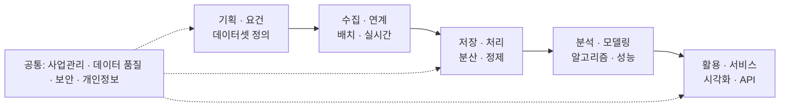

# 지능정보기술 감리 실무 가이드 (빅데이터 중심)

---

## I. 데이터와 모델까지 점검하는 감리, 지능정보기술 감리 실무 가이드의 개요

### 가. 정의

- 빅데이터·AI 등 지능정보기술 사업에서 **데이터 수집·저장·분석·활용 전 과정의 사업 목표 부합성, 데이터 품질, 분산 인프라, 법제도 준수를 점검하기 위해 NIA가 마련한 감리 실무 지침**

### 나. 필요성

| 구분 | 내용 |
| --- | --- |
| 기존 감리 한계 | 기능 중심 SI 감리로는 데이터 파이프라인·모델 반복 개발·데이터 품질 점검 곤란 |
| 분산 인프라 | [[HDFS]]·객체 스토리지·Kafka·람다/카파 구조의 확장성·[[HA(High Availability)\|가용성]] 검증 |
| 법제도 준수 | 가명정보 처리·[[비식별화]] 적정성, 수집 데이터의 저작권·이용 허락 확인 |
| 모델 품질 | 데이터셋 분할, 과적합, 성능 지표 등 AI 고유 품질 점검 |

---

## II. 점검 체계 및 점검 요소

### 가. 빅데이터 생명주기 기반 점검 체계

- 생명주기 단계별 점검 항목에 사업관리·품질·보안 공통 관점을 겹쳐, 체크리스트로 인프라·데이터 품질·[[알고리즘]] 적정성을 진단

### 나. 점검 요소

| 구분 | 요소 | 설명 |
| --- | --- | --- |
| 기획 · 요건 | 데이터 요구 정의 | 데이터셋 출처·주기·규격 정의와 사업 성과지표 연계성 |
| 수집 · 연계 | ETL · CDC 파이프라인 | 유실·중복 방지, 장애 시 재처리 대책 |
| | 라이선스 · 저작권 | 크롤링 적법성, API 이용 허락, 오픈소스 라이선스 충돌 |
| 저장 · 처리 | 분산 저장 · 처리 | 복제 계수, 노드 장애 복구, [[샤딩]]·[[파티셔닝]] 설계 |
| | 스트림 처리 | 람다·카파 구조의 배치/실시간 정합성, 백프레셔 처리 |
| 분석 · 모델링 | 데이터셋 분할 | 학습·검증·시험 분리, 데이터 누수(Leakage) 여부 |
| | 성능 지표 | F1, AUC, RMSE 등 목표 달성도, [[일반화]] 성능 |
| 보안 · 개인정보 | 가명 · 익명 처리 | 식별자 제거·범주화·[[차분 프라이버시]] 등 비식별 적정성 |
| 품질 | [[데이터 품질관리(ISO 8000)\|데이터 품질관리]] | [[결측치]]·[[이상치]] 정제, 유효성·완전성·일관성 진단 (DQC-V·DQC-M 인증 참고) |

---

## III. 비교 및 동향

### 가. 기존 SI 감리 vs 빅데이터 감리

| 비교 항목 | 기존 SI 감리 | 빅데이터 감리 |
| --- | --- | --- |
| 점검 대상 | 응용 SW 기능·[[프로세스]] | 데이터 파이프라인과 분석 모델 |
| 품질 기준 | 요구사항 추적표, 테스트 커버리지 | 데이터 품질 지표, 모델 성능 지표 |
| 개발 방식 | 폭포수, V-모델 | 탐색적 분석, [[CRISP-DM]] 반복 |
| 인프라 | 이중화 서버, RDBMS | 분산 클러스터 Scale-out |
| 법·보안 | 접근통제, DB [[암호화]] | 가명정보 결합·재식별 위험, 저작권 |

### 나. 동향

- 구축 시점 1회 점검에서 데이터 드리프트·모델 성능 저하를 상시 감시하는 [[MLOps]] 연계 지속 감리로 확대
- 생성형 AI·RAG 사업의 환각, 합성 데이터 품질 등 새 점검 항목 반영 필요

---

### 🔗 연관 토픽

- **소속 도메인**: [[00_소프트웨어공학_MOC|🏗️ 소프트웨어공학]]
- **세부 분류**: `1. 소프트웨어 개발 생명주기(SDLC) & 방법론`
- **핵심 연관 토픽**:
  - [[빅데이터 감리]]
  - [[정보시스템 감리]]
  - [[데이터 거버넌스|데이터 거버넌스 (Data Governance)]]
  - [[데이터 품질관리(ISO 8000)]]
  - [[CRISP-DM|CRISP-DM(Cross Industry Standard Process for Data Mining)]]
