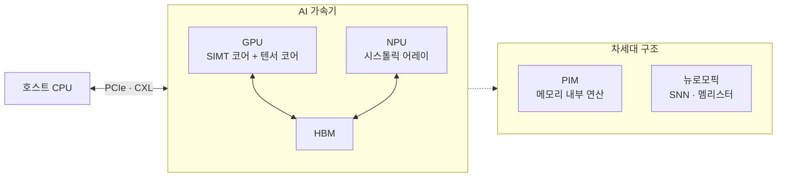

# 지능형 반도체 (AI Semiconductor)

---

## I. AI 연산에 특화된 반도체, 지능형 반도체의 개요

### 가. 정의

- [[인공지능]] 연산(대규모 행렬·텐서 곱)을 **고성능·저전력으로 처리하도록 특화한 반도체**로, AI 가속기(GPU·NPU)부터 PIM·뉴로모픽까지 포함

### 나. 등장 배경 및 특징

| 구분 | 내용 |
| --- | --- |
| 메모리 장벽 | 연산 속도에 비해 메모리 대역폭이 부족 (Memory Wall) |
| 전력 장벽 | [[초거대 언어 모델\|LLM]] 학습·추론 확대로 데이터센터 전력·TCO 증가, TOPS/W가 핵심 지표 |
| 특화 설계 | 범용 [[CPU]] 대신 행렬 연산 유닛·저정밀 연산·온칩 메모리 강화 |
| 진화 방향 | 가속기([[GPU]]·[[NPU]]) → 메모리 중심([[PIM]]) → 뇌 모사(뉴로모픽) |

---

## II. 구조 및 구성요소

### 가. 유형별 구조

- 가속기는 연산 유닛을 늘리고 HBM으로 대역폭을 키우며, PIM·뉴로모픽은 데이터 이동 자체를 줄이는 방향

### 나. 구성요소

| 구분 | 요소 | 설명 |
| --- | --- | --- |
| 연산 | [[시스톨릭 어레이]] | PE 간 데이터 전달로 행렬 곱([[MAC 배열\|MAC]]) 가속 |
| | 저정밀 연산 | FP8·INT8·INT4 등으로 연산량·메모리 절감 |
| 메모리 | [[HBM]] | DRAM을 TSV로 적층한 고대역폭 메모리 (HBM3E, HBM4는 2048비트 인터페이스) |
| | PIM | 메모리 뱅크 옆에 연산 유닛 배치 (삼성 HBM-PIM, SK hynix GDDR6-AiM) |
| 신소자 | [[멤리스터]] | 저항 상태로 가중치 저장, 아날로그 행렬 연산 |
| 연산 방식 | SNN | 스파이크 발생 시에만 연산하는 [[뉴로모픽 칩]] 방식 |
| 연결 | [[CXL]] | 가속기·메모리 간 [[캐시 일관성]] 유지, 메모리 확장·풀링 |
| | UCIe [[칩렛]] | 연산·I/O 다이를 한 패키지로 묶는 다이 간 표준 |
| SW 스택 | AI 컴파일러 | PyTorch 등의 연산 그래프를 하드웨어 명령으로 최적화 (MLIR, TVM, Triton) |

---

## III. 비교 및 동향

### 가. 유형 비교

| 비교 항목 | GPU | NPU | PIM | 뉴로모픽 |
| --- | --- | --- | --- | --- |
| 구조 | SIMT (폰노이만) | [[DSA]], 시스톨릭 어레이 | 메모리 근접·내부 연산 | SNN (비 폰노이만) |
| 목표 | 범용 병렬 학습·추론 | [[딥러닝]] 추론 효율 | 데이터 이동 제거 | 뇌 동작 모사 |
| 데이터 이동 | 메모리↔코어 대량 | 온칩 SRAM 재사용 | 메모리 내부에서 연산 | 스파이크 발생 시만 |
| 적용 | 대규모 모델 학습 | [[온디바이스 AI]], 추론 서버 | 메모리 집약 추론 | 초저전력 엣지 |
| 성숙도 | 시장 주도 | 확산 | 양산 초기 | 연구·시제품 |

### 나. 동향

- **추론 중심 이동**: 학습 인프라 이후 추론 비용 절감이 과제가 되며 ASIC형 NPU, 모바일 AP 내장 NPU 확대
- **SW 생태계 경쟁**: 하드웨어 성능만큼 컴파일러·런타임·프레임워크 지원(CUDA 대비 대안 생태계)이 채택을 좌우

---

### 🔗 연관 토픽

- **소속 도메인**: [[00_컴퓨터구조_MOC|💻 컴퓨터구조]]
- **세부 분류**: `1. CPU 프로세서 & 마이크로아키텍처`
- **핵심 연관 토픽**:
  - [[NPU|NPU(Neural Processing Unit)]]
  - [[GPU]]
  - [[PIM|PIM(Processing-In-Memory)]]
  - [[뉴로모픽 칩|뉴로모픽 칩 (Neuromorphic Chip)]]
  - [[HBM|HBM (High Bandwidth Memory)]]
