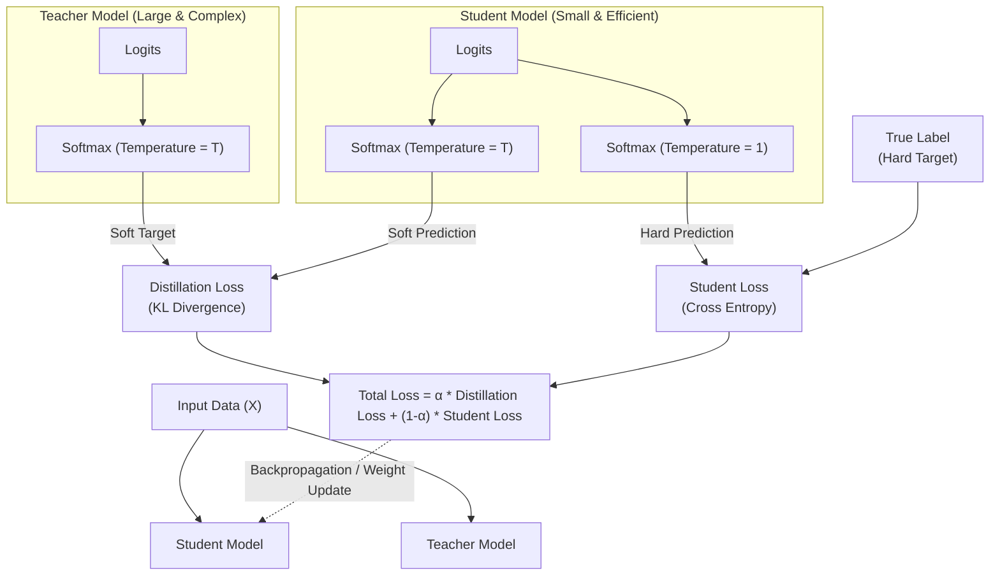

# 지식 증류 (Knowledge Distillation)

---

## I. 초거대 AI 경량화를 위한 모델 압축 기술, 지식 증류의 개요

### 가. 지식 증류(Knowledge Distillation)의 정의
- 거대하고 복잡한 교사 모델(Teacher Model)이 학습한 지식과 확률 분포를 압축하여 작고 효율적인 학생 모델(Student Model)로 전달하는 모델 경량화 및 학습 최적화 기술이다.

### 나. 지식 증류의 주요 특징 및 필요성
| 구분 | 내용 |
| :--- | :--- |
| **암묵적 지식(Dark Knowledge) 전이** | 소프트 타겟(Soft Target)의 상대적 클래스 확률 분포를 통해 레이블 간 상관관계까지 전수 |
| **일반화 성능 보존** | 물리적 가지치기나 양자화 단독 적용 대비 원본 모델의 추론 정확도 및 일반화 성능 유지 우수 |
| **온디바이스 AI 확산** | 대규모 연산 자원이 부족한 모바일, 엣지 기기에서 sLLM 및 SLM의 초경량 고속 추론 실현 |
| **학습 손실의 결합 최적화** | 교사-학생 분포 차이(KL Divergence)와 정답 라벨 오차(Cross-Entropy)를 복합 손실로 설계 |

---

## II. 지식 증류의 개념도 및 핵심 기술 요소

### 가. 지식 증류의 아키텍처 및 동작 원리

* 교사 모델의 Soft Target(확률 분포)과 학생 모델의 예측 간 KL Divergence 손실, 그리고 정답 라벨과의 Cross Entropy 손실을 결합(Total Loss)하여 학생 모델의 가중치를 최적화함

### 나. 지식 증류의 핵심 구성 요소

| 구분 | 요소 기술(키워드) | 세부 설명 |
| :--- | :--- | :--- |
| **구성 모델** | Teacher Model | 사전 학습된 파라미터 수가 많고 정확도가 높은 대형 모델 (지식 제공자) |
| **구성 모델** | Student Model | 교사 모델의 지식을 전이받아 추론을 수행하는 경량화 모델 (지식 수용자) |
| **주요 지표** | Soft Target | 온도(T)를 적용하여 정답 이외의 [[클래스]] 확률 분포(Dark Knowledge)를 보존한 값 |
| **주요 지표** | Hard Target | 실제 정답을 나타내는 One-Hot Encoding 벡터 (True Label, Ground Truth) |
| **손실 함수** | Distillation Loss | 교사와 학생의 Soft Target 분포 간의 차이 측정 (주로 KL Divergence 활용) |
| **손실 함수** | Student Loss | 학생 모델의 일반적인 예측값(T=1)과 실제 정답 간의 차이 (Cross Entropy 활용) |
| **제어 변수** | Temperature ($T$) | Softmax 출력 분포를 평활화(Smoothing)하여 정보량(Variance)의 노출을 조절하는 상수 |
| **제어 변수** | Weight ($\alpha$) | 전체 손실 함수 계산 시 Distillation Loss와 Student Loss 간의 반영 비율(가중치) |

---

## III. 지식 증류와 주요 AI 모델 경량화 기술 비교 및 동향

### 가. 지식 증류와 타 모델 경량화(Compression) 기술 비교

| 비교 항목 | 지식 증류 (Knowledge Distillation) | 프루닝 (Pruning) | 양자화 (Quantization) |
| :--- | :--- | :--- | :--- |
| **핵심 개념** | 큰 모델의 지식을 작은 모델로 학습 전이 | 중요도가 낮은 연결망(가중치/노드) 제거 | 가중치 표현 데이터 비트 수를 축소 (예: FP32 → INT8) |
| **압축 대상** | 알고리즘 및 학습 [[프로세스]] | 모델 파라미터 구조 (희소성 확보) | 데이터 타입 및 정밀도(Precision) |
| **주요 장점** | [[모델 구조]] 변경 없이 일반화 성능 유지 우수 | 모델 크기 축소 및 연산량 직접적 감소 | 연산 속도 대폭 향상 및 메모리 대역폭 최소화 |
| **주요 단점** | 교사 모델 사전 학습 및 증류에 긴 시간 소요 | 과도한 압축 시 성능 저하 (재학습 필요) | 정밀도 손실(Loss)로 인한 모델 정확도 하락 가능성 |

### 나. 최신 기술 동향 및 향후 전망

- **하이브리드 경량화 파이프라인 결합**: 지식 증류 단독 적용을 넘어 구조적 프루닝(Pruning) 및 양자화 인식 훈련(QAT)과 연계하여 극단적인 모델 압축비와 원본 추론 성능을 동시에 달성하는 복합 파이프라인이 정착됨.
- **초거대 LLM 추론 지식 증류(Black-box KD)**: 교사 모델의 내부 가중치에 접근할 수 없는 상용 API 환경에서 교사 LLM의 생성 답변 및 사고 사슬(Chain-of-Thought) 추론 경로를 데이터셋으로 삼아 소형 오픈소스 모델을 파인튜닝하는 합성 데이터 증류가 주류로 부상함.
- **온디바이스 sLLM 및 에이전트 탑재 가속화**: 7B~70B 파운데이션 모델의 핵심 기능을 1B~3B 급 온디바이스 모델로 이식하여 스마트폰, PC, 모빌리티 등 엣지 하드웨어에서 저지연·독립 구동형 인공지능 서비스 구축이 가속화됨.

---

### 🔗 연관 토픽

- **소속 도메인**: [[00_인공지능_MOC|🤖 인공지능]]
- **세부 분류**: `4. 거대언어모델 (LLM) & 생성형 AI`
- **핵심 연관 토픽**:
  - [[온디바이스 AI]]
  - [[sLLM (Smaller Large Language Model)]]
  - [[초거대 언어 모델|초거대 언어 모델(Large Language Model)]]
  - [[파운데이션 모델|파운데이션 모델(Foundation Model)]]
  - [[전이학습|전이학습 (Transfer Learning)]]
