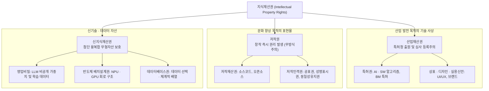

# 지식재산권 (Intellectual Property Rights)

---

## I. 무형자산 보호와 가치 창출의 법적 기제, 지식재산권의 개요

### 가. 정의

- 인간의 지적 창작 활동으로 발생한 기술, 아이디어, 영업 표지 등 **무형의 결과물에 대하여 법령에 따라 인정되는 배타적·독점적 재산권**

### 나. 특징 및 필요성

| 구분 | 내용 |
| --- | --- |
| 무체재산성 | 물리적 형체가 없는 정보, 아이디어, 사상을 보호 대상으로 규정 |
| 배타적 독점권 | 권리자의 허락 없는 제3자의 무단 복제, 배포, 상업적 실시를 법적으로 금지 |
| 기간의 제한성 | 공공의 이익과 균형을 위해 보호 기간(특허 20년, 저작권 사후 70년 등) 한정 |
| 아이디어-표현 이분법 | 저작권은 표현물만 보호하고, 기초 아이디어와 알고리즘 자체는 특허권 영역으로 분리 |

---

## II. 개념도 및 핵심 구성요소

### 가. 개념도

- IT 분야에서 소프트웨어는 소스코드 자체(저작권)와 동작 알고리즘 및 BM(특허권)으로 다층 보호되며, 인공지능 자산은 영업비밀 및 DB권으로 확장 적용

### 나. 핵심 권리 분류 및 특징

| 구분 | 권리 | 설명 |
| --- | --- | --- |
| 산업재산권 | 특허권 (Patent) | 자연법칙을 이용한 고도의 기술적 사상 창작 보호. 신규성·진보성·산업상이용가능성 심사 등록 (20년) |
| | 실용신안권 | 물품의 형상이나 구조에 관한 기술적 고안 보호 (10년) |
| | 상표권 | 자타 상품 식별 표지 보호. 10년마다 갱신 등록으로 반영구적 독점 가능 |
| 저작권 | 컴퓨터프로그램 저작물 | 특정 결과를 위해 컴퓨터에서 구동되는 일련의 지시·명령 집합(소스코드/바이너리) 보호 |
| | 저작인격권 / 저작재산권 | 저작자의 인격 보호(양도 불가) 및 복제·배포·2차적저작물작성권 등 경제적 권리 (사후 70년) |
| 신지식재산권 | 영업비밀 (Trade Secret) | 비공지성, 경제적 유용성, 비밀관리성을 갖춘 기술·경영 정보. 무제한 보호 |
| | 반도체 배치설계권 | 반도체 집적회로의 소자 및 배선을 평면·입체적으로 배치한 설계물 보호 (10년) |
| | 데이터베이스권 | 소재의 선택·배열에 창작성이 있거나 상당한 투자가 이루어진 DB 제작자의 권리 보호 |

---

## III. 특허권과 저작권 비교 및 동향

### 가. SW 특허권 vs 컴퓨터프로그램 저작권

| 비교 항목 | SW 특허권 (Patent) | 컴퓨터프로그램 저작권 (Copyright) |
| --- | --- | --- |
| 보호 대상 | 기술적 사상, 알고리즘, 비즈니스 모델(BM) | 소스코드, 오브젝트 코드 등 구체적 표현물 |
| 발생 요건 | 특허청 심사 후 등록 시 발생 (등록주의) | 창작 완료 즉시 자동 발생 (무방식주의) |
| 성립 기준 | 신규성, 진보성, 산업상 이용가능성 | 창작성 (독자적 작성 여부) |
| 존속 기간 | 출원일로부터 20년 | 저작자 사후 70년 (법인 저작물 공표 후 70년) |
| 침해 판단 | 균등론 (실질적으로 동일한 기술 사상인가) | 실질적 유사성 및 의거성 (보고 모방하였는가) |

### 나. 동향

- **생성형 AI 산출물의 저작권 주체성 논의**: 현행 지식재산권법상 '인간의 사상과 감정의 표현'만 저작물로 인정되므로, 프롬프트 입력만으로 생성된 AI 결과물은 저작권 불인정이 원칙이나 인간의 실질적 창작 기여도에 따른 인정 기준 검토 중
- **TDM(Text and Data Mining) 면책 규정 도입 추진**: 초거대 AI 모델 학습을 위한 방대한 데이터 수집·가공 시 저작권 침해 우려를 해소하기 위해 공정이용(Fair Use) 기반 TDM 면책 법안 마련 추세
- **부정경쟁방지법을 통한 데이터 자산 보호**: 저작권 요건을 충족하기 어려운 대규모 비정형 데이터셋에 대해 '상당한 투자나 노력으로 만들어진 성과물'로서 부정경쟁행위(데이터 무단 크롤링·도용) 방지 판례 확립

---

### 🔗 연관 토픽

- **소속 도메인**: [[00_경영전략_MOC|📈 경영전략]]
- **세부 분류**: `5. IT 투자 성과 평가 & 비즈니스 연속성 계획 (BCP)`
- **핵심 연관 토픽**:
  - [[폐쇄형 라이선스]]
  - [[오픈소스 거버넌스]]
  - [[오픈소스 SW 보안위협]]
  - [[생성형 인공지능 저작권]]
  - [[데이터 마이닝]]
