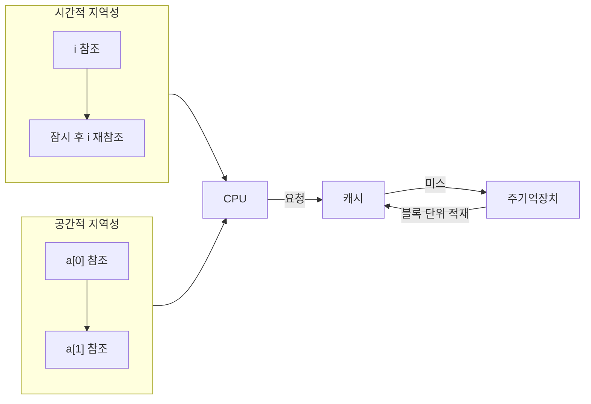

# 지역성 (Locality)

---

## I. 참조는 몰린다, 지역성의 개요

### 가. 정의

- 프로그램이 **짧은 시간 동안 특정 메모리 위치나 그 주변을 집중적으로 참조하는 성질** (Locality of Reference)

### 나. 특징 및 의미

| 구분 | 내용 |
| --- | --- |
| 계층 구조의 근거 | 작은 캐시·적은 프레임으로도 높은 적중률을 얻는 이유 ([[기억장치 계층 구조]]) |
| 워킹 셋 형성 | 일정 구간 동안 참조되는 페이지 집합이 작고 천천히 변함 |
| 교체 알고리즘 | [[LRU]] 등이 과거 참조로 미래를 예측하는 근거 |
| 성능 영향 | 지역성이 낮은 코드는 캐시·TLB 미스, 페이지 부재가 많아 느림 |

---

## II. 유형 및 구성요소

### 가. 지역성 유형과 캐시 동작

- 재사용될 값은 캐시에 남기고(시간적), 미스 때 주변 데이터를 블록째 가져와(공간적) 다음 참조를 적중시킴

### 나. 구성요소

| 구분 | 요소 | 설명 |
| --- | --- | --- |
| 유형 | 시간적 (Temporal) | 최근 참조한 항목을 곧 다시 참조 (반복문 변수, 스택, 카운터) |
| | 공간적 (Spatial) | 참조한 주소 근처를 곧 참조 (배열 순회, 연속 명령어) |
| | 순차적 (Sequential) | 분기가 없으면 명령어가 저장 순서대로 실행 (공간적 지역성의 특수형) |
| 하드웨어 활용 | 캐시 라인 | 미스 시 주변 바이트까지 한 번에 적재 (예: 64B) |
| | 프리페칭 | 접근 패턴을 보고 다음 블록을 미리 적재 |
| | TLB | 최근 주소 변환 결과 재사용 |
| OS 활용 | 워킹 셋 (Working Set) | 최근 Δ 동안 참조한 페이지를 메모리에 유지, [[스레싱|스레싱]] 방지 |
| | 페이지 교체 | LRU·Clock이 최근 참조 정보를 활용 |
| 분산 환경 | 데이터 지역성 | 데이터가 있는 노드에서 연산 ([[하둡]] [[HDFS]], Spark) |
| | 지리적 지역성 | 사용자와 가까운 곳에 데이터 배치 ([[CDN]], [[EDGE\|엣지]]) |

---

## III. 비교 및 동향

### 가. 시간적 vs 공간적 지역성

| 비교 항목 | 시간적 지역성 | 공간적 지역성 |
| --- | --- | --- |
| 의미 | 같은 항목 재참조 | 인접 항목 참조 |
| 예 | 반복문 제어 변수, 자주 호출되는 함수 | 배열 순차 접근, 순차 명령어 |
| 하드웨어 활용 | 캐시 유지, 교체 정책 (LRU) | 캐시 라인 크기, 프리페칭 |
| 코드 최적화 | 루프 내 변수 재사용, 레지스터 할당 | 행 우선 순회, 구조체 배열 배치, 루프 타일링 |

### 나. 동향

- **NUMA 인지 배치**: 스레드와 데이터를 같은 소켓의 로컬 메모리에 두는 OS·런타임 스케줄링 (Linux 자동 NUMA 밸런싱)
- **GPU 타일링**: 행렬 곱·어텐션 연산을 공유 메모리 크기의 타일로 나눠 재사용률을 높임 (예: FlashAttention)
- **데이터 배치 최적화**: 컬럼형 저장(Parquet), 랙 인식 배치로 분석 워크로드의 지역성 확보

---

### 🔗 연관 토픽

- **소속 도메인**: [[00_운영체제_MOC|⚙️ 운영체제]]
- **세부 분류**: `6. 커널 아키텍처 & 입출력 시스템`
- **핵심 연관 토픽**:
  - [[기억장치 계층 구조|기억장치 계층 구조 (Memory Hierarchy)]]
  - [[캐시 메모리]]
  - [[스레싱|스레싱 (Thrashing)]]
  - [[LRU]]
  - [[직접 사상과 연관 사상 페이징 기법]]
