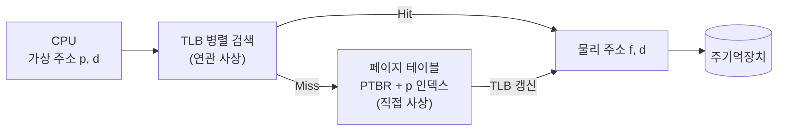

# 직접 사상과 연관 사상 페이징 기법

---

## I. 페이지 테이블을 어디서 찾나, 직접·연관 사상의 개요

### 가. 정의

- 페이징 시스템에서 페이지 번호를 프레임 번호로 바꾸는 방식으로, **주기억장치의 페이지 테이블을 인덱스로 참조하는 직접 사상**과 **연관 메모리(TLB)를 내용으로 병렬 검색하는 연관 사상**, 둘을 함께 쓰는 연관/직접 혼합 사상으로 구분

### 나. 특징

| 구분 | 내용 |
| --- | --- |
| 직접 사상 | 주소 하나를 읽으려면 페이지 테이블 1회 + 데이터 1회, 메모리 접근 2회 |
| 연관 사상 | CAM으로 모든 항목을 동시에 비교해 빠르지만 비싸서 용량 작음 |
| 혼합 사상 | 최근 사용한 매핑만 TLB에 두고, 없으면 페이지 테이블 참조 (현대 MMU 방식) |
| [[지역성\|지역성]] 활용 | 작은 TLB로도 높은 적중률 확보 |

---

## II. 변환 구조 및 구성요소

### 가. 혼합 사상 변환 흐름

- TLB 적중 시 바로 프레임 번호를 얻고, 미스 시 PTBR이 가리키는 페이지 테이블에서 p번째 항목을 읽어 변환 후 TLB에 저장

### 나. 구성요소

| 구분 | 요소 | 설명 |
| --- | --- | --- |
| 직접 사상 | 페이지 테이블 | 페이지 번호 → 프레임 번호, 주기억장치에 위치 |
| | PTBR | 페이지 테이블 시작 주소 레지스터, 문맥 교환 시 교체 |
| | 인덱싱 | PTBR + p × 항목 크기로 O(1) 접근 |
| 연관 사상 | TLB | 최근 변환 결과를 담은 연관 메모리 캐시 |
| | CAM | 주소가 아닌 내용(페이지 번호)으로 모든 항목을 동시에 검색 |
| | ASID·PCID | TLB 항목에 주소 공간 ID 태그, 문맥 교환 시 전체 플러시 회피 |
| 평가 | 적중률 (h) | TLB에서 찾은 비율 (예: 90% 이상) |
| | 유효 접근 시간 (EAT) | EAT = h × (t + m) + (1 − h) × (t + 2m), t: TLB 검색 시간, m: 메모리 접근 시간 |

---

## III. 비교 및 동향

### 가. 직접 사상 vs 연관 사상

| 비교 항목 | 직접 사상 | 연관 사상 |
| --- | --- | --- |
| 매핑 위치 | 주기억장치의 페이지 테이블 | MMU 내부 TLB |
| 검색 방식 | 페이지 번호로 인덱스 접근 | 내용 기반 병렬 검색 |
| 메모리 접근 | 2회 (테이블 + 데이터) | 적중 시 1회 (데이터만) |
| 비용 | 저렴 (일반 메모리) | 고가 (CAM), 수십~수천 항목 |
| 속도 | 느림 | 빠름 |

### 나. 동향

- **Huge Page**: 2MB·1GB 페이지로 TLB 항목 하나가 덮는 범위를 넓혀 미스 감소
- **2단계 변환 (EPT·NPT)**: 가상화 환경의 게스트 가상 → 게스트 물리 → 호스트 물리 변환을 하드웨어가 수행, TLB 미스 비용이 커져 대형 페이지와 함께 사용
- **5단계 페이징**: Intel Ice Lake 이후 LA57 지원으로 57비트 가상 주소, 대신 페이지 워크 단계 증가

---

### 🔗 연관 토픽

- **소속 도메인**: [[00_운영체제_MOC|⚙️ 운영체제]]
- **세부 분류**: `5. 가상 메모리 관리 & 페이지 교체 알고리즘`
- **핵심 연관 토픽**:
  - [[가상메모리의 페이징과 세그멘테이션]]
  - [[MMU(Memory Management Unit)]]
  - [[논리 주소]]
  - [[물리 주소]]
  - [[지역성|지역성(Locality)]]
