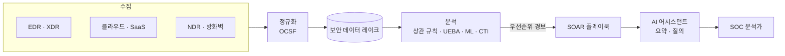

# 차세대 SIEM (Next-Gen SIEM)

---

## I. 로그 저장소에서 분석·대응 플랫폼으로, 차세대 SIEM의 개요

### 가. 정의

- 기존 [[SIEM]]에 **클라우드 데이터 레이크, UEBA·머신러닝 분석, SOAR 자동 대응, 생성형 AI 보조 기능을 결합**하여 대규모 보안 데이터를 분석하고 대응까지 수행하는 보안 관제 플랫폼

### 나. 등장 배경 및 특징

| 구분 | 내용 |
| --- | --- |
| 데이터 폭증 | 클라우드·SaaS·엔드포인트 로그 증가로 기존 장비 확장 한계 |
| 경보 피로 | 정적 상관 규칙의 오탐·과다 경보 |
| 탄력적 확장 | 클라우드 저장·컴퓨팅 분리로 대용량 처리 |
| 행위 분석 | 정상 기준선 이탈로 알려지지 않은 위협 탐지 |
| 개방형 스키마 | OCSF 등 공통 스키마로 이기종 로그 정규화 |

---

## II. 구조 및 구성요소

### 가. 처리 구조

- 이기종 로그를 정규화해 데이터 레이크에 모으고, 다양한 분석 엔진의 결과를 우선순위화해 자동 대응과 분석가 판단으로 연결

### 나. 구성요소

| 구분 | 요소 | 설명 |
| --- | --- | --- |
| 수집·저장 | 데이터 레이크 | 핫·콜드 계층 저장, 장기 보존 비용 절감 |
| | OCSF | 벤더 중립 보안 이벤트 스키마 (2022 공개) |
| 분석 | 상관 규칙 | 시그니처·조건 기반 탐지 |
| | UEBA | 사용자·엔티티 행위 기준선 대비 이상 탐지 |
| | [[CTI]] 연계 | IoC·TTP 매칭 |
| 대응 | [[SOAR (Security Orchestration, Automation and Response)\|SOAR]] | 격리·차단 등 플레이북 자동 실행 |
| | [[위협 헌팅]] | 가설 기반 능동 탐색 |
| 보조 | 생성형 AI | 자연어 질의, 사건 요약, 대응 권고 |

---

## III. 비교 및 동향

### 가. 기존 SIEM vs 차세대 SIEM

| 비교 항목 | 기존 SIEM | 차세대 SIEM |
| --- | --- | --- |
| 아키텍처 | 온프레미스 어플라이언스, RDBMS | 클라우드 네이티브, 데이터 레이크 |
| 탐지 | 정적 규칙 상관 분석 | 규칙 + UEBA·ML + CTI |
| 경보 | 대량·저품질 | 위험 점수 기반 우선순위 |
| 대응 | 수동 조사 | SOAR 자동화 |
| 연동 | 벤더 종속 | 개방형 스키마, [[XDR]]·[[EDR(Endpoint Detection and Response)\|EDR]] 연계 |

### 나. 동향

- **SIEM·XDR 통합**: 엔드포인트 텔레메트리와 SIEM을 하나의 플랫폼으로 묶는 제품 통합
- **AI 에이전트 SOC**: 경보 분류·조사를 AI 에이전트가 1차 수행하고 분석가가 검토
- **데이터 파이프라인 분리**: 수집·필터링 계층을 별도로 두어 저장 비용과 벤더 종속 감소

---

### 🔗 연관 토픽

- **소속 도메인**: [[00_보안_MOC|🛡️ 보안]]
- **세부 분류**: `2. 현대 암호학 & 키 관리 · 전자서명`
- **핵심 연관 토픽**:
  - [[SIEM]]
  - [[SOAR (Security Orchestration, Automation and Response)]]
  - [[XDR|XDR(eXtended Detection Response)]]
  - [[CTI]]
  - [[위협 헌팅|위협 헌팅(Threat Hunting)]]
