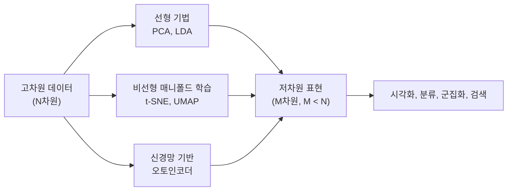

# 차원 축소 (Dimensionality Reduction)

---

## I. 정보는 지키고 차원은 줄이는, 차원 축소의 개요

### 가. 정의

- 고차원 데이터를 **정보 손실을 최소화하며 더 적은 차원으로 재표현**하는 기법 (특징 선택과 특징 추출로 구분)

### 나. 필요성 및 특징

| 구분 | 내용 |
| --- | --- |
| 차원의 저주 | 차원이 늘수록 데이터가 희소해지고 거리 의미가 약해져 필요한 표본 수가 급증 |
| 효과 | 과적합 완화, 연산·저장 비용 절감, 노이즈 제거 |
| 시각화 | 2·3차원 투영으로 군집 구조 확인 ([[데이터 가시화\|데이터 시각화]]) |
| 학습 방식 | 대부분 비지도(PCA, t-SNE), LDA처럼 레이블을 쓰는 지도 방식도 존재 |

---

## II. 기법 구조 및 핵심 요소

### 가. 개념도

- 선형 투영, 이웃 관계 보존, 신경망 압축 중 하나로 저차원 표현을 얻어 후속 작업에 사용

### 나. 핵심 요소

| 구분 | 요소 | 설명 |
| --- | --- | --- |
| 선형 | [[PCA(Principal Component Analysis)\|PCA]] | 공분산 행렬의 고유벡터(또는 [[SVD(Singular Value Decomposition)\|SVD]])로 분산 최대 직교 축 도출, 비지도 |
| | [[LDA(Linear Discriminant Analysis)\|LDA]] | 클래스 간 분산 / 클래스 내 분산을 최대화, 지도 방식, 최대 (클래스 수 − 1)차원 |
| 비선형 | t-SNE | 고·저차원 이웃 확률분포의 KL 발산 최소화, 국소 구조 시각화에 강함 |
| | UMAP | 근접 그래프·위상 기반, t-SNE보다 빠르고 전역 구조를 상대적으로 잘 보존 |
| 신경망 | 오토인코더 | 병목 층으로 압축·복원하며 잠재 표현 학습 ([[VAE]]는 확률적 확장) |
| 임베딩 | Matryoshka (MRL) | 임베딩 앞쪽 일부 차원만 잘라 써도 성능이 유지되도록 학습 ([[표현 학습]]) |
| 특징 선택 | 필터·래퍼·임베디드 | 원 변수 중 일부를 고름 (상관·정보량, 전진/후진 선택, Lasso) |

---

## III. 비교 및 동향

### 가. PCA vs t-SNE vs UMAP

| 비교 항목 | PCA | t-SNE | UMAP |
| --- | --- | --- | --- |
| 원리 | 선형, 분산 최대화 | 비선형, 이웃 확률 보존 | 비선형, 근접 그래프·위상 |
| 계산 비용 | 낮음 | 높음 (정확 구현 $O(N^2)$, Barnes-Hut $O(N \log N)$) | 중간, 대규모 데이터 가능 |
| 신규 데이터 변환 | 가능 | 기본 미지원 | 가능 (transform) |
| 결과 해석 | 축 의미·설명 분산 해석 가능 | 군집 간 거리·크기는 의미 약함 | t-SNE보다 전역 배치 신뢰도 높음 |
| 용도 | 전처리, 압축, 노이즈 제거 | 2·3차원 시각화 | 시각화, 군집 전처리 |

### 나. 동향

- **가변 차원 임베딩**: OpenAI text-embedding-3 등 일부 임베딩 모델이 MRL 방식으로 차원 축소 옵션을 제공해 [[벡터 데이터베이스]] 저장·검색 비용 절감
- **대규모 시각화**: 수백만 건 임베딩 탐색에 UMAP·GPU 가속 구현(cuML 등) 활용

---

### 🔗 연관 토픽

- **소속 도메인**: [[00_인공지능_MOC|🤖 인공지능]]
- **세부 분류**: `1. 수학 · 통계학 & 데이터 전처리`
- **핵심 연관 토픽**:
  - [[PCA(Principal Component Analysis)]]
  - [[SVD(Singular Value Decomposition)]]
  - [[LDA(Linear Discriminant Analysis)]]
  - [[표현 학습]]
  - [[비지도 학습]]
