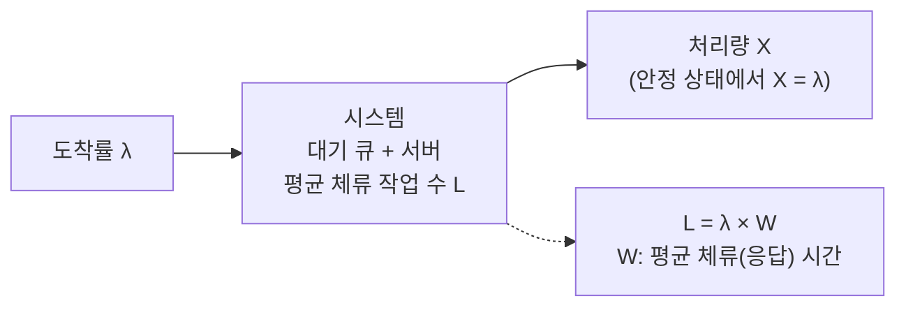

# 처리량 (Throughput)

---

## I. 단위 시간당 완료량, 처리량의 개요

### 가. 정의

- 시스템이 **단위 시간당 완료한 작업의 양**, CPU 스케줄링에서는 단위 시간당 완료된 프로세스 수

### 나. 특징

| 구분 | 내용 |
| --- | --- |
| 스케줄링 목표 | CPU 이용률과 함께 최대화 대상 (반환·대기·[[응답시간]]은 최소화 대상) |
| 시스템 관점 | 개별 요청 지연이 아닌 전체 처리 능력을 표현 |
| 포화 | 부하가 늘면 처리량이 늘다가 병목 자원이 포화되면 정체, 대기 시간만 증가 |
| 저하 요인 | 과도한 [[문맥 교환]], [[스레싱|스레싱]], 락 경합 등 오버헤드가 커지면 오히려 감소 |

---

## II. 성능 관계 및 측정 지표

### 가. 리틀의 법칙 (Little's Law)

- 안정 상태에서 처리량 X = L / W, 동시 처리 수가 같으면 응답시간이 짧을수록 처리량 증가

### 나. 측정 지표

| 구분 | 요소 | 설명 |
| --- | --- | --- |
| OS | 프로세스/초 | 단위 시간당 완료 프로세스 수 |
| 애플리케이션 | RPS·QPS | 초당 요청·쿼리 수 |
| [[데이터베이스]] | TPS | 초당 커밋된 트랜잭션 수 |
| 네트워크 | bps·pps | 초당 전송 비트·패킷 수 |
| 스토리지 | IOPS·MB/s | 초당 입출력 횟수, 전송량 |
| AI 추론 | Tokens/s | 초당 생성 토큰 수 |
| 분석 이론 | 리틀의 법칙 | L = λW로 동시 작업 수·처리량·응답시간 관계 표현 |
| | 포화점 (Saturation Point) | 병목 자원 이용률이 100%에 이르러 처리량이 더 늘지 않는 지점 |

---

## III. 비교 및 동향

### 가. 처리량 vs 응답시간

| 비교 항목 | 처리량 | [[응답시간]] |
| --- | --- | --- |
| 관점 | 시스템 (전체 용량) | 사용자 (개별 요청 체감) |
| 측정 | 단위 시간당 완료량 | 요청부터 첫 응답까지 시간 |
| 목표 | 클수록 좋음 | 작을수록 좋음 |
| 부하 증가 시 | 포화점까지 증가 후 정체 | 포화점 부근부터 급증 |
| 개선 기법 | 스케일 아웃, 배치 처리, 비동기화 | 캐싱, [[CDN]], 우선순위 스케줄링 |
| 트레이드오프 | 배치 크기를 키우면 처리량 증가, 개별 응답시간 증가 | |

### 나. 동향

- **LLM 서빙**: vLLM의 연속 배치(Continuous Batching)와 PagedAttention으로 [[GPU]] 메모리 낭비를 줄여 토큰 처리량 향상
- **자동 확장**: [[쿠버네티스]] [[HPA (Horizontal Pod Autoscaler)|HPA]]로 부하에 따라 Pod 수를 늘려 처리량 확보
- **비동기 I/O**: io_uring, 이벤트 루프 기반 서버로 적은 스레드로 높은 동시 처리량 달성

---

### 🔗 연관 토픽

- **소속 도메인**: [[00_운영체제_MOC|⚙️ 운영체제]]
- **세부 분류**: `1. 프로세스 & 스레드 관리`
- **핵심 연관 토픽**:
  - [[응답시간]]
  - [[자원사용율]]
  - [[스케줄링]]
  - [[스레싱|스레싱 (Thrashing)]]
  - [[문맥 교환|문맥 교환 (Context Switching)]]
