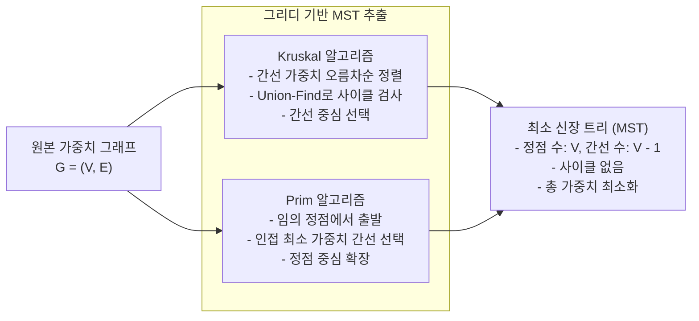

# 최소 신장 트리 (Minimum Spanning Tree, MST)

---

## I. 네트워크 연결 비용 최적화, 최소 신장 트리의 개요

### 가. 정의

- 가중치 무방향 그래프(Weighted Undirected Graph)에서 **모든 정점을 사이클 없이 연결하며 간선들의 가중치 합이 최소가 되도록 구성한 트리 형태의 부분 그래프**

### 나. 특징 및 필요성

| 구분 | 내용 |
| --- | --- |
| 간선 수 제약 | 정점 수가 $V$개일 때, 신장 트리를 이루는 간선 수는 반드시 $V-1$개로 고정 |
| 사이클 부재 | 모든 정점이 연결되면서도 폐곡선(Cycle)이 형성되지 않는 비순환(Acyclic) 구조 |
| 유일성 | 그래프 내 모든 간선의 가중치가 서로 다르면 MST는 유일하게 하나만 존재 |
| 비용 최적화 | 통신망(LAN/WAN), 전력망, 도로망 등 물리적 인프라 구축 비용 최소화의 수학적 기초 |

---

## II. 개념도 및 핵심 구성요소

### 가. 개념도

- 원본 그래프에서 탐욕적(Greedy) 기법을 기반으로 간선 중심(Kruskal) 또는 정점 중심(Prim)으로 최적 간선을 추출하여 MST 구축

### 나. 핵심 알고리즘 및 구성요소

| 구분 | 요소 | 설명 |
| --- | --- | --- |
| 핵심 알고리즘 | Kruskal (크루스칼) | 간선을 가중치 오름차순으로 정렬한 뒤, 사이클을 만들지 않는 간선을 차례로 $V-1$개 선택 |
| | Prim (프림) | 임의의 시작 정점에서 출발하여 현재 트리에 인접한 간선 중 최소 가중치 간선을 선택하며 확장 |
| | Borůvka (보루프카) | 각 연결 컴포넌트에서 최소 간선을 병렬로 선택하여 병합 (분산 및 병렬 컴퓨팅에 적합) |
| 핵심 자료구조 | Union-Find (Disjoint Set) | Kruskal에서 두 정점이 이미 같은 트리에 속해 있는지 판별하여 사이클 형성 방지 ($O(\alpha(V))$) |
| | Priority Queue (Min-Heap) | Prim에서 인접 정점의 최소 가중치 간선을 $O(\log V)$에 추출하기 위한 우선순위 큐 |
| 복잡도 및 적합성 | Kruskal 복잡도 | $O(E \log E)$, 간선 정렬이 지배하므로 간선 수가 적은 **희소 그래프(Sparse Graph)**에 유리 |
| | Prim 복잡도 | 힙 사용 시 $O(E \log V)$, 간선 수가 많은 **밀집 그래프(Dense Graph)**에 유리 |

---

## III. 알고리즘 비교 및 동향

### 가. Kruskal vs Prim

| 비교 항목 | Kruskal 알고리즘 | Prim 알고리즘 |
| --- | --- | --- |
| 탐색 관점 | **간선(Edge) 중심** (전역 간선 정렬) | **정점(Vertex) 중심** (인접 간선 확장) |
| 사이클 검사 | 필수 (Union-Find 알고리즘 활용) | 불필요 (기존 트리에 미방문 정점을 연결) |
| 주요 자료구조 | 간선 배열 정렬, 분리 집합(Disjoint Set) | 최소 힙(Min-Heap) 기반 우선순위 큐 |
| 시간 복잡도 | $O(E \log E)$ 또는 $O(E \log V)$ | 최소 힙 시 $O(E \log V)$, 피보나치 힙 시 $O(E + V \log V)$ |
| 유리한 환경 | 희소 그래프 ($E \ll V^2$) | 밀집 그래프 ($E \approx V^2$) |

### 나. 동향

- **대규모 분산 네트워크 라우팅(GHS 알고리즘)**: 중앙 집중 연산이 불가능한 대규모 P2P 및 센서 네트워크에서 Gallager-Humblet-Spira(GHS) 분산 MST 알고리즘을 활용한 토폴로지 구축
- **머신러닝 데이터 군집화(Clustering)**: 데이터 포인트 간 유클리드 거리를 간선으로 변환하여 MST를 구축한 뒤, 가장 가중치가 큰 간선을 분할하는 방식으로 단일 연결 계층적 군집화 구현
- **반도체 물리 설계(VLSI) 배선 최적화**: 수십억 개의 셀을 연결하는 IC 칩 라우팅 단계에서 배선 총 길이를 최소화하고 신호 지연을 줄이기 위해 슈타이너 트리(Steiner Tree)의 근사 기초 모델로 MST 활용

---

### 🔗 연관 토픽

- **소속 도메인**: [[00_컴퓨터구조_MOC|💻 컴퓨터구조]]
- **세부 분류**: `4. 기본 자료구조 (Data Structures)`
- **핵심 연관 토픽**:
  - [[다익스트라 알고리즘|다익스트라 (Dijkstra) 알고리즘]]
  - [[Queue]]
  - [[힙|힙 (Heap)]]
  - [[알고리즘]]
  - [[그리디 알고리즘|그리디 (탐욕) 알고리즘]]
