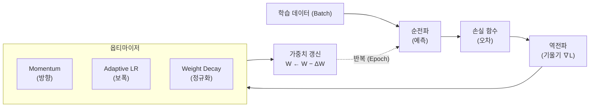

# 최적화 알고리즘 (Optimization Algorithm, 머신러닝 옵티마이저)

---

## I. 손실 최소화를 위한 파라미터 갱신 전략, 최적화 알고리즘의 개요

### 가. 정의

- 머신러닝·[[딥러닝]] 모델의 손실 함수를 최소화하기 위해 **기울기(Gradient)를 바탕으로 가중치·[[편향]]의 갱신 방향과 보폭을 결정**하는 [[알고리즘]] (옵티마이저)

### 나. 필요성 및 특징

| 구분 | 내용 |
| --- | --- |
| 필요성 | 지역 최솟값·안장점 탈출, 수렴 속도 향상, [[초거대 언어 모델\|LLM]]의 막대한 학습 비용·메모리 절감 |
| 관성 (Momentum) | 과거 기울기 방향을 누적해 진동(지그재그) 감소 |
| 적응형 학습률 | 파라미터별 갱신 이력에 따라 보폭을 자동 조절 |
| 정규화 결합 | 가중치 감쇠(Weight Decay)로 [[일반화]] 성능 향상 |

---

## II. 동작 원리 및 핵심 알고리즘

### 가. 학습 루프에서의 위치

- [[역전파]]로 구한 기울기를 옵티마이저가 가공하여 실제 갱신량(ΔW)을 결정 (기본 원리는 [[경사하강법]])

### 나. 주요 알고리즘

| 구분 | 알고리즘 | 설명 |
| --- | --- | --- |
| 기본 | SGD | 미니배치 단위로 기울기를 계산해 자주·빠르게 갱신 |
| 방향 제어 | Momentum | 이전 갱신 방향의 관성을 반영해 진동 감소, 지역 최솟값 탈출 |
| | NAG (Nesterov) | 관성으로 이동할 위치의 기울기를 미리 계산(Look-ahead) |
| 보폭 제어 | AdaGrad | 많이 갱신된 파라미터의 학습률을 줄임 (학습률이 0으로 수렴하는 문제) |
| | RMSProp | 기울기 제곱의 지수 이동 평균으로 AdaGrad 문제 해결 |
| 통합 | Adam | Momentum(방향) + RMSProp(보폭), 사실상 표준 |
| | AdamW | 가중치 감쇠를 기울기 갱신과 분리해 일반화 개선 → LLM 학습 표준 |
| 대규모 학습 | LARS / LAMB | 층별 학습률 스케일링으로 초대형 배치 학습 안정화 |
| 2차 정보 | Newton's Method / Sophia | 헤시안(곡률) 정보 활용, Sophia는 대각 헤시안 근사로 LLM 사전학습 가속 |
| 메모리 절감 | Lion | 부호(Sign) 기반 단순 모멘텀, 2차 모멘트 미저장으로 메모리 절감 |
| 행렬 기반 | Muon | Newton-Schulz 직교화로 갱신 방향 안정화, 학습 효율 향상 |
| 비미분 탐색 | 메타휴리스틱 | [[유전 알고리즘]], PSO 등 미분 불가능한 공간의 전역 탐색 |
| 안정화 기법 | Gradient Clipping, LR Scheduling | 기울기 폭주 억제, Warm-up 후 Cosine Annealing |

---

## III. 알고리즘 비교 및 동향

### 가. 계보별 비교

| 알고리즘 | 개선 방향 | 장점 | 한계 |
| --- | --- | --- | --- |
| SGD | 미니배치 | 메모리 효율, 단순 | 방향 불안정 |
| Momentum | 방향(관성) | 지역 최솟값 탈출 | 학습률 고정 |
| RMSProp | 보폭(적응형) | AdaGrad의 학습률 소실 해결 | 관성 미반영 |
| Adam | 방향 + 보폭 | 범용 표준 | L2 정규화와의 결합 오류 |
| AdamW | 가중치 감쇠 분리 | 안정적 수렴, LLM 기본값 | 옵티마이저 상태로 VRAM 2배 소모 |

### 나. LLM 특화 옵티마이저 비교

| 비교 항목 | AdamW | Lion | Sophia | Muon |
| --- | --- | --- | --- | --- |
| 원리 | 1·2차 모멘트 + 분리된 Weight Decay | 부호 기반 모멘텀 | 대각 헤시안 근사 + 클리핑 | 행렬 직교화 |
| 메모리 | 높음 | 낮음 | 중간 | 중간 |
| 장점 | 범용성, 튜닝에 강건 | 메모리 절감 | 학습 스텝 감소 | 토큰당 학습 효율 향상 |
| 한계 | VRAM 부담 | 작은 배치에서 노이즈에 취약 | 헤시안 계산 주기 튜닝 | 2차원 가중치 행렬 전용 (임베딩·출력층은 AdamW 병행) |

### 다. 동향

- **메모리 병목 대응**: 8-bit Adam, Paged Optimizer 등 옵티마이저 상태의 양자화·오프로딩
- **기하학적·2차 접근**: Muon, Sophia처럼 기울기 행렬 구조·곡률을 활용해 효율과 안정성 동시 확보
- **[[MOE(Mixture of Experts)\|MoE]] 등 초대형 모델**: 분산 학습(ZeRO)과 결합한 메모리 효율 옵티마이저가 핵심 경쟁력

---

### 🔗 연관 토픽

- **소속 도메인**: [[00_인공지능_MOC|🤖 인공지능]]
- **세부 분류**: `2. 머신러닝 기초 & 핵심 알고리즘`
- **핵심 연관 토픽**:
  - [[경사하강법|경사하강법 (Gradient Descent Algorithm)]]
  - [[역전파|역전파(Backpropagation)]]
  - [[딥러닝]]
  - [[손실함수]]
  - [[LoRA(Low-rank adaptation)]]
