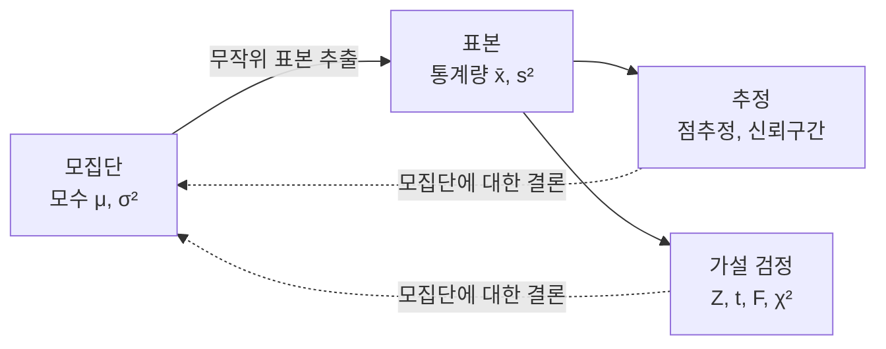

# 추론 통계 (Inferential Statistics)

---

## I. 표본으로 모집단을 말하는, 추론 통계의 개요

### 가. 정의

- 모집단에서 추출한 **표본으로 모집단의 모수를 추정하거나 가설을 검정하고, 그 불확실성을 확률로 표현**하는 통계 분야

### 나. 필요성 및 특징

| 구분 | 내용 |
| --- | --- |
| 필요성 | 전수조사의 시간·비용 한계, 불확실성 아래 데이터 기반 의사결정 |
| 두 축 | 추정(점추정·구간추정)과 [[가설 검정]] |
| 확률 기반 | 표본분포·[[중심극한정리]]로 오차를 정량화 |
| 전제 | 무작위 [[표본 추출]], 모형 가정(정규성 등) |

---

## II. 분석 절차 및 구성요소

### 가. 개념도

- 표본 통계량의 분포를 이용해 모수의 값을 추정하고 모수에 대한 주장을 검정

### 나. 구성요소

| 구분 | 요소 | 설명 |
| --- | --- | --- |
| 추정 | 점추정 | 표본평균 등으로 모수를 단일 값으로 추정 ([[추정 이론]]) |
| | 구간추정 | 신뢰수준(예: 95%)의 신뢰구간 제시, 같은 절차를 반복하면 95%의 구간이 모수를 포함 |
| 검정 | 귀무·대립가설 | $H_0$(차이 없음)와 $H_1$(입증할 주장) |
| | [[유의확률\|p-value]] | $H_0$가 참일 때 관측값 이상으로 극단적일 확률 |
| | 유의수준 $\alpha$ | 제1종 오류 허용 한계 (0.05, 0.01) |
| | 제1·2종 오류 | 참인 $H_0$ 기각 / 거짓인 $H_0$ 기각 실패 |
| 방법 | 모수 검정 | 분포 가정 기반: [[Z-검정]], [[t-검정 (t-test)\|t-검정]], [[ANOVA(Analysis of variance)\|ANOVA]] |
| | 비모수 검정 | 분포 가정 없음: 맨-휘트니 U, 윌콕슨, 크루스칼-월리스 |

---

## III. 비교 및 동향

### 가. 기술 통계 vs 추론 통계

| 비교 항목 | [[기술 통계]] | 추론 통계 |
| --- | --- | --- |
| 목적 | 보유 데이터 요약 | 모집단 추정·검정 |
| 지표 | 평균, 중앙값, 분산, 왜도·첨도 | 신뢰구간, 오차한계, p-value, 검정통계량 |
| 불확실성 | 없음 | 표본 오차 존재 |
| 결과 | 표·그래프 | 추정값, 기각 여부 |

### 나. 동향

- **온라인 실험 고도화**: A/B 테스트에서 순차 검정, CUPED(사전 데이터로 분산 축소), 베이지안 A/B·다중 슬롯머신(MAB) 병행
- **인과 추론**: 관찰 데이터에서 성향점수, 이중차분(DiD), 인과 그래프로 처치 효과(ATE) 추정
- **ML 평가**: 모델 간 성능 차이를 부트스트랩 신뢰구간·통계 검정으로 확인

---

### 🔗 연관 토픽

- **소속 도메인**: [[00_인공지능_MOC|🤖 인공지능]]
- **세부 분류**: `1. 수학 · 통계학 & 데이터 전처리`
- **핵심 연관 토픽**:
  - [[기술 통계|기술 통계(Descriptive statistics)]]
  - [[추정 이론|추정 이론(Estimation Theory)]]
  - [[가설 검정]]
  - [[표본 추출]]
  - [[중심극한정리|중심극한정리 (Central Limit Theorem)]]
