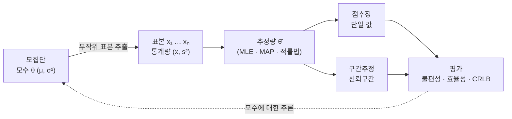

# 추정 이론 (Estimation Theory) / 추정통계

---

## I. 표본으로 모수를 예측하는 통계적 기반, 추정 이론의 개요

### 가. 정의

- 모집단에서 추출한 표본(관측 데이터)의 통계량으로 **알 수 없는 모집단의 모수(Parameter)를 확률적으로 예측**하는 통계 이론 ([[추론 통계]]의 한 축)

### 나. 필요성 및 특징

| 구분 | 내용 |
| --- | --- |
| 필요성 | 전수조사의 시간·비용 한계 극복, 노이즈 섞인 센서 신호에서 상태 추정, ML 파라미터 학습의 수학적 근거 |
| 추정 방식 | 하나의 값을 제시하는 점추정, 범위를 제시하는 구간추정 |
| 좋은 추정량 | 불편성·효율성·일치성·충분성 4가지 기준으로 평가 |
| 성능 한계 | 크래머-라오 하한(CRLB)이 불편추정량 분산의 이론적 최솟값 |

---

## II. 추정 절차 및 핵심 요소

### 가. 추정 절차

### 나. 핵심 요소

| 구분 | 요소 | 설명 |
| --- | --- | --- |
| 추정 방식 | 점추정 | 표본평균 $\bar{x}$ 등으로 모수를 단일 값으로 추정 |
| | 구간추정 | 신뢰수준(예: 95%)에서 모수를 포함하는 신뢰구간 제시, 예) $\bar{x} \pm z_{\alpha/2}\frac{\sigma}{\sqrt{n}}$ |
| 추정량 평가 | 불편성 | $E(\hat{\theta})=\theta$, 체계적 [[편향]]이 없음 ([[불편추정량]]) |
| | 효율성 | 불편추정량 중 분산이 가장 작음 (MVUE) |
| | 일치성 | $n \to \infty$일 때 $\hat{\theta}$가 $\theta$에 확률 수렴 |
| | 충분성 | 추정량이 모수에 관한 표본의 정보를 모두 담음 |
| 추정 방법 | 최대우도추정 (MLE) | 우도 $P(X \mid \theta)$를 최대화하는 θ |
| | 최대사후추정 (MAP) | 사전분포를 반영해 사후확률 $P(\theta \mid X) \propto P(X \mid \theta)P(\theta)$를 최대화 |
| | 적률법 (MoM) | 표본 적률(평균·분산)을 모집단 적률과 같다고 놓고 풀이 |
| 성능 한계 | CRLB | $Var(\hat{\theta}) \ge 1/I(\theta)$, 피셔 정보량의 역수가 분산 하한 |

---

## III. 비교 및 동향

### 가. MLE vs MAP

| 비교 항목 | MLE | MAP |
| --- | --- | --- |
| 최적화 대상 | 우도 $P(X \mid \theta)$ | 사후확률 $P(\theta \mid X)$ |
| 사전 지식 | 사용하지 않음 (균등 사전분포와 동일) | 사전분포 $P(\theta)$ 반영 |
| 소표본 | 과적합 위험 | 사전분포가 규제 역할을 해 안정적 |
| ML 대응 | 크로스 엔트로피·MSE 최소화와 동치 | 가우시안 사전분포 ↔ L2 정규화, 라플라스 사전분포 ↔ L1 정규화 |
| 대표본 | 둘의 결과가 수렴 | |

### 나. 추정 vs 가설검정

| 비교 항목 | 추정 | [[가설 검정]] |
| --- | --- | --- |
| 질문 | 모수가 **얼마인가** | 모수에 대한 주장이 **맞는가** |
| 결과 | 추정값, 신뢰구간 | 귀무가설 기각 여부 ([[유의확률\|p-value]]) |
| 예시 | 모평균은 50~55 사이 (95%) | 모평균 = 50이라는 주장은 기각 |

### 다. 동향

- **센서 퓨전**: [[Smart Car(자율주행)|자율주행]]·로봇은 라이다·레이더·카메라의 잡음 섞인 신호에서 위치·속도를 실시간 추정하기 위해 칼만 필터(MMSE 추정)를 사용
- **불확실성 정량화**: 가중치를 점추정 대신 분포로 추정하는 [[베이지안 딥러닝]], MC Dropout, MCMC로 의료·자율주행 AI의 예측 신뢰도를 수치화

---

### 🔗 연관 토픽

- **소속 도메인**: [[00_인공지능_MOC|🤖 인공지능]]
- **세부 분류**: `1. 수학 · 통계학 & 데이터 전처리`
- **핵심 연관 토픽**:
  - [[추론 통계]]
  - [[불편추정량|불편추정량 (Unbiased Estimator)]]
  - [[가설 검정]]
  - [[베이지안 딥러닝]]
  - [[베이지안 모델]]
