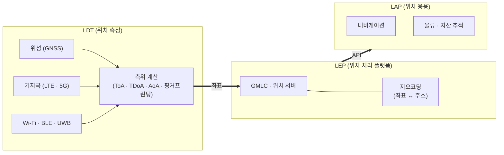

# 측위기술 (LDT: Location Determination Technology)

---

## I. LBS의 기반, 측위기술의 개요

### 가. 정의

- 위성·이동통신망·무선 AP·센서 신호를 이용하여 **단말이나 이동체의 위치(좌표)를 산출**하는 기술로, 위치기반서비스(LBS)의 최하위 구성요소

### 나. 등장 배경 및 특징

| 구분 | 내용 |
| --- | --- |
| 등장 배경 | GPS 실내 음영 한계, 실내 길안내·물류·자율주행 등 정밀 위치 수요 |
| 연속성 | 실내·실외 끊김 없는(Seamless) 측위 |
| 정밀성 | 보정·초광대역 기술로 cm급까지 향상 |
| 하이브리드 | 위성·무선·관성·영상 측위 융합 |

---

## II. 구조 및 기술요소

### 가. LBS 구조와 측위 원리

- LDT가 신호의 도달 시간·시간차·각도·세기 패턴으로 좌표를 계산하면, LEP가 가공(지오코딩·이력 관리)하여 LAP 서비스에 제공

### 나. 기술요소

| 구분 | 요소 | 설명 |
| --- | --- | --- |
| 측위 원리 | ToA / TDoA | 신호 도달 시간 / 도달 시간차로 거리를 구해 삼변측량 |
| | AoA / AoD | 신호 도달·출발 각도로 삼각측량 |
| | [[핑거프린팅]] | 사전 수집한 신호 세기(RSSI) 지도와 현재 패턴 매칭 |
| 실외 | GNSS / A-GNSS | GPS·Galileo·BeiDou 위성 측위, 통신망 보조로 초기 측위 시간(TTFF) 단축 |
| | RTK | 기준국이 보내는 반송파 위상 보정 정보로 cm급 정밀 측위 |
| | Cell-ID | 접속 기지국 위치로 개략 측위 (수백 m~km 오차) |
| 실내 | Wi-Fi | RSSI 핑거프린팅, Wi-Fi RTT(802.11mc) 거리 측정 |
| | BLE | 비콘 RSSI, Bluetooth 5.1 방향 탐지(AoA/AoD) |
| | UWB | 500MHz 이상 대역폭 펄스로 ToF·TDoA 측정, 수십 cm 이내 정밀도 |
| 보조 | PDR · 관성항법 | 가속도·자이로로 이동 궤적 추정 (누적 오차 존재) |
| | VPS · SLAM | 카메라 영상 특징점을 3D 지도와 매칭해 위치·방향 추정 |

---

## III. 비교 및 동향

### 가. 주요 측위기술 비교

| 비교 항목 | GNSS | Wi-Fi 핑거프린팅 | BLE / UWB | VPS |
| --- | --- | --- | --- | --- |
| 원리 | 위성 ToA 삼변측량 | RSSI 패턴 매칭 | AoA·ToF·TDoA | 영상-3D 지도 매칭 |
| 정확도 (예) | 수 m (RTK 시 cm급) | 수 m | BLE 1~3m, UWB 수십 cm | 수십 cm~1m |
| 인프라 | 위성 (별도 설치 없음) | 기존 AP 활용, 라디오맵 구축 | 비콘·앵커 설치 필요 | 사전 3D 지도 필요 |
| 한계 | 실내·도심 협곡 음영 | AP 변경 시 DB 재구축 | 설치·유지 비용 | 조명·환경 변화에 취약 |
| 활용 | 차량 내비게이션 | 쇼핑몰 길안내 | 디지털 키, 공장 자산 추적 | AR 내비게이션, 로봇 |

### 나. 동향

- **5G 측위**: 3GPP Rel-16에서 NR 측위(Multi-RTT, DL-TDoA, AoD) 도입, Rel-17·18에서 산업용 고정밀·저전력 측위 고도화
- **UWB 확산**: 스마트폰·차량 디지털 키(CCC Digital Key 3.0), 분실물 추적에 UWB 탑재 보편화
- **센서 융합**: GNSS·IMU·카메라·LiDAR를 결합한 자율주행·[[드론]] 측위, 국내 KASS(위성 기반 보정 시스템) 서비스 개시

---

### 🔗 연관 토픽

- **소속 도메인**: [[00_디지털서비스_MOC|🚀 디지털서비스]]
- **세부 분류**: `3. 사물인터넷 (IoT) & 스마트 플랫폼 · 메타버스`
- **핵심 연관 토픽**:
  - [[핑거프린팅]]
  - [[Smart Car(자율주행)]]
  - [[드론|드론 (Drone; 무인기)]]
  - [[C-ITS|C-ITS (Cooperative-Intelligent Transport Systems)]]
  - [[UAM|UAM (Urban Air Mobility)]]
