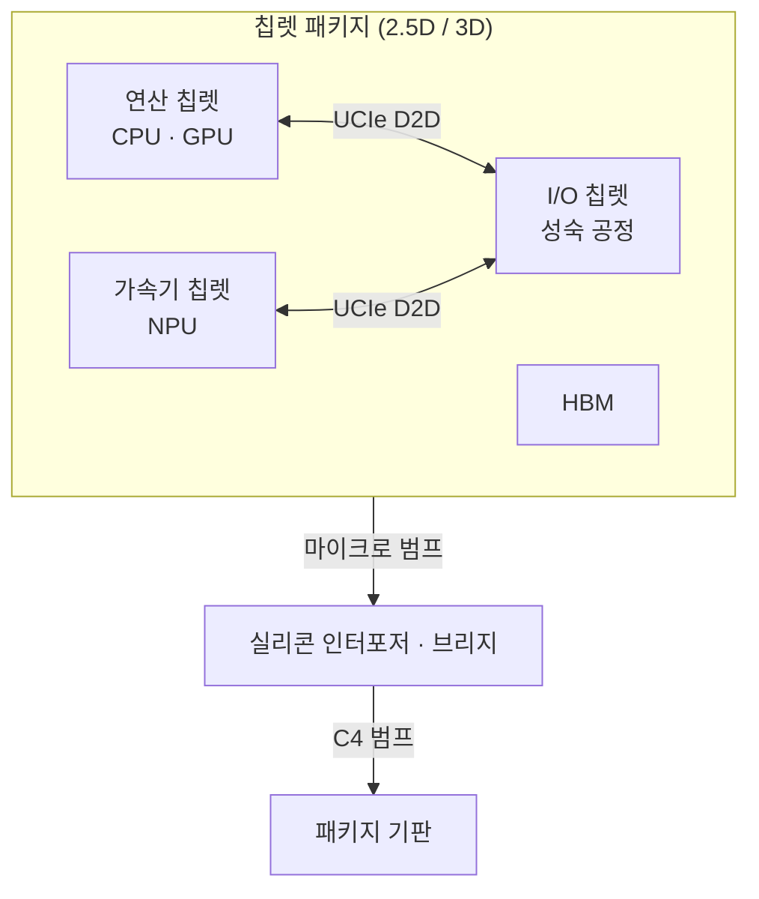

# 칩렛 (Chiplet)

---

## I. 큰 칩을 작은 다이로 나누어 붙이는, 칩렛의 개요

### 가. 정의

- 하나의 큰 칩(모놀리식)으로 만들던 기능을 **여러 개의 작은 다이(칩렛)로 나누어 만든 뒤 첨단 패키징으로 한 패키지에 통합**하는 반도체 설계·제조 방식

### 나. 등장 배경 및 특징

| 구분 | 내용 |
| --- | --- |
| 배경 | 최선단 공정 비용 급증, 대형 다이의 수율 저하, 레티클 크기 한계 |
| 수율 향상 | 작은 다이일수록 결함 확률이 낮아 수율·원가 개선 |
| 이종 집적 | 연산은 최선단, I/O·아날로그는 성숙 공정 등 블록별 최적 공정 |
| 재사용 | 검증된 칩렛을 여러 제품에 조합해 개발 기간 단축 |
| 비용 | 다이 간 연결의 지연·전력, 패키징·테스트 복잡도 증가 |

---

## II. 구조 및 구성요소

### 가. 구조

- 서로 다른 공정의 칩렛을 인터포저·브리지 위에 배치하고 다이 간 인터페이스로 고대역폭 연결

### 나. 구성요소

| 구분 | 요소 | 설명 |
| --- | --- | --- |
| 패키징 | 2.5D | 인터포저 위 수평 배치 (TSMC CoWoS) |
| | 3D | 다이를 수직 적층 (Intel Foveros, TSMC SoIC) |
| | 실리콘 브리지 | 인터포저 대신 다이 가장자리만 잇는 작은 브리지 (Intel EMIB) |
| 연결 | TSV | 실리콘 관통 전극으로 수직 연결 |
| | 마이크로 범프 / 하이브리드 본딩 | 미세 솔더 접점 / 범프 없이 구리 직접 접합 |
| 인터페이스 | UCIe | 다이 간(D2D) 개방형 표준, 1.x 레인당 최대 32GT/s, 2.0(2024) 3D 적층 지원 |
| | 독자 인터페이스 | AMD Infinity Fabric, NVIDIA NV-HBI 등 |
| 품질 | KGD (Known Good Die) | 패키징 전 개별 다이를 검증해 최종 수율 확보 |

---

## III. 비교 및 동향

### 가. 모놀리식 SoC vs 칩렛

| 비교 항목 | 모놀리식 SoC | 칩렛 |
| --- | --- | --- |
| 구조 | 모든 기능을 한 다이에 | 기능별 다이를 패키지에서 통합 |
| 수율 | 다이가 클수록 급감 | 작은 다이 단위로 높음 |
| 공정 | 전 블록이 같은 공정 | 블록별 최적 공정 |
| 개발 | 전체 마스크·설계 비용 큼 | 칩렛 재사용으로 비용·기간 단축 |
| 연결 성능 | 온칩 배선, 지연·전력 최소 | 다이 간 통신 오버헤드 존재 |

### 나. 동향

- **AI 가속기 표준 구조**: AMD Instinct MI300(다수 칩렛 + 3D 적층), NVIDIA B200(다이 2개 결합 + [[HBM]]) 등 대형 AI 칩은 칩렛·첨단 패키징이 사실상 필수
- **개방형 생태계**: UCIe 컨소시엄(2022 결성, Intel·AMD·TSMC·삼성 등)이 다른 회사 칩렛 간 상호 연결을 목표로 표준 확장
- **패키징 공급 경쟁**: CoWoS 등 첨단 패키징 용량이 AI 칩 공급을 좌우하며 파운드리·OSAT 투자 확대

---

### 🔗 연관 토픽

- **소속 도메인**: [[00_컴퓨터구조_MOC|💻 컴퓨터구조]]
- **세부 분류**: `3. 고성능 AI 가속기 & 입출력 시스템`
- **핵심 연관 토픽**:
  - [[비메모리 반도체|비메모리 반도체 (Non-Memory Chip System Semiconductor)]]
  - [[HBM|HBM (High Bandwidth Memory)]]
  - [[지능형 반도체]]
  - [[CXL|CXL (Compute Express Link)]]
  - [[GPU]]
