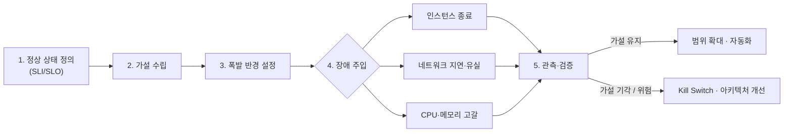

# 카오스 엔지니어링 (Chaos Engineering) / 카오스 테스트

---

## I. 분산 시스템의 회복탄력성 검증, 카오스 엔지니어링의 개요

### 가. 정의

- 운영 환경 등 분산 시스템에 **의도적으로 장애를 주입해 예상치 못한 상황에서도 시스템이 정상 상태를 유지하는지 검증**하는 실험적 기법 (실행 활동을 카오스 테스트라고도 함)

### 나. 등장 배경 및 특징

| 구분 | 내용 |
| --- | --- |
| 등장 배경 | [[MSA (Micro Service Architecture)\|MSA]]·[[클라우드 네이티브]]로 복잡도가 높아져 일부 장애가 연쇄 장애(Cascading Failure)로 확산 |
| 사전 예방 | 사후 장애 대응에서 사전 검증으로 패러다임 전환 |
| 통제된 실험 | 폭발 반경(Blast Radius)을 최소화하여 안전하게 수행 |
| 운영 환경 지향 | 최종적으로 실제 운영 환경에서 수행해야 의미 있는 결과 |

---

## II. 실험 절차 및 핵심 요소

### 가. 실험 프로세스

### 나. 핵심 요소

| 구분 | 요소 | 설명 |
| --- | --- | --- |
| 원칙 | 정상 상태 (Steady State) | 오류율·[[응답시간]]·[[처리량]] 등 측정 가능한 기준 지표 |
| | 가설 | 장애가 나도 정상 상태가 유지된다는 가정, 대조군·실험군 비교 |
| | 폭발 반경 | 영향 범위를 작게 시작해 점진적으로 확대 |
| 장애 유형 | 인프라 | 인스턴스·컨테이너 강제 종료 |
| | 네트워크 | 지연·패킷 손실 → 타임아웃, 재시도, [[서킷브레이커]] 검증 |
| | 자원 고갈 | CPU·메모리·디스크 부하 → 오토스케일링 검증 |
| | 상태 변화 | DB 페일오버, 시스템 시간 변경 |
| 안전장치 | Kill Switch | 치명적 상황 시 즉시 중단·원복 |
| 훈련 | Game Day | 조직 전체가 모의 장애 대응을 훈련 |
| 도구 | Chaos Monkey, Gremlin, Chaos Mesh, LitmusChaos | 무작위 종료(넷플릭스), SaaS형, 쿠버네티스 특화 |

---

## III. 비교 및 도입 전략

### 가. 카오스 엔지니어링 vs 전통적 테스트 vs 스트레스 테스트

| 비교 항목 | 카오스 엔지니어링 | 전통적 테스트 (단위·[[통합 테스트]]) | 스트레스 테스트 |
| --- | --- | --- | --- |
| 목적 | 미지의 장애 대비, 회복탄력성 | 알려진 기능 결함 탐지 | 최대 처리량·병목 확인 |
| 관점 | 환경 변수 (장애) | 기능 로직 | 부하 변수 (TPS) |
| 환경 | 운영(최종 지향) | 개발·QA | 테스트·스테이징 |
| 방식 | 가설 기반 실험 | 기대 결과 검증 | 부하 증가 |

### 나. 도입 전략

- **관측성 선행**: 메트릭·로그·트레이스 통합 모니터링 체계(Prometheus, Grafana, Datadog) 구축
- **점진적 확대**: 개발 → 스테이징 → 운영 순으로 범위 확대, Kill Switch 필수
- **지속적 카오스**: CI/CD 파이프라인에 카오스 실험을 통합해 배포마다 검증 ([[SRE (Site Reliability Engineering)\|SRE]] 실천)

---

### 🔗 연관 토픽

- **소속 도메인**: [[00_소프트웨어공학_MOC|🏗️ 소프트웨어공학]]
- **세부 분류**: `4. 아키텍처 스타일 & 객체지향 설계 원리`
- **핵심 연관 토픽**:
  - [[MSA (Micro Service Architecture)]]
  - [[SRE (Site Reliability Engineering)]]
  - [[서킷브레이커]]
  - [[성능 테스트]]
  - [[사이버 레질리언스]]
