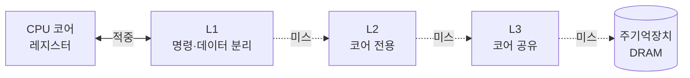

# 캐시 메모리 (Cache Memory)

---

## I. CPU와 메모리의 속도 차를 메우는, 캐시 메모리의 개요

### 가. 정의

- [[CPU]]와 주기억장치 사이에서 **자주 쓰는 데이터·명령어 복사본을 보관하는 소용량 고속 SRAM 기억장치**

### 나. 필요성 및 특징

| 구분 | 내용 |
| --- | --- |
| 필요성 | CPU와 DRAM의 속도 격차(Memory Wall) 완화 |
| [[지역성]] 활용 | 시간 지역성(최근 참조 재참조)·공간 지역성(인접 주소 참조) 이용 |
| 블록 단위 전송 | 미스 시 캐시 라인(예: 64B) 단위로 하위 계층에서 가져옴 |
| 성능 지표 | 평균 메모리 접근 시간 AMAT = 적중 시간 + 미스율 × 미스 페널티 |

---

## II. 구조 및 구성요소

### 가. 계층 구조와 동작

- L1부터 차례로 찾고, 미스가 나면 하위 계층에서 블록을 가져와 상위 캐시에 적재

### 나. 구성요소

| 구분 | 요소 | 설명 |
| --- | --- | --- |
| 구조 | 캐시 라인 | 데이터 블록 + 태그 + 상태 비트(Valid, Dirty) |
| 사상 방식 | 직접 / 완전 연관 / 집합 연관 | 블록을 둘 위치 결정 ([[사상 기법]]) |
| 교체 정책 | [[LRU]]·FIFO·랜덤 | 빈 자리가 없을 때 내보낼 라인 선택 |
| 쓰기 정책 | Write-Through / Write-Back | 메모리 반영 시점 결정 ([[캐시 메모리의 쓰기 정책]]) |
| 미스 유형 (3C) | 최초 (Compulsory) | 처음 참조하는 블록 |
| | 용량 (Capacity) | 작업 집합이 캐시보다 큼 |
| | 충돌 (Conflict) | 같은 위치에 대응하는 블록 간 경쟁 |
| 다중 코어 | [[캐시 일관성]] | 코어별 캐시 복사본 일치 유지 ([[MESI 프로토콜]]) |

---

## III. 비교 및 동향

### 가. 캐시 계층 비교 (일반적인 범위)

| 비교 항목 | L1 | L2 | L3 (LLC) |
| --- | --- | --- | --- |
| 용량 | 수십 KB | 수백 KB~수 MB | 수 MB~수백 MB |
| 지연 | 약 4~5 사이클 | 약 10~15 사이클 | 약 30~50 사이클 |
| 공유 | 코어 전용, 명령·데이터 분리 | 코어 전용 (또는 클러스터 공유) | 전 코어 공유 |
| 설계 우선순위 | 접근 속도 | 속도와 용량 절충 | 용량, DRAM 접근 감소 |

### 나. 동향

- **3D 적층 캐시**: AMD 3D V-Cache처럼 SRAM 다이를 코어 다이 위에 적층해 L3 용량 확대
- **SRAM 미세화 둔화**: 공정이 줄어도 SRAM 셀 면적 감소가 작아, 캐시를 별도 다이·칩렛으로 분리하는 설계 증가

---

### 🔗 연관 토픽

- **소속 도메인**: [[00_컴퓨터구조_MOC|💻 컴퓨터구조]]
- **세부 분류**: `1. CPU 프로세서 & 마이크로아키텍처`
- **핵심 연관 토픽**:
  - [[사상 기법]]
  - [[캐시 메모리의 쓰기 정책]]
  - [[캐시 일관성|캐시 일관성(Cache Coherence)]]
  - [[LRU]]
  - [[CPU|중앙처리장치 (CPU Central Processing Unit)]]
