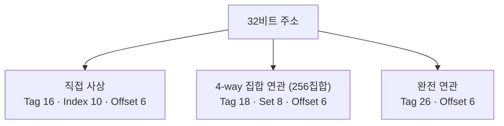

# 캐시 메모리의 사상 방식 (Cache Memory Mapping Scheme)

---

## I. 주소를 쪼개 위치를 정하는, 캐시 사상 방식의 개요

### 가. 정의

- 주기억장치 주소를 **Tag·Index·Offset 필드로 나누어 블록이 들어갈 [[캐시 메모리]] 위치와 적중 여부를 판단**하는 규칙 (직접·완전 연관·집합 연관)

### 나. 필요성 및 특징

| 구분 | 내용 |
| --- | --- |
| N:1 대응 | 많은 메모리 블록이 적은 캐시 라인을 나눠 써야 함 |
| 트레이드오프 | 비교기 수·전력·탐색 시간 대 충돌 미스·적중률 |
| 주소 필드 크기 | 캐시 용량, 블록 크기, 연관도로 결정 |

---

## II. 주소 구조 및 구성요소

### 가. 주소 필드 구성 (예: 32비트 주소, 캐시 64KB, 블록 64B → 1,024라인)

- Offset = log₂(블록 크기), Index = log₂(라인 수 또는 집합 수), Tag = 나머지 비트, 연관도가 2배가 될 때마다 Index 1비트가 Tag로 이동

### 나. 구성요소

| 구분 | 요소 | 설명 |
| --- | --- | --- |
| 주소 필드 | Tag | 라인에 들어 있는 블록이 어느 블록인지 식별 |
| | Index (Line / Set) | 직접 사상은 라인 번호, 집합 연관은 집합 번호 |
| | Offset (Word) | 블록 내부 바이트 위치 |
| 라인 구성 | Valid · Dirty 비트 | 유효 여부, 수정 여부 |
| | 태그 저장소 | 라인마다 Tag 보관, 비교 대상 |
| 하드웨어 | 비교기 | 요청 Tag와 저장 Tag 비교 (직접 1개, n-way n개, 완전 연관 라인 수만큼) |
| | MUX | 적중한 way의 데이터 선택 |
| 현상 | 충돌 미스·스래싱 | 같은 Index의 블록이 번갈아 참조되어 계속 교체 |

---

## III. 비교 및 동향

### 가. 세 방식 비교

| 비교 항목 | 직접 사상 | 완전 연관 사상 | 집합 연관 사상 (n-way) |
| --- | --- | --- | --- |
| 주소 형식 | Tag + Line + Offset | Tag + Offset | Tag + Set + Offset |
| 배치 위치 | 1곳 | 어디든 | 집합 내 n곳 |
| 태그 비교 | 1회 | 전체 라인 동시 | n개 동시 |
| 하드웨어 비용 | 낮음 | 높음 | 중간 |
| 적중률 | 낮음 | 높음 | n이 커질수록 완전 연관에 근접 |
| 교체 [[알고리즘]] | 불필요 | 필요 ([[LRU]] 등) | 집합 내에서 필요 |

### 나. 동향

- **n-way 집합 연관 표준화**: 현대 CPU의 L1~L3는 대부분 4~16-way 이상 집합 연관 사상 (예: L1D 8~12-way)
- **TLB 구성**: 소용량 L1 TLB는 완전 연관이 흔하고, 대용량 L2 TLB는 집합 연관 사용
- **Way 예측**: 접근할 way를 미리 예측해 전체 way 동시 읽기 전력을 줄이는 기법 적용

---

### 🔗 연관 토픽

- **소속 도메인**: [[00_컴퓨터구조_MOC|💻 컴퓨터구조]]
- **세부 분류**: `2. 캐시 & 메모리 계층 구조 · 스토리지`
- **핵심 연관 토픽**:
  - [[사상 기법]]
  - [[캐시 메모리]]
  - [[캐시 메모리의 쓰기 정책]]
  - [[LRU]]
  - [[MMU(Memory Management Unit)]]
