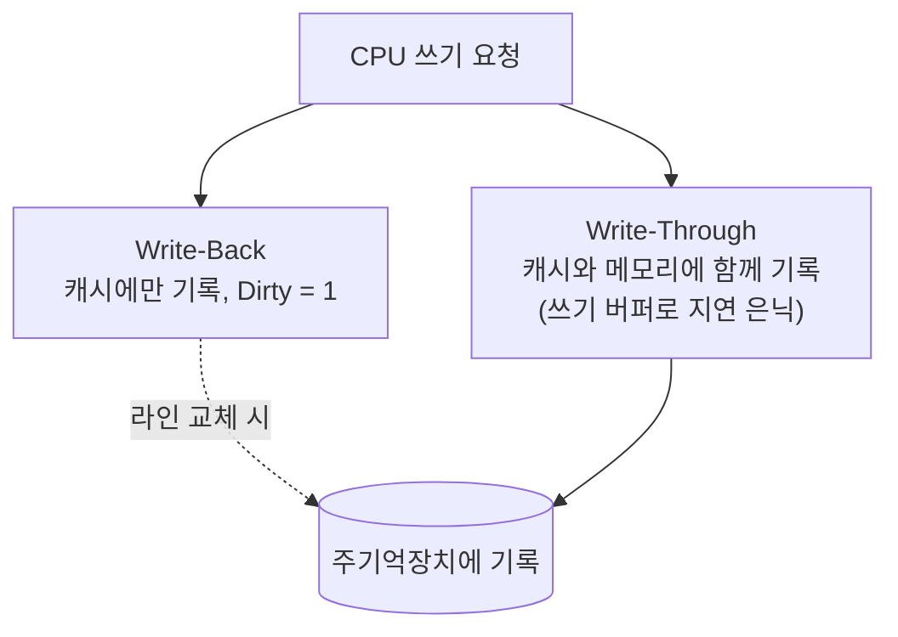

# 캐시 메모리의 쓰기 정책 (Write Policy)

---

## I. 언제 메모리에 반영할 것인가, 캐시 쓰기 정책의 개요

### 가. 정의

- [[CPU]]가 캐시에 쓴 데이터를 **하위 계층(주기억장치)에 언제·어떻게 반영할지 정하는 규칙** (적중 시 WT/WB, 미스 시 Allocate 여부)

### 나. 필요성 및 특징

| 구분 | 내용 |
| --- | --- |
| 일관성 | 캐시와 메모리의 값 불일치(Stale Data) 관리 |
| 트레이드오프 | 메모리 트래픽·쓰기 지연 대 구현 단순성·복구 용이성 |
| 조합 | 적중 시 정책(WT/WB)과 미스 시 정책(WA/NWA)을 함께 선택 |

---

## II. 동작 및 구성요소

### 가. 동작 원리

- Write-Through는 쓰기마다 메모리에 반영, Write-Back은 수정된 라인이 교체될 때 한 번만 반영

### 나. 구성요소

| 구분 | 요소 | 설명 |
| --- | --- | --- |
| 적중 시 정책 | Write-Through (WT) | 캐시와 메모리에 동시 기록, 항상 일치 |
| | Write-Back (WB) | 캐시에만 기록, 교체 시 메모리에 반영 |
| 미스 시 정책 | Write-Allocate | 블록을 캐시로 가져온 뒤 기록 (주로 WB와 조합) |
| | No-Write-Allocate | 캐시를 거치지 않고 메모리에만 기록 (주로 WT와 조합) |
| 상태 비트 | Dirty Bit | WB에서 라인이 수정되었음을 표시, 교체 시 기록 여부 판단 |
| | Valid Bit | 라인에 유효 데이터가 있는지 표시 |
| 보완 | 쓰기 버퍼 ([[FIFO]]) | WT의 메모리 쓰기를 버퍼에 모아 CPU 정지 방지 |
| | 교체 정책 | 내보낼 라인 선택 ([[LRU]], [[LFU]]), Dirty 라인은 쓰기 후 교체 |

---

## III. 비교 및 동향

### 가. Write-Through vs Write-Back

| 비교 항목 | Write-Through | Write-Back |
| --- | --- | --- |
| 메모리 일치 | 항상 일치 | 수정 라인은 불일치 구간 존재 |
| 메모리 트래픽 | 쓰기마다 발생 | 교체 시에만 발생 |
| 쓰기 지연 | 메모리 속도에 영향 (쓰기 버퍼로 완화) | 캐시 속도로 완료 |
| 구현 | 단순, 장애 시 데이터 손실 적음 | Dirty 관리·교체 시 쓰기 필요 |
| 적용 | 단순 임베디드, 일부 L1, I/O 영역 | 현대 CPU의 L1~L3 대부분 |

### 나. 동향

- **WB 중심 계층**: 현대 x86·ARM 코어는 L1D부터 대부분 Write-Back이며, 일부 설계(예: AMD Bulldozer L1D)만 WT L1 + WB L2 조합 사용
- **일관성 프로토콜 결합**: WB 캐시 간 불일치는 [[MESI 프로토콜]]·MOESI 등 [[캐시 일관성]] 프로토콜로 관리
- **영속 메모리·CXL**: 전원 손실 대비 캐시 플러시 명령(CLWB 등)과 [[CXL]] 메모리의 일관성 관리가 쓰기 정책 설계 요소로 부상

---

### 🔗 연관 토픽

- **소속 도메인**: [[00_컴퓨터구조_MOC|💻 컴퓨터구조]]
- **세부 분류**: `1. CPU 프로세서 & 마이크로아키텍처`
- **핵심 연관 토픽**:
  - [[캐시 메모리]]
  - [[캐시 일관성|캐시 일관성(Cache Coherence)]]
  - [[캐시 플러시|캐시 플러시(Cache Flush)]]
  - [[MESI 프로토콜]]
  - [[LRU]]
