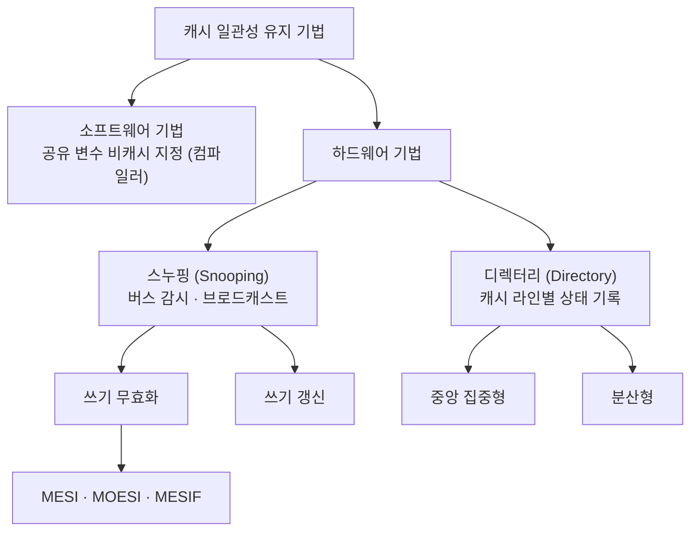

# 캐시 일관성 (Cache Coherence)

---

## I. 멀티코어의 데이터 일치 보장, 캐시 일관성의 개요

### 가. 정의

- 다중 프로세서 환경에서 **각 코어의 로컬 캐시에 복사된 같은 메모리 블록이 항상 일치된 값을 유지**하도록 보장하는 하드웨어·소프트웨어 메커니즘

### 나. 필요성 및 특징

| 구분 | 내용 |
| --- | --- |
| 필요성 | 공유 메모리(SMP)에서 한 코어가 갱신한 값을 다른 코어가 낡은 값(Stale Data)으로 읽는 문제 방지 |
| 투명성 | 하드웨어 [[프로토콜]]로 자동 처리, 응용 프로그램 수정 불필요 |
| 설계 핵심 | 버스·인터커넥트 트래픽 최소화와 코어 확장성 확보 |

---

## II. 유지 기법 및 핵심 기술

### 가. 기법 분류

- 각 캐시 컨트롤러가 공유 버스를 감시하다가 다른 코어가 쓰기를 하면 자기 복사본을 무효화(또는 갱신)

### 나. 핵심 기술 요소

| 구분 | 요소 | 설명 |
| --- | --- | --- |
| 프로토콜 | 스누핑 | 모든 캐시가 버스를 감시하는 분산 방식, 소규모 코어에 적합 |
| | 디렉터리 | 디렉터리가 공유 상태·소유자를 기록해 해당 노드에만 메시지, 대규모 코어에 적합 |
| 쓰기 정책 | 쓰기 무효화 (Write-Invalidate) | 갱신 시 다른 캐시의 복사본을 Invalid로 변경 (일반적) |
| | 쓰기 갱신 (Write-Update) | 갱신 값을 모든 복사본에 전송 |
| 상태 관리 ([[MESI 프로토콜]]) | Modified | 수정됨, 메모리와 불일치, 유일한 최신본 |
| | Exclusive | 메모리와 일치, 이 캐시에만 존재 |
| | Shared | 메모리와 일치, 여러 캐시가 공유 |
| | Invalid | 무효, 사용 불가 |
| 확장 프로토콜 | MOESI (AMD) | Owner 상태 추가, 수정 데이터를 메모리 기록 없이 다른 캐시에 직접 전달 |
| | MESIF (Intel) | Forward 상태 추가, 공유 캐시 중 하나만 응답해 트래픽 감소 |

---

## III. 비교 및 동향

### 가. 스누핑 vs 디렉터리

| 비교 항목 | 스누핑 | 디렉터리 |
| --- | --- | --- |
| 상태 관리 | 각 캐시 컨트롤러 (분산) | 디렉터리 컨트롤러 |
| 통신 | 공유 버스 브로드캐스트 | [[Point-to-Point]] 메시지 |
| 트래픽 | 큼 | 작음 |
| 확장성 | 낮음 (수십 코어) | 높음 (수백 코어 이상) |
| 구현 | 단순, 저비용 | 디렉터리 메모리·라우팅 필요, 고비용 |

### 나. 동향

- **하이브리드**: 칩 내부 코어 간은 스누핑, 멀티 소켓 간은 디렉터리 방식 결합
- **이기종 일관성 ([[CXL]].cache)**: [[CPU]]와 [[GPU]]·[[NPU]]·DPU 등 가속기 간 [[캐시 메모리]] 일관성을 하드웨어로 유지하는 개방형 표준 확산

---

### 🔗 연관 토픽

- **소속 도메인**: [[00_컴퓨터구조_MOC|💻 컴퓨터구조]]
- **세부 분류**: `1. CPU 프로세서 & 마이크로아키텍처`
- **핵심 연관 토픽**:
  - [[MESI 프로토콜|MESI 프로토콜 (MESI Protocol)]]
  - [[캐시 메모리]]
  - [[캐시 메모리의 쓰기 정책]]
  - [[CXL|CXL (Compute Express Link)]]
  - [[CPU]]
