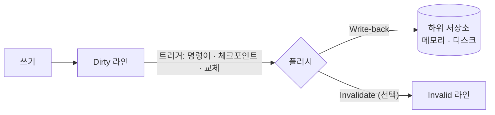

# 캐시 플러시 (Cache Flush)

---

## I. 캐시 내용을 내려쓰고 비우는, 캐시 플러시의 개요

### 가. 정의

- 캐시의 **수정된(Dirty) 데이터를 하위 저장소에 기록(Write-back)하고 필요하면 해당 라인을 무효화(Invalidate)**하여 캐시와 하위 계층의 내용을 일치시키는 동작

### 나. 필요성 및 특징

| 구분 | 내용 |
| --- | --- |
| 일관성 | Write-Back 캐시와 메모리, 또는 캐시를 거치지 않는 장치([[DMA(Direct Memory Access)\|DMA]])와의 불일치 해소 |
| 영속성 | 전원 손실 전에 버퍼·캐시 내용을 비휘발 저장소에 반영 |
| 비용 | 대량 플러시는 I/O 급증과 일시 정지 유발 |
| 보안 | 플러시 명령이 캐시 [[부채널 공격]](Flush+Reload)에 악용될 수 있음 |

---

## II. 동작 및 구성요소

### 가. 동작 원리

- 쓰기만 하고 라인을 유지할 수도(Clean), 쓰고 무효화할 수도 있음

### 나. 구성요소

| 구분 | 요소 | 설명 |
| --- | --- | --- |
| 대상 | Dirty 블록 | 하위 저장소 원본과 값이 다른 블록 |
| 동작 | Write-back (Clean) | 수정 데이터를 하위에 기록, 라인은 유지 가능 |
| | Invalidate | Valid 비트를 0으로, 다음 접근 시 미스 유도 |
| CPU 명령 (x86) | CLFLUSH / CLFLUSHOPT | 라인을 기록 후 무효화 |
| | CLWB | 라인을 기록만 하고 유지 (영속 메모리용) |
| | WBINVD | 전체 캐시 기록 후 무효화 (특권 명령) |
| 트리거 | 명시적 | 명령어, 드라이버의 DMA 전후 처리, [[CDN]] Purge |
| | 묵시적 | 교체(Eviction), DB 체크포인트 |
| 적용 영역 | DB 버퍼 플러시 | 체크포인트 시 더티 페이지를 데이터 파일에 기록 |
| | TLB 플러시 | 페이지 테이블 변경 시 TLB 무효화, 멀티코어는 TLB Shootdown |
| 보안 | Flush+Reload | 공유 메모리 라인을 플러시 후 재접근 시간으로 피해자의 접근 여부 추론 |

---

## III. 비교 및 동향

### 가. 캐시 플러시 vs 캐시 교체

| 비교 항목 | 캐시 플러시 | 캐시 교체 |
| --- | --- | --- |
| 목적 | 일관성·영속성 확보 | 새 데이터를 위한 공간 확보 |
| 시점 | 명령·체크포인트 등 이벤트 | 미스 발생 시 공간 부족 |
| 대상 | 지정 범위 또는 전체 Dirty 블록 | 교체 [[알고리즘]]([[LRU]], [[LFU]], [[FIFO]])이 고른 희생 블록 |
| 부하 | 일괄 수행 시 I/O 급증 | 블록 단위로 분산 |

### 나. 동향

- **점진·비동기 플러시**: DBMS·파일시스템이 퍼지(Fuzzy) 체크포인트, 백그라운드 쓰기로 플러시 부하 분산
- **부채널 대응**: 공유 페이지 중복 제거 제한, 캐시 [[파티셔닝]](Intel CAT 등), 상수 시간 암호 구현으로 Flush+Reload 위험 완화
- **영속 메모리·CXL**: 전원 손실 시 캐시 내용을 보존하는 eADR, CXL 메모리의 GPF(Global Persistent Flush) 등 플러시 영역 확대

---

### 🔗 연관 토픽

- **소속 도메인**: [[00_컴퓨터구조_MOC|💻 컴퓨터구조]]
- **세부 분류**: `2. 캐시 & 메모리 계층 구조 · 스토리지`
- **핵심 연관 토픽**:
  - [[캐시 메모리의 쓰기 정책]]
  - [[캐시 메모리]]
  - [[캐시 일관성|캐시 일관성(Cache Coherence)]]
  - [[LRU]]
  - [[부채널 공격]]
