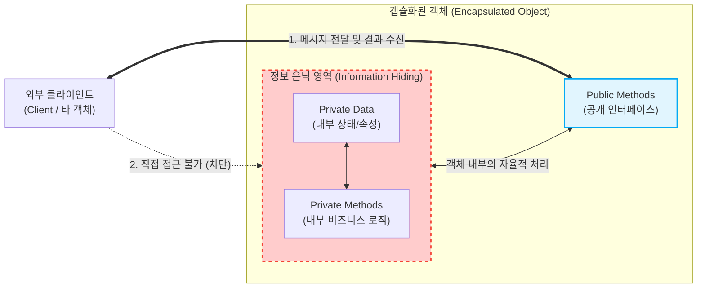

# 캡슐화 (Encapsulation)

---

## I. 객체지향 설계의 핵심, 캡슐화의 개요

### 가. 캡슐화의 정의
- 데이터(속성)와 데이터를 조작하는 연산(메서드)을 하나의 논리적 단위(클래스/객체)로 묶고, 내부의 구체적인 세부 구현을 외부로부터 감추는 객체지향 핵심 설계 기법

### 나. 캡슐화의 필요성 및 주요 특징
| 구분 | 내용 |
| --- | --- |
| 무결성 보장 | 정보 은닉(Information Hiding)을 통해 외부의 비인가 직접 접근 및 비정상적 상태 변질 차단 |
| 결합도 최소화 | 객체 내부 구현 변경 시에도 노출된 공개 인터페이스가 불변이면 외부 코드 파급 효과(Ripple Effect) 차단 |
| 응집도 극대화 | 밀접하게 연관된 데이터와 비즈니스 연산 로직을 한곳에 응집하여 코드의 가독성 및 유지보수성 향상 |
| 설계 원칙 준수 | 객체에게 필요한 행위를 요청하는 Tell, Don't Ask 원칙과 풍부한 도메인 모델(Rich Domain Model) 지향 |

---

## II. 캡슐화의 개념도 및 핵심 구성 요소

### 가. 캡슐화의 아키텍처 및 동작 원리

* 객체는 자신의 데이터(Private)를 스스로 관리하며, 외부 클라이언트는 내부 구조를 알 필요 없이 제공된 공개 인터페이스(Public)를 통해서만 메시지를 전달하고 상호작용함

### 나. 캡슐화의 핵심 기술 및 구성 요소

| 구분 | 요소기술(키워드) | 세부 설명 |
| --- | --- | --- |
| **구현 메커니즘** | 접근 제어자 (Access Modifier) | `public`, `private`, `protected`, `default` 등을 통해 클래스 멤버에 대한 가시성 및 접근 권한 통제 |
| **구현 메커니즘** | 인터페이스 (Interface) | 객체 외부와 통신하기 위한 API 역할 수행 (Getter, Setter 및 비즈니스 공개 메서드) |
| **설계 원칙** | 정보 은닉 (Information Hiding) | 객체의 구체적인 자료구조나 내부 상태, 알고리즘을 외부로부터 숨기는 방어적 설계 원칙 |
| **설계 원칙** | Tell, Don't Ask | 객체의 데이터를 꺼내서 외부에서 처리하지 말고, 객체 스스로 행위를 수행하도록 메시지를 던지는 설계 방식 |
| **품질 속성** | 높은 응집도 (High Cohesion) | 클래스 내부의 데이터와 메서드들이 하나의 공통 목적을 위해 강하게 연관되어 있는 상태 |
| **품질 속성** | 낮은 결합도 (Low Coupling) | 외부 모듈이 객체의 내부 구현에 의존하지 않게 함으로써 시스템의 유연성과 재사용성 확보 |
| **설계 패턴** | 팩토리 패턴 (Factory Pattern) | 객체 생성의 복잡한 로직을 캡슐화하여, 클라이언트에게 생성 인터페이스만 제공하는 [[디자인 패턴]] |

---

## III. 캡슐화와 정보 은닉 비교 및 설계 지향점

### 가. 캡슐화(Encapsulation)와 정보 은닉(Information Hiding) 비교

| 비교 항목 | 캡슐화 (Encapsulation) | 정보 은닉 (Information Hiding) |
| --- | --- | --- |
| **관점 및 성격** | **구조적/물리적 관점** (데이터와 메서드의 패키징) | **논리적/보안 관점** (내부 상태 및 복잡성 보호) |
| **핵심 목적** | 관련된 요소를 묶어 **[[모듈화]] 및 재사용성 향상** | 의존성을 줄여 **변경의 파급 효과(결합도) 최소화** |
| **구현 수단** | 클래스(Class), 객체(Object), 캡슐화 단위 | 접근 제어자(Private 등), 인터페이스(Interface) 분리 |
| **상호 관계** | 정보 은닉을 달성하기 위한 구체적인 **실행 메커니즘** | 캡슐화를 통해 달성하고자 하는 궁극적인 **설계 목표** |

### 나. 성공적인 캡슐화를 위한 설계 지향점
- **무분별한 Getter/Setter 남용 지양**: 모든 필드에 무조건 접근자를 개방하면 C언어 구조체(struct) 수준으로 전락하므로 의미 있는 도메인 행위 메서드로 래핑
- **풍부한 도메인 모델(Rich Domain Model) 지향**: 비즈니스 로직을 외부 서비스 계층에 모두 넘기는 빈약한 도메인 모델(Anemic Model)을 탈피하고, 객체가 데이터와 연산 책임을 함께 갖도록 설계
- **불변 객체(Value Object) 적극 활용**: 상태 변경이 불필요한 값 객체는 Setter를 원천 배제하고 생성자 불변 필드로 캡슐화하여 멀티스레드 동시성 안전성 확보

---

### 🔗 연관 토픽

- **소속 도메인**: [[00_소프트웨어공학_MOC|🏗️ 소프트웨어공학]]
- **세부 분류**: `4. 아키텍처 스타일 & 객체지향 설계 원리`
- **핵심 연관 토픽**:
  - [[모듈화|모듈화 (Modularity)]]
  - [[결합도]]
  - [[객체지향]]
  - [[클래스]]
  - [[응집도]]
