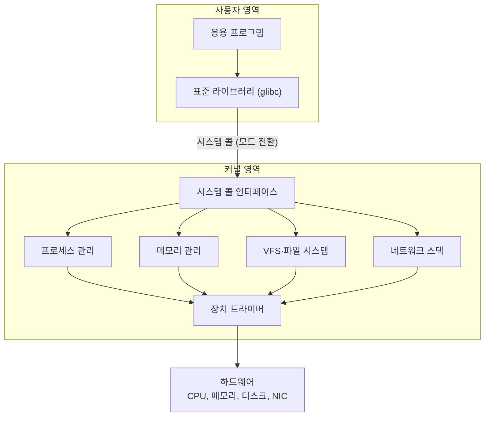

# 커널 (Kernel)

---

## I. 하드웨어와 응용 사이의 중재자, 커널의 개요

### 가. 정의

- [[OS(운영체제)|운영체제]]의 핵심으로, **커널 모드에서 상주하며 CPU·메모리·장치 등 자원을 관리하고 응용 프로그램에 시스템 콜 인터페이스를 제공**하는 프로그램

### 나. 특징

| 구분 | 내용 |
| --- | --- |
| 하드웨어 [[추상화]] | 장치 차이를 숨기고 일관된 시스템 콜·파일 인터페이스 제공 |
| 자원 관리 | [[CPU]] 시간, 메모리, 장치를 프로세스에 할당·회수 |
| 보호·격리 | 사용자 모드(Ring 3)와 커널 모드(Ring 0) 분리로 커널 영역 보호 |
| 상주 | 부팅 시 메모리에 적재되어 종료까지 상주 |

---

## II. 구조 및 구성요소

### 가. 커널 구조

- 응용은 시스템 콜로 커널 모드에 진입하고, 커널 서브시스템이 드라이버를 통해 하드웨어를 제어한 뒤 결과 반환

### 나. 구성요소

| 구분 | 요소 | 설명 |
| --- | --- | --- |
| 인터페이스 | 시스템 콜 | 사용자 프로세스가 커널 서비스를 요청하는 진입점 |
| 프로세스 관리 | [[스케줄링\|스케줄러]] | CPU 시간 분배 (Linux EEVDF) |
| | [[프로세스간 통신\|IPC]] | 파이프, 메시지 큐, 공유 메모리, 시그널 |
| 메모리 관리 | [[가상 메모리]] | 페이징, 페이지 교체, 주소 공간 관리 |
| 파일 관리 | VFS | ext4·XFS 등 여러 파일 시스템을 같은 인터페이스로 제공 |
| 입출력 | 장치 드라이버 | 장치별 제어, [[인터럽트]] 처리 |
| | 네트워크 스택 | 소켓, [[TCP]]/IP 처리 |
| 확장 | 적재 가능 모듈 (LKM) | 실행 중 드라이버·기능을 동적으로 적재 |
| | eBPF | 검증기를 통과한 프로그램을 커널 안에서 실행, 관측·네트워킹·보안 확장 |

---

## III. 비교 및 동향

### 가. 커널 구조 비교

| 비교 항목 | 모놀리식 커널 | 마이크로커널 | 하이브리드 커널 |
| --- | --- | --- | --- |
| 구조 | 모든 서비스를 커널 공간에서 실행 | 스케줄링·IPC·기본 메모리 관리만 커널, 나머지는 사용자 공간 서버 | 마이크로커널 구조에 주요 서비스를 커널 공간에 포함 |
| 성능 | 함수 호출로 처리, 빠름 | 서버 간 IPC 오버헤드 | 모놀리식에 가까움 |
| 안정성 | 드라이버 버그가 전체 장애로 이어짐 | 서버 장애가 격리됨 | 중간 |
| 사례 | Linux, 전통 UNIX | QNX, L4, MINIX 3, seL4 | Windows NT, macOS XNU |

### 나. 동향

- **eBPF 확산**: Cilium(네트워킹), Falco·Tetragon(보안), bpftrace(관측) 등 커널 수정 없는 기능 확장
- **Rust for Linux**: Linux 6.1에서 Rust 지원이 처음 병합, 이후 일부 신규 드라이버(예: NVIDIA GPU용 Nova)를 Rust로 작성하는 중
- **경량·검증 커널**: seL4는 기능 정확성을 형식 검증한 마이크로커널, 유니커널은 응용과 최소 커널을 단일 이미지로 결합

---

### 🔗 연관 토픽

- **소속 도메인**: [[00_운영체제_MOC|⚙️ 운영체제]]
- **세부 분류**: `1. 프로세스 & 스레드 관리`
- **핵심 연관 토픽**:
  - [[OS(운영체제)]]
  - [[운영체제 특권레벨|운영체제 특권레벨 (Privilege Levels)]]
  - [[프로세스 관리]]
  - [[인터럽트|인터럽트 (Interrupt)]]
  - [[바이너리 런타임]]
