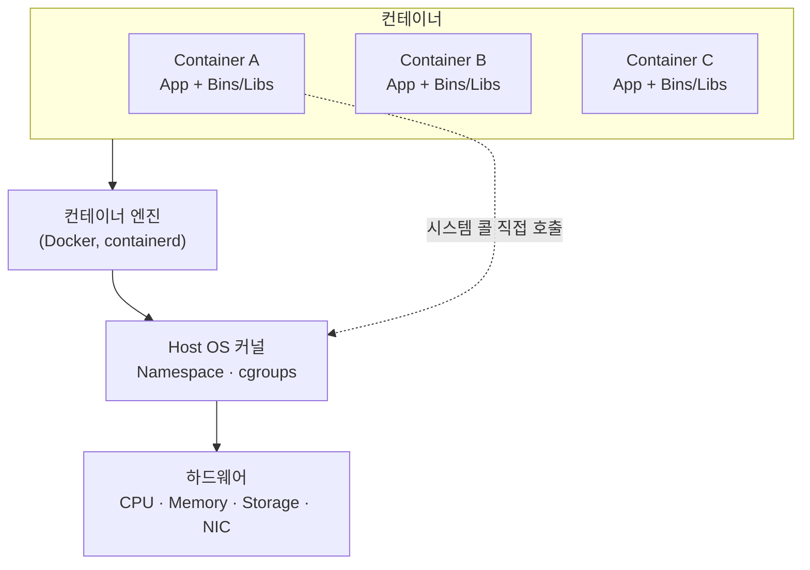

# 컨테이너 (Container)

---

## I. OS 수준 경량 가상화, 컨테이너의 개요

### 가. 정의

- 호스트 [[OS(운영체제)|OS]] 커널을 공유하면서 애플리케이션과 라이브러리·런타임을 **하나의 이미지로 패키징하여 격리된 프로세스로 실행**하는 OS 수준 [[가상화]] 기술

### 나. 특징

| 구분 | 내용 |
| --- | --- |
| 등장 배경 | VM의 Guest OS 오버헤드, [[MSA (Micro Service Architecture)\|MSA]] 확산에 따른 빠른 배포 요구 |
| 이식성 | "Build Once, Run Anywhere", 개발·운영 환경 불일치 해소 |
| 경량성 | Guest OS 부팅 생략, 수십 MB 수준 이미지, 빠른 기동 |
| 확장성 | 빠른 복제로 오토스케일링에 유리 |

---

## II. 구조 및 핵심 기술

### 가. 구조

- Guest OS 없이 호스트 [[커널]]을 공유하고, 엔진이 Namespace·cgroups로 각 컨테이너를 독립 프로세스처럼 격리

### 나. 핵심 기술

| 구분 | 요소 | 설명 |
| --- | --- | --- |
| 격리 | Namespace | [[프로세스]](PID)·네트워크·마운트·사용자·IPC 등의 가시성 분리 |
| 자원 제어 | cgroups | 컨테이너별 [[CPU]]·메모리·디스크 I/O 사용량 제한 |
| 파일 시스템 | UnionFS / OverlayFS | 읽기 전용 이미지 레이어 + 쓰기 레이어 계층 구조 |
| 표준 | OCI (Open Container Initiative) | 런타임(runc)·이미지 포맷·배포 규격 표준 |
| 런타임 | containerd, CRI-O | 생명주기·이미지 관리 고수준 런타임, Kubernetes CRI 호환 |
| 보안 | Seccomp | 허용된 시스템 콜만 호출하도록 필터링 |
| | AppArmor / SELinux | [[MAC]](강제적 접근통제)으로 호스트 자원 접근 제한 |
| 이미지 | Container Image | 애플리케이션과 의존성을 담은 읽기 전용 템플릿, Dockerfile로 정의 |

---

## III. 비교 및 동향

### 가. 컨테이너 vs 가상머신

| 비교 항목 | 컨테이너 | 가상머신 |
| --- | --- | --- |
| 가상화 수준 | OS 수준 | 하드웨어 수준 ([[Hypervisor (VMM)\|Hypervisor]]) |
| 커널 | 모든 컨테이너가 호스트 커널 공유 | VM별 독립 Guest OS 커널 |
| 크기 | MB 단위 | GB 단위 |
| 기동 | ms ~ 초 단위 | 분 단위 |
| 격리 · 보안 | 프로세스 수준, 커널 취약점 공유 | 하드웨어 수준 격리 |
| 활용 | MSA, CI/CD, [[클라우드 네이티브]] | 모놀리식 앱, 이기종 OS, 높은 격리 요구 |

### 나. 동향

- **오케스트레이션 표준**: [[쿠버네티스|Kubernetes]]가 배포·스케일링·네트워킹 자동화의 사실상 표준
- **샌드박스 컨테이너**: 커널 공유 약점을 보완하는 MicroVM 기반 Kata Containers·Firecracker, 사용자 공간 커널 방식의 gVisor 도입
- **Wasm 워크로드**: OS·CPU 아키텍처 독립적인 WebAssembly를 서버 측 런타임으로 쓰는 시도 (containerd runwasi 등), 컨테이너를 보완하는 형태

---

### 🔗 연관 토픽

- **소속 도메인**: [[00_디지털서비스_MOC|🚀 디지털서비스]]
- **세부 분류**: `1. 클라우드 컴퓨팅 & 가상화 인프라`
- **핵심 연관 토픽**:
  - [[가상화]]
  - [[도커|도커 (Docker)]]
  - [[쿠버네티스|쿠버네티스(Kubernates)]]
  - [[Hypervisor (VMM)]]
  - [[클라우드 네이티브]]
