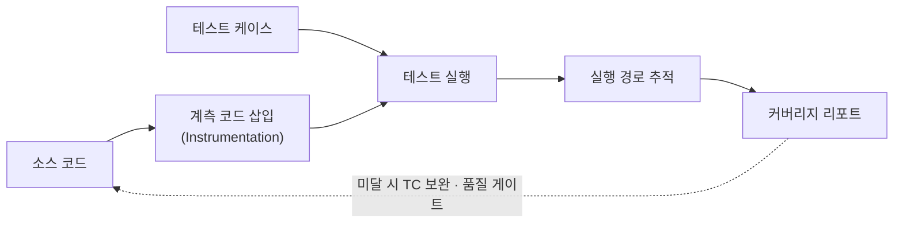

# 코드 커버리지 (Code Coverage) / 테스트 커버리지

---

## I. 테스트 충분성의 정량 지표, 코드 커버리지의 개요

### 가. 정의

- **테스트 커버리지**: 테스트가 대상(요구사항·기능·코드)을 얼마나 검증했는지 나타내는 정도
- **코드 커버리지**: 그중 소스 코드 기준으로, 테스트 실행 시 **실행된 구문·분기·조건의 비율(%)** 을 측정하는 [[화이트박스 테스트]] 지표

### 나. 필요성 및 특징

| 구분 | 내용 |
| --- | --- |
| 완전성 검증 | 테스트 누락 영역과 미실행 코드(Dead Code) 식별 |
| 규제 준수 | 안전 필수 시스템의 구조적 커버리지 요구 ([[ISO 26262]], DO-178C) |
| 품질 게이트 | CI/CD에서 기준치 미달 시 병합·배포 차단, 테스트 종료 기준 ([[Test Exit Criteria]]) |
| 한계 | 100% 커버리지가 결함 0을 보장하지 않음 (검증 여부가 아닌 실행 여부만 측정) |

### 다. 테스트 커버리지의 유형

| 유형 | 측정 대상 |
| --- | --- |
| 기능 커버리지 | 명세된 기능 중 테스트된 비율 |
| 요구사항 커버리지 | 요구사항 대비 TC 매핑 비율 (RTM) |
| 코드 커버리지 | 구문·분기·조건·경로의 실행 비율 |

---

## II. 측정 원리 및 코드 커버리지 기법

### 가. 측정 흐름

- 측정 도구(JaCoCo, Coverage.py, SonarQube 등)가 프로브를 삽입하고 실행된 구문·분기를 수집해 비율 산출

### 나. 구조적 커버리지 기법

| 기법 | 기준 | 설명 |
| --- | --- | --- |
| 구문 (Statement) | 모든 [[명령문]] 1회 이상 실행 | 가장 약한 기준 |
| 결정 (Decision / Branch) | 각 조건문 전체 결과가 참·거짓을 모두 가짐 | 구문 커버리지 포함 |
| 조건 (Condition) | 개별 조건식이 각각 참·거짓을 모두 가짐 | 결정 커버리지를 보장하지 않음 |
| 조건/결정 (C/D) | 결정과 조건 기준을 동시에 만족 | |
| MC/DC | 각 개별 조건이 전체 결과에 **독립적으로 영향**을 주는지 확인 | 조건 수 N에 대해 최소 N+1개 TC, 항공·자동차 필수 |
| 다중 조건 | 개별 조건의 모든 조합 ($2^n$) | 비용 매우 큼 |
| 경로 (Path) | 가능한 모든 실행 경로 | 반복문으로 현실적으로 불가능한 경우 많음 |
| 데이터 흐름 | 변수의 정의–사용(DU) 경로 | 제어 흐름 기준 보완 |

---

## III. 기법 비교 및 동향

### 가. 결정 vs 조건 vs MC/DC

| 비교 항목 | 결정 (Branch) | 조건 (Condition) | MC/DC |
| --- | --- | --- | --- |
| 검증 대상 | 조건문 전체 결과 | 개별 조건식 결과 | 개별 조건의 독립적 영향 |
| 한계 | 내부 개별 조건 오류 누락 가능 | 전체 결과의 일부 누락 가능 | 비용·설계 난이도 높음 |
| 포함 관계 | 구문 포함 | 구문·결정 미보장 | 구문·결정·조건 모두 포함 |
| 적용 분야 | 일반 업무 시스템 | 복잡한 논리 모듈 | 항공(DO-178C), 자동차([[ISO 26262]]), 원자력 |

### 나. 동향

- **[[뮤테이션 테스트]]**: 의도적 결함(Mutant)을 주입해 테스트가 이를 잡아내는지 측정 → 커버리지의 질적 한계 보완
- **AI 기반 테스트 생성**: [[초거대 언어 모델\|LLM]]이 미실행 분기를 분석해 TC를 자동 생성
- **[[DevSecOps]] 품질 게이트**: 병합 전 커버리지 임계치(예: 80%) 자동 점검
- **AI 모델 대상 커버리지**: 뉴런 활성화 비율을 보는 뉴런 커버리지 등 [[딥러닝]] 검증 지표 연구 ([[ISO 29119-11]])

---

### 🔗 연관 토픽

- **소속 도메인**: [[00_소프트웨어공학_MOC|🏗️ 소프트웨어공학]]
- **세부 분류**: `6. 소프트웨어 테스팅 & 품질 보증 (QA/QC)`
- **핵심 연관 토픽**:
  - [[화이트박스 테스트]]
  - [[소프트웨어 테스트|소프트웨어 테스트 (Software Test)]]
  - [[단위 테스트]]
  - [[뮤테이션 테스트]]
  - [[Test Exit Criteria]]
