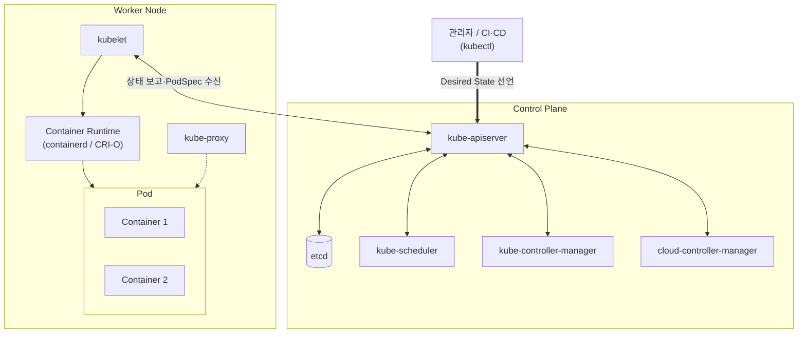

# 쿠버네티스 (Kubernetes, K8s)

---

## I. 컨테이너 오케스트레이션 표준, 쿠버네티스의 개요

### 가. 정의

- 컨테이너화된 애플리케이션의 **배포·스케일링·로드밸런싱·자동 복구를 선언적(Declarative) 방식으로 자동화**하는 오픈소스 오케스트레이션 플랫폼 (Google Borg 기반, 2014년 공개, CNCF 관리)

### 나. 특징

| 구분 | 내용 |
| --- | --- |
| 등장 배경 | [[MSA (Micro Service Architecture)\|MSA]] 확산으로 수백~수천 개 컨테이너의 수동 관리 한계 |
| 선언적 API | 원하는 상태(Desired State)를 선언하면 제어 루프가 현재 상태를 일치시킴 |
| 자가 치유 | 장애 컨테이너 재시작·재배치(Self-healing), [[HA(High Availability)\|고가용성]] |
| 무중단 배포 | Rolling Update, 롤백 지원 ([[무중단 배포]]) |
| 확장성 | CRI·CNI·CSI 표준 인터페이스, CRD로 API 확장 |
| 이식성 | 인프라 [[추상화]], 온프레미스·멀티클라우드 어디서나 동일 운영 |

---

## II. 아키텍처 및 구성요소

### 가. 아키텍처

- kubectl로 선언한 상태가 apiserver를 거쳐 etcd에 저장되고, 스케줄러·컨트롤러가 배치를 결정하면 노드의 kubelet이 런타임으로 Pod를 실행해 실제 상태를 맞춤

### 나. 구성요소

| 구분 | 요소 | 설명 |
| --- | --- | --- |
| Control Plane | kube-apiserver | 모든 컴포넌트 통신의 허브, REST API 제공 |
| | etcd | 클러스터 상태를 저장하는 분산 키-값 저장소 (Raft 합의, 일관성 우선) |
| | kube-scheduler | 자원 요구량·Affinity·Taint 등을 고려해 Pod를 노드에 배치 |
| | controller-manager | Deployment·ReplicaSet·Node 등 리소스를 원하는 상태로 수렴시키는 제어 루프 |
| Worker Node | kubelet | PodSpec에 따라 컨테이너 실행·헬스체크 |
| | kube-proxy | Service 가상 IP로의 트래픽 라우팅 (iptables, IPVS) |
| | Container Runtime | CRI 호환 OCI 런타임 (containerd, CRI-O) |
| 오브젝트 | Pod / Deployment / Service | 최소 배포 단위 / 복제·롤링 업데이트 관리 / 안정적 접근 엔드포인트 |
| 확장 인터페이스 | CNI / CSI | 네트워크 플러그인(Calico, Cilium) / 스토리지 플러그인 연동 표준 |

---

## III. 비교 및 동향

### 가. 쿠버네티스 vs 오픈스택

| 비교 항목 | 쿠버네티스 | [[오픈 스택 프로젝트\|오픈스택]] |
| --- | --- | --- |
| 관리 단위 | [[컨테이너]], Pod | 가상 머신 (Instance) |
| [[가상화]] 수준 | OS [[커널]] 공유, [[프로세스]] 격리 | [[Hypervisor (VMM)\|하이퍼바이저]](KVM) 기반 하드웨어 가상화 |
| 기동 속도 | 초 단위 이하 | 분 단위 (OS 부팅) |
| 오버헤드 | 작음 (Guest OS 없음) | 큼 (VM별 OS) |
| 네트워크 | 플랫한 Pod-to-Pod 네트워크 (CNI) | 가상 네트워크 (Neutron) |
| 주요 활용 | MSA, [[클라우드 네이티브]] 앱, AI 워크로드 | IaaS, 레거시 VM 운영 |

- 경쟁보다 결합 관계: 오픈스택(IaaS) 위에 쿠버네티스를 올리거나, KubeVirt로 쿠버네티스에서 VM 관리

### 나. 동향

- **eBPF 네트워킹**: kube-proxy(iptables) 대신 커널 수준에서 패킷을 처리하는 Cilium 확산
- **AI 워크로드**: DRA(Dynamic Resource Allocation)로 [[GPU]] 할당 세분화, Kueue 기반 배치 작업 큐잉, [[초거대 언어 모델\|LLM]] 서빙 지원 확대
- **Gateway API**: Ingress를 대체하는 표준 트래픽 라우팅 API로 이행

---

### 🔗 연관 토픽

- **소속 도메인**: [[00_디지털서비스_MOC|🚀 디지털서비스]]
- **세부 분류**: `1. 클라우드 컴퓨팅 & 가상화 인프라`
- **핵심 연관 토픽**:
  - [[컨테이너|컨테이너 (Container)]]
  - [[도커|도커 (Docker)]]
  - [[클라우드 네이티브]]
  - [[HPA (Horizontal Pod Autoscaler)]]
  - [[MSA (Micro Service Architecture)|MSA]]
