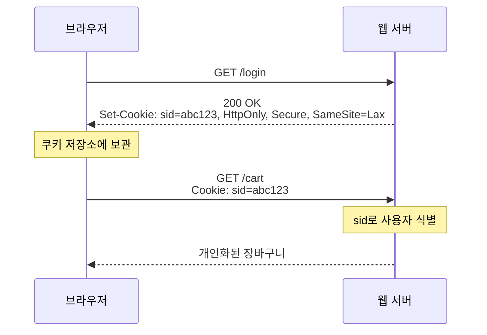

# HTTP 쿠키 (Cookie)

---

## I. 브라우저에 남기는 작은 상태 정보, HTTP 쿠키의 개요

### 가. 정의

- 서버가 `Set-Cookie` 헤더로 브라우저에 저장시키고, **브라우저가 이후 같은 도메인 요청마다 `Cookie` 헤더로 자동 전송하는 이름=값 형태의 소규모 상태 정보** (RFC 6265)

### 나. 특징

| 구분 | 내용 |
| --- | --- |
| 상태 유지 | 무상태 HTTP에서 로그인 [[세션]], 장바구니, 개인화 설정 유지 |
| 자동 전송 | 조건(도메인·경로·보안 속성)에 맞으면 요청마다 자동 포함 |
| 크기 제한 | 쿠키 1개당 약 4KB, 도메인당 개수 제한 |
| 보안 위협 | 스니핑, [[XSS]]를 통한 탈취, [[CSRF]] 악용 |
| 프라이버시 | 서드파티 쿠키 기반 교차 사이트 추적 → 규제(GDPR, ePrivacy) 대상 |

---

## II. 동작 구조 및 속성

### 가. 발급 및 전송 흐름

- 서버는 응답 헤더로 쿠키를 심고, 브라우저는 범위·속성 조건에 맞는 이후 요청에 쿠키를 자동으로 붙여 보냄

### 나. 주요 속성

| 구분 | 요소 | 설명 |
| --- | --- | --- |
| 헤더 | Set-Cookie / Cookie | 서버의 저장 지시(응답), 브라우저의 전달(요청) |
| 수명 | 세션 쿠키 / 영속 쿠키 | `Expires`·`Max-Age`가 없으면 브라우저 종료 시 삭제, 있으면 만료 시까지 보관 |
| 범위 | Domain / Path | 쿠키를 보낼 도메인·경로 제한 |
| 보안 | HttpOnly | `document.cookie` 접근 차단, XSS 탈취 완화 |
| | Secure | HTTPS 요청에만 전송 |
| | SameSite | 교차 사이트 요청 시 전송 제한 (Strict · Lax · None), CSRF 완화 |
| | `__Host-` 접두어 | Secure·Path=/·Domain 미지정 강제로 하위 도메인 덮어쓰기 방지 |
| 발급 주체 | 퍼스트 파티 | 방문 중인 사이트가 발급, 로그인·설정 유지 |
| | 서드 파티 | 다른 도메인(광고·분석)이 발급, 교차 사이트 추적 |

---

## III. 비교 및 동향

### 가. 쿠키 vs 웹 스토리지

| 비교 항목 | 쿠키 | Local Storage | Session Storage |
| --- | --- | --- | --- |
| 용량 | 쿠키당 약 4KB | 출처당 약 5MB (브라우저별 상이) | 출처당 약 5MB |
| 서버 전송 | 요청마다 자동 포함 | 전송 안 함 | 전송 안 함 |
| 수명 | 만료 설정에 따름 | 직접 삭제 전까지 유지 | 탭 종료 시 삭제 |
| 스크립트 접근 | HttpOnly면 불가 | 가능 (XSS에 노출) | 가능 |
| 용도 | 세션 ID, 인증 | UI 설정, 캐시 | 탭 단위 임시 데이터 |

### 나. 동향

- **서드파티 쿠키 제한**: Safari(ITP)·Firefox(Total Cookie Protection)는 기본 차단, Chrome은 폐지 계획을 철회하고 서드파티 쿠키를 유지 (2025)
- **파티션 쿠키 (CHIPS)**: 최상위 사이트별로 쿠키를 분리 저장하는 `Partitioned` 속성 도입
- **인증 방식 다변화**: 세션 쿠키와 함께 JWT·OAuth 2.0, 패스키 기반 인증 확대

---

### 🔗 연관 토픽

- **소속 도메인**: [[00_네트워크_MOC|🌐 네트워크]]
- **세부 분류**: `1. OSI 7계층 & 데이터링크 계층 (L1/L2)`
- **핵심 연관 토픽**:
  - [[세션]]
  - [[XSS|크로스 사이트 스크립팅]]
  - [[CSRF]]
  - [[스위치 (Layer 7 Switch)]]
  - [[제로 트러스트 보안모델|Zero Trust]]
