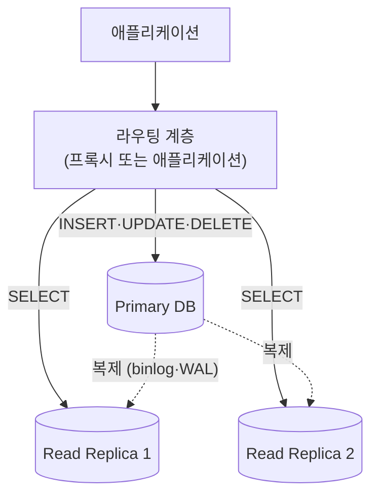

# 쿼리 오프로딩 (Query Offloading)

---

## I. 읽기는 복제본으로, 쿼리 오프로딩의 개요

### 가. 정의

- **쓰기 트랜잭션은 원본(Primary) DB에서, 읽기 쿼리는 복제본(Read Replica)에서 처리하도록 분리해 원본 DB의 부하를 줄이는 성능 확장 기법** (Read/Write Splitting)

### 나. 필요성 및 특징

| 구분 | 내용 |
| --- | --- |
| 부하 분산 | 조회가 많은 서비스에서 원본 DB의 CPU·I/O 부하 경감 |
| 확장성 | 복제본 추가로 읽기 처리량 수평 확장 |
| 간섭 감소 | 대용량 조회·리포트가 운영 [[트랜잭션]]에 주는 영향 축소 |
| 제약 | 비동기 복제 지연(Replication Lag)으로 방금 쓴 데이터가 복제본에 없을 수 있음 |

---

## II. 구조 및 구성요소

### 가. 오프로딩 구조

- 라우팅 계층이 SQL 유형에 따라 원본·복제본으로 분기하고, 복제본은 원본의 로그를 받아 재현

### 나. 구성요소

| 구분 | 요소 | 설명 |
| --- | --- | --- |
| 분기 | Read/Write Splitting | SQL 유형별로 대상 DB 결정 |
| 라우팅 | 프록시 방식 | ProxySQL, MaxScale, RDS Proxy 등 중간 계층에서 투명하게 분기 |
| | 애플리케이션 방식 | Spring `AbstractRoutingDataSource`, 읽기 전용 트랜잭션 표시로 DataSource 전환 |
| 동기화 | 복제 | MySQL binlog, PostgreSQL WAL 스트리밍 (비동기·반동기) |
| 정합성 | 지연 감시 | 복제 지연이 임계치를 넘으면 원본으로 우회, 쓰기 직후 읽기는 원본 사용 |
| 분산 | 부하 분산 | 복제본 간 라운드로빈·최소 연결 |
| 가용성 | 자동 장애 조치 | 원본 장애 시 복제본을 원본으로 승격 ([[HA(High Availability)\|고가용성]]) |
| 상태 관리 | 헬스 체크 | 장애·지연 복제본을 라우팅 대상에서 제외 |

---

## III. 비교 및 동향

### 가. 프록시 방식 vs 애플리케이션 방식

| 비교 항목 | 프록시 방식 | 애플리케이션 방식 |
| --- | --- | --- |
| 위치 | 애플리케이션과 DB 사이 별도 계층 | 애플리케이션 코드·프레임워크 |
| 장점 | DB 구성 변경 시 앱 수정 불필요 | 추가 인프라 불필요 |
| 단점 | 프록시 이중화 필요, 홉 추가 | 구성 변경 시 앱 재배포 |
| 예 | ProxySQL, RDS Proxy | Spring, MyBatis 라우팅 |

### 나. 동향

- **클라우드 관리형 기능**: Aurora·Cloud SQL이 읽기 전용 엔드포인트와 자동 부하 분산 제공 ([[클라우드 네이티브]])
- **CQRS**: DB 수준 분리를 넘어 쓰기 모델과 조회 모델 자체를 분리 ([[MSA (Micro Service Architecture)|MSA]])
- **분석 오프로딩**: 분석 질의는 CDC로 DW·레이크하우스에 옮겨 처리 ([[데이터 레이크하우스]])

---

### 🔗 연관 토픽

- **소속 도메인**: [[00_데이터베이스_MOC|🗄️ 데이터베이스]]
- **세부 분류**: `2. 트랜잭션 & 동시성 제어 (Concurrency)`
- **핵심 연관 토픽**:
  - [[DB 성능 개선 방안]]
  - [[분산 데이터베이스]]
  - [[샤딩]]
  - [[HA(High Availability)]]
  - [[OLTP]]
