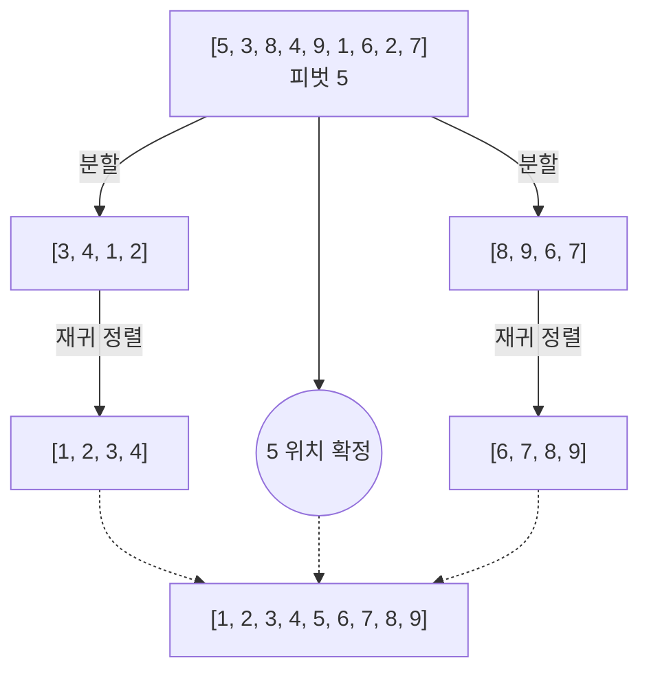

# 퀵 정렬 (Quick Sort)

---

## I. 피벗으로 나누어 정복하는, 퀵 정렬의 개요

### 가. 정의

- **피벗(Pivot)을 기준으로 작은 값과 큰 값으로 분할(Partition)한 뒤 각 부분을 재귀적으로 정렬**하는 분할 정복 정렬 [[알고리즘]] (C. A. R. Hoare, 1959~1961)

### 나. 특징

| 구분 | 내용 |
| --- | --- |
| 빠른 평균 성능 | 평균 O(n log n), 상수 계수가 작고 [[캐시 메모리\|캐시]] 친화적이라 실측이 빠름 |
| 제자리 정렬 | 배열 안에서 교환, 추가 공간은 재귀 스택 O(log n) (평균) |
| 불안정 정렬 | 분할 중 교환으로 같은 값의 순서가 바뀔 수 있음 |
| 최악 O(n²) | 피벗이 매번 최솟값·최댓값이면 한쪽으로 치우친 분할 |

---

## II. 동작 및 구성요소

### 가. 동작 원리

- 분할이 끝나면 피벗은 최종 위치에 고정되며, 병합 단계 없이 좌우 부분만 정렬하면 완료

### 나. 구성요소

| 구분 | 요소 | 설명 |
| --- | --- | --- |
| 패러다임 | 분할 정복 | 분할(Partition)에 일이 몰리고 결합 단계는 없음 |
| 피벗 | 선택 방식 | 첫·마지막·중간 원소, 난수, 세 값의 중앙값(Median-of-Three) |
| 분할 | Hoare 방식 | 양 끝 포인터를 마주 보며 이동·교환, 교환 횟수 적음 |
| | Lomuto 방식 | 한 방향 포인터, 구현 단순하나 교환 많음 |
| 복잡도 | 평균·최선 O(n log n) | 균등 분할 시 깊이 log n × 레벨당 n |
| | 최악 O(n²) | 정렬·역정렬된 입력에서 첫·끝 원소를 피벗으로 쓸 때 등 |
| | 공간 | 평균 O(log n), 짧은 쪽을 먼저 재귀하면 최악에도 O(log n) |
| 안정성 | 불안정 | 원거리 교환 발생 |

---

## III. 비교 및 동향

### 가. 퀵 정렬 vs 병합 정렬

| 비교 항목 | 퀵 정렬 | [[병합 정렬\|병합 정렬 (Merge Sort)]] |
| --- | --- | --- |
| 일이 몰리는 단계 | 분할 | 병합 |
| 시간 | 평균 O(n log n), 최악 O(n²) | 항상 O(n log n) |
| 추가 공간 | O(log n) 스택 | O(n) 임시 배열 (배열 기준) |
| 안정성 | 불안정 | 안정 |
| 적합 | 메모리 내 배열 정렬 | 연결 리스트, 외부 정렬, 안정성 필요 시 |

### 나. 동향

- **최악 회피 기법**: Median-of-Three, 무작위 피벗으로 치우친 분할 확률 감소
- **하이브리드 정렬**: Introsort(C++ std::sort)는 재귀가 깊어지면 힙 정렬로 바꾸고 작은 구간은 [[삽입 정렬]]로 처리, pdqsort(Rust 불안정 정렬 등)는 패턴 감지로 최악 입력 회피
- **Dual-Pivot Quicksort**: 피벗 2개로 3분할, Java 기본형 배열 정렬(Arrays.sort)에 사용

---

### 🔗 연관 토픽

- **소속 도메인**: [[00_컴퓨터구조_MOC|💻 컴퓨터구조]]
- **세부 분류**: `2. 캐시 & 메모리 계층 구조 · 스토리지`
- **핵심 연관 토픽**:
  - [[병합 정렬|병합 정렬 (Merge Sort)]]
  - [[삽입 정렬|삽입 정렬 (Insertion Sort)]]
  - [[힙|힙 (Heap)]]
  - [[알고리즘 성능평가]]
  - [[O-Notation (O-표기법)]]
