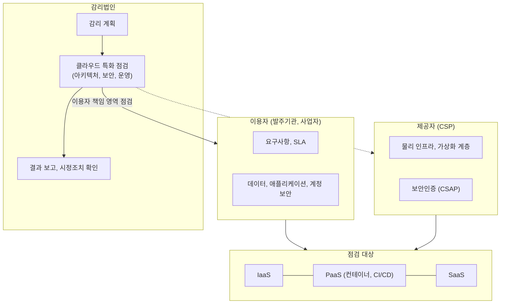

# 클라우드 감리 (Cloud Audit)

---

## I. 공동 책임 모델 기반 점검, 클라우드 감리의 개요

### 가. 정의

- [[클라우드 컴퓨팅]](IaaS·[[PaaS]]·SaaS) 기반 정보화 사업의 도입·구축·운영 전반을 **공동 책임 모델에 따라** 효율성·안전성·보안성 관점에서 점검하는 감리

### 나. 등장 배경 및 특징

| 구분 | 내용 |
| --- | --- |
| 배경 | 공공 부문 클라우드 전환 확대, [[클라우드 네이티브]] 사업 증가 |
| 책임 경계 | 이용자(CSC)와 제공자([[CSP]])의 책임 범위가 서비스 모델별로 다름 |
| 점검 대상 변화 | 물리 장비 대신 가상 자원, 설정, API, IaC |
| 준거 기준 | 클라우드컴퓨팅법, [[CSAP]](클라우드 보안인증), [[ISMS-P]], [[SLA]] |

---

## II. 점검 구조와 구성요소

### 가. 개념도

- 이용자 책임 영역은 직접 점검하고, 제공자 책임 영역은 보안인증·SLA·감사 보고서 등 증적으로 확인

### 나. 핵심 점검 요소

| 구분 | 요소 | 설명 |
| --- | --- | --- |
| 거버넌스 | SLA | [[HA(High Availability)\|가용성]], [[응답시간]], 장애 보상 등 서비스 수준 협약 적정성 |
| | 컴플라이언스 | CSAP 인증 서비스 이용, 개인정보·국가 정보 보호 기준 준수 |
| 아키텍처 | 클라우드 네이티브 | [[MSA (Micro Service Architecture)\|MSA]], [[컨테이너]]·[[쿠버네티스]], 서버리스 설계 적정성 |
| | 탄력성 | 오토스케일링 정책, 부하 분산, 부하 시험으로 확장성 검증 |
| 보안 | 공동 책임 모델 | 서비스 모델별 책임 경계 명시와 이용자 통제 이행 |
| | [[IAM]] | 최소 권한, MFA, 네트워크 분리(VPC·보안그룹), [[제로 트러스트 보안모델\|제로 트러스트]] |
| 데이터 | [[암호화]]·백업 | 전송·저장 암호화, [[KMS]] 키 관리, 백업·재해복구 |
| 운영 | 배포·모니터링 | [[DevSecOps]] 파이프라인, IaC 형상 관리, 통합 로깅·모니터링 |
| 비용 | 자원 최적화 | 과다 할당·유휴 자원, 비용 모니터링(FinOps) |

---

## III. 비교 및 동향

### 가. 전통적 감리 vs 클라우드 감리

| 비교 항목 | 전통적 [[정보시스템 감리]] | 클라우드 감리 |
| --- | --- | --- |
| 대상 인프라 | 온프레미스 물리 서버·네트워크 | 가상화·서비스형 자원 |
| 책임 | 발주기관·사업자 | CSP와 CSC 공동 책임 |
| 확장성 점검 | 장비 사양 중심 Scale-up | 오토스케일링 중심 Scale-out |
| 점검 방식 | 장비·구성 직접 확인 | 콘솔·API, IaC 템플릿, 인증 증적 확인 |
| 주요 기준 | 감리기준, 감리 점검 해설서 | 감리기준 + CSAP, 클라우드 이용 기준 |

### 나. 동향

- **상시 점검**: CSPM 등 자동화 도구로 설정 오류를 지속 탐지 ([[CWPP & CSPM]])
- **IaC 사전 점검**: 배포 전 파이프라인에서 IaC 설정 오류·취약점 검사 (Shift-Left)
- **멀티클라우드**: 다수 CSP 간 정책 일관성과 데이터 이동성 점검 ([[멀티클라우드]])

---

### 🔗 연관 토픽

- **소속 도메인**: [[00_프로젝트관리_MOC|📋 프로젝트관리]]
- **세부 분류**: `4. 품질 보증 · 위험 관리 & 정보시스템 감리`
- **핵심 연관 토픽**:
  - [[정보시스템 감리 프레임워크|정보시스템 감리 프레임워크 (Information System Audit Framework)]]
  - [[CSAP]]
  - [[클라우드 네이티브]]
  - [[CWPP & CSPM]]
  - [[CSP|CSP (Cloud Service Provider)]]
