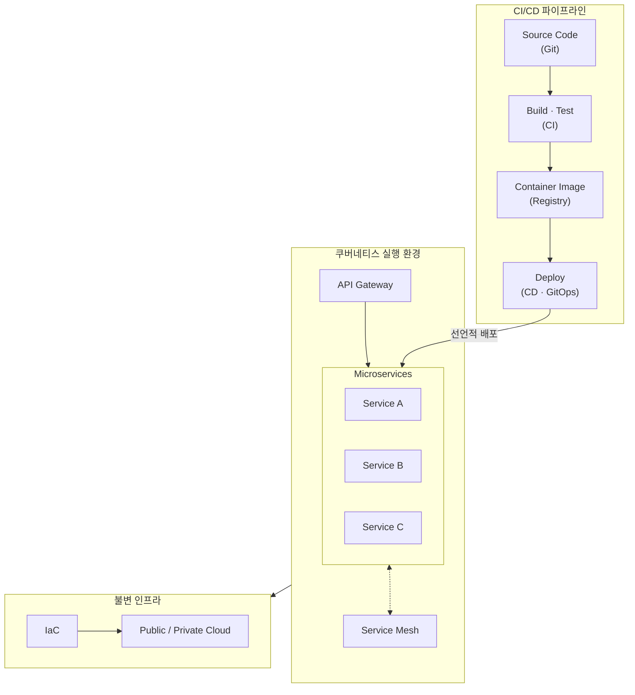

# 클라우드 네이티브 (Cloud Native)

---

## I. 클라우드에서 태어난 애플리케이션, 클라우드 네이티브의 개요

### 가. 정의

- [[클라우드 컴퓨팅]]의 확장성·탄력성을 전제로 **[[MSA (Micro Service Architecture)|MSA]]·[[컨테이너]]·선언적 API·자동화된 배포**를 활용해 애플리케이션을 설계·운영하는 방식 (CNCF 정의 기반)

### 나. 특징

| 구분 | 내용 |
| --- | --- |
| 등장 배경 | 출시 주기(TTM) 단축 요구, 모놀리식 구조의 확장·배포 한계 |
| 민첩성 | 서비스 단위 독립 배포, 잦은 릴리스 |
| 탄력성 | 부하에 따른 자동 확장·축소 |
| 복원력 | 장애 격리(Fault Isolation), 자동 복구로 [[HA(High Availability)\|고가용성]] |
| 이식성 | 컨테이너·쿠버네티스 표준으로 벤더 종속 최소화 |

---

## II. 구조 및 핵심 기술

### 가. 개념도

- 코드가 CI/CD로 컨테이너 이미지가 되고, 선언적 API로 [[쿠버네티스]] 위 마이크로서비스에 자동 배포·운영

### 나. 핵심 기술

| 구분 | 요소 | 설명 |
| --- | --- | --- |
| 아키텍처 | MSA | 비즈니스 기능 단위로 독립 배포 가능한 소규모 서비스 분할 |
| 패키징 | [[컨테이너]] | 애플리케이션과 의존성을 하나의 이미지로 묶어 일관성 확보 |
| 운영 | 오케스트레이션 (K8s) | 배포·스케일링·자동 복구 자동화 |
| | 선언적 API | 원하는 상태를 명시하면 시스템이 현재 상태를 맞춤 |
| 프로세스 | [[DevOps]] · CI/CD | 개발·운영 통합, 지속적 통합·배포 |
| 통신 | Service Mesh | 사이드카 프록시로 서비스 간 라우팅·mTLS·관측 [[추상화]] |
| 인프라 | 불변 인프라 · IaC | 서버를 수정하지 않고 교체, 인프라를 코드로 버전 관리 |
| 관측 | Observability | 로그·메트릭·트레이스 통합 (OpenTelemetry) |

---

## III. 비교 및 동향

### 가. Cloud Based (Lift & Shift) vs Cloud Native

| 비교 항목 | Cloud Based (Lift & Shift) | Cloud Native |
| --- | --- | --- |
| 개념 | 기존 시스템을 그대로 클라우드로 이전 | 클라우드에 맞게 재설계 |
| 아키텍처 | 모놀리식 | 마이크로서비스 |
| 실행 단위 | 가상 머신 | 컨테이너, 서버리스 |
| 인프라 상태 | 가변 (패치·업데이트) | 불변 (폐기 후 재생성) |
| 배포 | 수동·정기 배포 | CI/CD 자동·무중단 배포 |

### 나. 동향

- **플랫폼 엔지니어링**: 내부 개발자 플랫폼(IDP, Backstage)으로 쿠버네티스 복잡성을 감추고 셀프서비스 제공
- **AI 워크로드 수용**: Kubeflow·KServe 등 [[MLOps]]와 GPU [[스케줄링]]을 쿠버네티스 위에서 운영
- **FinOps**: 동적 자원 할당에 따른 비용 가시화·최적화를 개발 단계부터 반영

---

### 🔗 연관 토픽

- **소속 도메인**: [[00_디지털서비스_MOC|🚀 디지털서비스]]
- **세부 분류**: `1. 클라우드 컴퓨팅 & 가상화 인프라`
- **핵심 연관 토픽**:
  - [[쿠버네티스|쿠버네티스(Kubernetes)]]
  - [[컨테이너|컨테이너 (Container)]]
  - [[MSA (Micro Service Architecture)]]
  - [[DevOps]]
  - [[클라우드 컴퓨팅|클라우드 컴퓨팅 (Cloud Computing)]]
