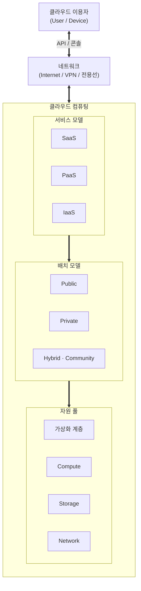

# 클라우드 컴퓨팅 (Cloud Computing)

---

## I. 소유에서 이용으로, 클라우드 컴퓨팅의 개요

### 가. 정의

- 네트워크를 통해 공유된 IT 자원 풀(서버·스토리지·SW 등)을 **필요할 때 즉시(On-Demand) 할당받고 사용량만큼 비용을 지불(Pay-as-you-go)** 하는 컴퓨팅 모델 (NIST SP 800-145)

### 나. 특징 (NIST 5대 특성)

| 구분 | 내용 |
| --- | --- |
| 주문형 셀프서비스 | 제공자 개입 없이 이용자가 직접 자원 할당 |
| 광대역 네트워크 접근 | 다양한 단말에서 표준 네트워크로 접근 |
| 자원 풀링 | 다중 테넌트가 물리 자원을 공유, 위치 독립성 |
| 신속한 탄력성 | 수요에 따라 빠르게 확장·축소 |
| 측정 가능한 서비스 | 사용량 측정·과금·보고 |

---

## II. 구조 및 핵심 기술

### 가. 개념도

- 이용자는 서비스 모델(IaaS·[[PaaS]]·SaaS) 단위로 자원을 쓰고, 하부 [[가상화]] 계층이 물리 자원을 논리 풀로 묶어 다중 테넌트에 격리 할당 ([[클라우드 컴퓨팅의 배치 모델 유형|배치 모델]], [[XaaS]])

### 나. 핵심 기술

| 구분 | 요소 | 설명 |
| --- | --- | --- |
| 자원 공유 | 가상화 | 서버·스토리지·네트워크의 논리적 분할·통합 |
| | 멀티 테넌시 | 하나의 인프라·[[인스턴스]]를 여러 이용자가 격리된 상태로 공유 |
| 자원 관리 | [[프로비저닝]] | 요청에 따른 [[CPU]]·메모리·스토리지 자동 할당 |
| | 오토스케일링 | 부하에 따라 Scale-out/in ([[Auto Scale Up Auto Scale Out]]) |
| 인프라 제어 | SDx | [[SDN(Software Defined Network)\|SDN]]·SDS 등 소프트웨어로 인프라 제어 |
| 과금 | Metering · Billing | 사용량 측정과 종량제 과금 |
| 보안 | [[IAM]] · VPC | 권한 제어, 가상 사설 네트워크로 테넌트 격리 |

---

## III. 비교 및 동향

### 가. 온프레미스 vs 클라우드

| 비교 항목 | 온프레미스 | 클라우드 |
| --- | --- | --- |
| 비용 구조 | 하드웨어 구매·소유 (CapEx) | 임대·구독 (OpEx) |
| 확장 | Scale-up 중심, 최대 부하 기준 과잉 구매 | Scale-out/in, 탄력적 확장 |
| 구축 기간 | 수 주 ~ 수 개월 (발주·설치) | 수 분 (셀프서비스) |
| 운영 책임 | 자사가 하드웨어부터 앱까지 관리 | [[CSP]]와 이용자의 공동 책임 모델 |
| 보안 모델 | 물리적 경계 보안 | VPC 논리적 격리, [[제로 트러스트 보안모델\|제로 트러스트]] |

### 나. 동향

- **[[클라우드 네이티브]] 전환**: 단순 이관(Lift & Shift)에서 [[MSA (Micro Service Architecture)|MSA]]·[[컨테이너]]·서버리스 기반 재설계로 이동
- **멀티·하이브리드 확산**: 종속 회피·데이터 주권·가용성 확보를 위해 여러 CSP와 온프레미스 병행 ([[멀티클라우드]])
- **AI 인프라**: GPU 클라우드·AI 전용 PaaS 수요 급증, 공공 부문은 민간 클라우드 우선 정책(CSAP 인증) 적용

---

### 🔗 연관 토픽

- **소속 도메인**: [[00_디지털서비스_MOC|🚀 디지털서비스]]
- **세부 분류**: `1. 클라우드 컴퓨팅 & 가상화 인프라`
- **핵심 연관 토픽**:
  - [[클라우드 컴퓨팅의 배치 모델 유형]]
  - [[XaaS|XaaS(Everything as a Service)]]
  - [[CSP|CSP (Cloud Service Provider)]]
  - [[가상화]]
  - [[클라우드 네이티브]]
