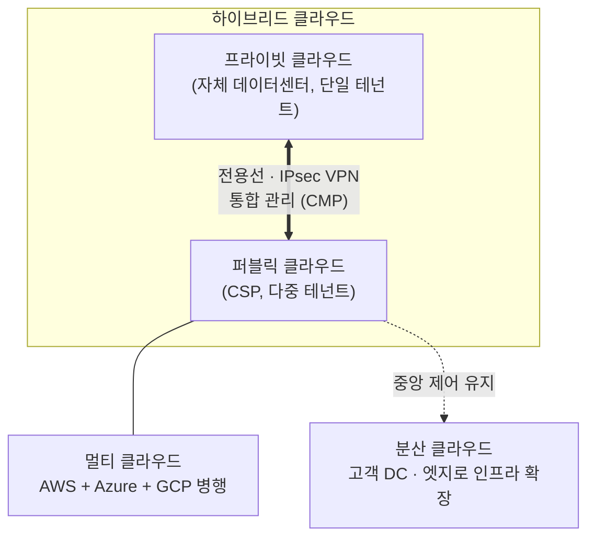

# 클라우드 컴퓨팅의 배치 모델 (Deployment Model)

---

## I. 소유·통제 범위에 따른 클라우드 제공 형태, 배치 모델의 개요

### 가. 정의

- 클라우드 자원의 **소유 주체, 공유 범위, 통제권**에 따라 구분한 [[클라우드 컴퓨팅]]의 구축·제공 형태 (NIST: Public, Private, Community, Hybrid)

### 나. 등장 배경 및 특징

| 구분 | 내용 |
| --- | --- |
| 등장 배경 | 퍼블릭 클라우드의 경제성과 규제·보안 요구 사이의 균형, 특정 [[CSP\|CSP]] 종속(Lock-in) 회피 |
| 분류 기준 | 소유·관리 주체, 단일 테넌트 vs 다중 테넌트 |
| 발전 방향 | 단일 모델 → 하이브리드 → 멀티 클라우드 → 분산 클라우드 |

---

## II. 배치 모델 유형 및 연동 기술

### 가. 배치 모델 구성

- 기밀 데이터와 레거시는 프라이빗에, 트래픽 변동이 큰 서비스는 퍼블릭에 두고 전용선으로 연동하며, 필요 시 여러 퍼블릭 CSP를 병행하거나 퍼블릭 인프라를 엣지로 분산

### 나. 유형 및 기술

| 구분 | 유형 · 기술 | 설명 |
| --- | --- | --- |
| NIST 기본 모델 | Public Cloud | CSP가 인터넷으로 불특정 다수에게 공유 자원을 종량제로 제공 |
| | Private Cloud | 단일 조직 전용, 자체 또는 위탁 데이터센터에서 운영 |
| | Community Cloud | 공공·금융·의료 등 공통 규제·목적을 가진 조직들이 공유 |
| | Hybrid Cloud | 둘 이상의 모델을 연동, Cloud Bursting(용량 초과 시 퍼블릭 자원 일시 활용) |
| 확장 모델 | Multi-Cloud | 둘 이상의 퍼블릭 CSP를 조합, 벤더 종속 회피·서비스별 강점 활용·이중화 |
| | Distributed Cloud | CSP 인프라를 고객 DC·통신사 엣지에 배치하고 중앙에서 관리 (AWS Outposts·Local Zones, Google Distributed Cloud) |
| 연동 | 전용선 · [[IP Sec\|IPsec]] [[VPN]] | Direct Connect·ExpressRoute 전용 회선, 인터넷 위 암호화 터널 |
| 관리 | CMP · IaC | 이기종 클라우드 통합 프로비저닝·모니터링, Terraform으로 코드화 |
| 이식성 | [[컨테이너]] · [[쿠버네티스]] | 환경 간 애플리케이션 이동성 확보 |

---

## III. 비교 및 동향

### 가. Public vs Private vs Hybrid

| 비교 항목 | Public | Private | Hybrid |
| --- | --- | --- | --- |
| 소유 · 관리 | CSP | 자기 조직 | 공동 |
| 테넌시 | 다중 테넌트 | 단일 테넌트 | 혼합 |
| 보안 · 통제권 | 상대적으로 낮음 (공동 책임 모델) | 높음 | 데이터 등급별 배치로 중~높음 |
| 확장성 | 매우 높음 | 보유 HW 범위 내 | 필요 시 퍼블릭으로 확장 |
| 초기 비용 | 낮음 (OpEx) | 높음 (CapEx) | 높음 (구축 + 연동) |
| 적합 워크로드 | 웹 서비스, 대규모 분석, 변동 트래픽 | 기밀 데이터, 규제 시스템 | 코어(Private) + 대고객 프런트(Public) |

### 나. 하이브리드 vs 멀티 vs 분산 클라우드

| 비교 항목 | 하이브리드 | 멀티 | 분산 |
| --- | --- | --- | --- |
| 구성 | 온프레미스 + 퍼블릭 | 퍼블릭 + 퍼블릭 | 퍼블릭 인프라를 외부 위치로 확장 |
| 주 목적 | 단계적 전환, 기밀 데이터 보호 | Lock-in 회피, 가용성 | 초저지연, 데이터 현지화 |
| 운영 복잡도 | 높음 (네트워크·보안 정책 일원화) | 매우 높음 (플랫폼별 전문성) | 높음 (원격 HW 관리) |
| 보안 이슈 | 경계 연동 구간 통제 | 정책 파편화 | 물리 제어권 확보로 규제 대응 유리 |

### 다. 동향

- **쿠버네티스 표준화**: 어느 클라우드에서도 동일하게 배포·운영하는 컨테이너 기반 이식성이 멀티·하이브리드의 기본 ([[클라우드 네이티브]])
- **소버린 클라우드**: 데이터 주권 요구로 특정 국가 법·규제를 따르는 독립 클라우드 확대
- **엣지·AI 연계**: 대화형 AI·영상 분석 등 초저지연 수요로 분산 클라우드와 [[EDGE\|엣지]] 클라우드 확산

---

### 🔗 연관 토픽

- **소속 도메인**: [[00_디지털서비스_MOC|🚀 디지털서비스]]
- **세부 분류**: `1. 클라우드 컴퓨팅 & 가상화 인프라`
- **핵심 연관 토픽**:
  - [[클라우드 컴퓨팅|클라우드 컴퓨팅 (Cloud Computing)]]
  - [[CSP|CSP (Cloud Service Provider)]]
  - [[쿠버네티스|쿠버네티스(Kubernates)]]
  - [[컨테이너|컨테이너 (Container)]]
  - [[클라우드 네이티브]]
