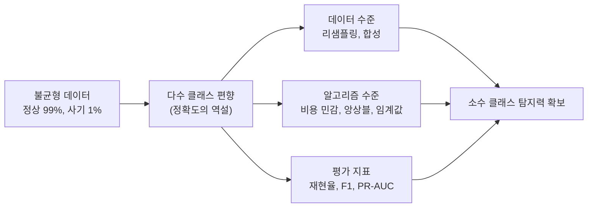

# 클래스 불균형 (Class Imbalance)

---

## I. 소수 클래스를 놓치는 문제, 클래스 불균형의 개요

### 가. 정의

- 분류 문제에서 **클래스별 표본 수가 크게 차이 나 모델이 다수 클래스 쪽으로 편향**되는 데이터 상태

### 나. 문제점 및 특징

| 구분 | 내용 |
| --- | --- |
| 발생 분야 | 금융 사기 탐지, 희귀 질환 진단, 제조 불량 검출, 침입 탐지 |
| 정확도의 역설 | 99:1 데이터에서 전부 다수로 예측해도 정확도 99%, 소수 재현율 0% |
| 결정 경계 | 다수 클래스에 유리하게 치우쳐 소수 영역을 침범 |
| 대응 축 | 데이터 수준, 알고리즘 수준, 평가 지표 |

---

## II. 대응 구조 및 핵심 기술

### 가. 대응 개념도

- 데이터·알고리즘·평가 지표를 함께 조정해 소수 클래스 재현율을 높임

### 나. 핵심 기술

| 구분 | 요소 | 설명 |
| --- | --- | --- |
| 데이터 수준 | 언더샘플링 | 다수 클래스 축소 (무작위, Tomek Links, ENN) |
| | 오버샘플링 | 소수 클래스 복제, 단순 복제 시 과적합 위험 |
| | SMOTE | 소수 표본과 kNN 이웃 사이를 보간해 합성 표본 생성 |
| | ADASYN·Borderline-SMOTE | 분류가 어려운 경계 부근에 합성 표본 집중 |
| 알고리즘 수준 | 비용 민감 학습 | 소수 클래스 오분류에 큰 가중치 (class_weight, Focal Loss) |
| | 앙상블 | Balanced Random Forest, EasyEnsemble, RUSBoost |
| | 임계값 조정 | 기본 0.5 대신 업무 비용에 맞춰 결정 임계값 이동 |
| | [[이상 감지]] 접근 | 극단적 불균형이면 Isolation Forest·One-Class [[서포트 벡터 머신\|SVM]] 활용 |
| 평가 | [[혼동행렬]] 기반 지표 | 정밀도·재현율·F1, 정확도 단독 사용 지양 |
| | PR-AUC·ROC-AUC | 불균형이 심하면 ROC-AUC가 낙관적이므로 PR-AUC 병행 |

---

## III. 비교 및 동향

### 가. 언더샘플링 vs 오버샘플링

| 비교 항목 | 언더샘플링 | 오버샘플링 |
| --- | --- | --- |
| 원리 | 다수 클래스 축소 | 소수 클래스 증식 |
| 대표 기법 | Random, Tomek Links, ENN, NearMiss | Random, SMOTE, ADASYN, Borderline-SMOTE |
| 장점 | 학습 시간·메모리 절약 | 정보 손실 없음 |
| 단점 | 다수 클래스 정보 손실 | 과적합, 잡음 표본 증폭 |
| 주의 | 검증·테스트셋에는 적용하지 않음 (원 분포 유지) | 교차검증 폴드 내부에서만 적용해 누수 방지 |

### 나. 동향

- **생성 모델 기반 증강**: [[GAN (Generative Adversarial Network)|GAN]]·[[VAE]]·확산 모델·LLM으로 소수 클래스 이미지·정형·텍스트 데이터 합성 ([[합성 데이터]])
- **하이브리드 샘플링**: SMOTE + Tomek Links(SMOTETomek), SMOTE + ENN으로 증식과 경계 정제를 함께 적용

---

### 🔗 연관 토픽

- **소속 도메인**: [[00_인공지능_MOC|🤖 인공지능]]
- **세부 분류**: `1. 수학 · 통계학 & 데이터 전처리`
- **핵심 연관 토픽**:
  - [[혼동행렬|혼동행렬 (Confusion Matrix)]]
  - [[ROC 곡선]]
  - [[이상 감지]]
  - [[합성 데이터|합성 데이터(Synthetic Data)]]
  - [[앙상블 학습|앙상블 학습(Ensemble Learning)]]
