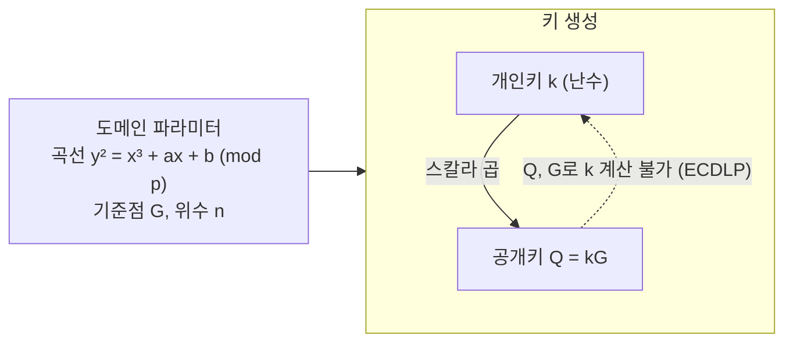

# 타원곡선 암호 (Elliptic Curve Cryptography)

---

## I. 짧은 키로 높은 강도를, 타원곡선 암호의 개요

### 가. 정의

- 유한체 위 **타원곡선 점들의 군 구조와 타원곡선 이산대수 문제(ECDLP)의 어려움에 기반**한 공개키 암호 (1985, Koblitz·Miller 제안)

### 나. 특징

| 구분 | 내용 |
| --- | --- |
| 짧은 키 | 256비트 키가 RSA 3072비트와 비슷한 128비트 강도 |
| 효율성 | 연산·메모리·대역폭·전력 절감, 모바일·IoT에 적합 |
| 일방향성 | 스칼라 곱 $Q = kG$는 쉽고 $Q$에서 $k$를 구하기는 어려움 |
| 곡선 선택 중요 | 안전한 곡선·구현을 쓰지 않으면 취약 (잘못된 곡선 공격, 부채널) |

---

## II. 동작 원리 및 구성요소

### 가. 키 생성 원리

- 개인키 k를 기준점 G에 점 덧셈·두 배 연산(double-and-add)으로 반복 적용해 공개키 Q 생성

### 나. 구성요소

| 구분 | 요소 | 설명 |
| --- | --- | --- |
| 수학적 기반 | 유한체 | 소수체 $GF(p)$ 또는 이진체 $GF(2^m)$ |
| | 바이어슈트라스 방정식 | $y^2 = x^3 + ax + b$, 판별식 ≠ 0 |
| 기본 연산 | 점 덧셈 | 두 점을 지나는 직선의 세 번째 교점을 x축 대칭 |
| | 점 두 배 | 접선의 교점을 x축 대칭 |
| | 스칼라 곱 | $kG$를 double-and-add로 계산 (상수 시간 구현 필요) |
| 난제 | ECDLP | $Q$와 $G$로 $k$를 구하기 어려움, 최선 공격 약 $\sqrt{n}$ |
| 응용 | ECDSA·EdDSA | 전자서명 (EdDSA는 결정적 서명) |
| | ECDH·[[ECDHE]] | 키 합의, 임시 키로 전방 비밀성 |
| 표준 곡선 | P-256, secp256k1, Curve25519 | NIST 곡선, 비트코인 곡선, 고속·안전 구현 곡선 |

---

## III. 비교 및 동향

### 가. ECC vs RSA

| 비교 항목 | ECC | [[RSA (Rivest Shamir Adleman)\|RSA]] |
| --- | --- | --- |
| 난제 | 타원곡선 이산대수 | 소인수분해 |
| 128비트 강도 키 | 256비트 | 3072비트 |
| 서명·키 교환 성능 | 빠름, 작은 서명 | 서명 느림, 검증 빠름 |
| 암호화 | ECIES 등 하이브리드 방식 | 직접 암호화(OAEP) 가능 |
| 활용 | TLS 1.3 키 교환, FIDO, 블록체인, 모바일 | 인증서 서명, 레거시 시스템 |

### 나. 동향

- **Curve25519 확산**: X25519·Ed25519가 TLS·SSH·Signal 등에서 기본 선택
- **양자 위협**: Shor 알고리즘으로 ECDLP가 풀리므로 ECC도 PQC 전환 대상 ([[양자내성암호]])
- **하이브리드 키 교환**: X25519 + ML-KEM(FIPS 203) 결합 방식이 주요 브라우저·CDN에 기본 적용

---

### 🔗 연관 토픽

- **소속 도메인**: [[00_보안_MOC|🛡️ 보안]]
- **세부 분류**: `2. 현대 암호학 & 키 관리 · 전자서명`
- **핵심 연관 토픽**:
  - [[ECC|ECC(Elliptic Curve Cryptography)]]
  - [[ECDHE]]
  - [[디피-헬만 알고리즘|디피-헬만 알고리즘(Diffie-Hellman Algorithm)]]
  - [[RSA (Rivest Shamir Adleman)]]
  - [[양자내성암호]]
