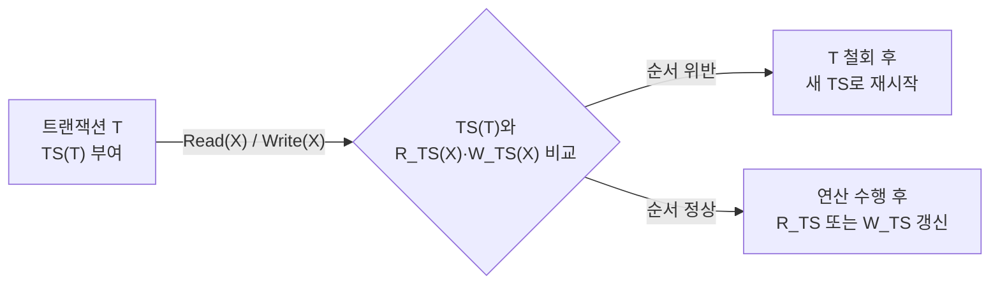

# 타임스탬프 순서 기법 (Timestamp Ordering)

---

## I. 잠금 없이 직렬성을 보장하는 병행 제어, 타임스탬프 순서 기법의 개요

### 가. 정의

- 트랜잭션이 시스템에 들어온 순서대로 **고유한 타임스탬프를 부여**하고, 데이터 읽기·쓰기 시 타임스탬프를 비교하여 **시간 순서와 같은 직렬 스케줄**이 되도록 제어하는 [[병행 제어]] 기법

### 나. 특징

| 구분 | 내용 |
| --- | --- |
| 무잠금 | Lock을 쓰지 않아 대기와 [[교착상태]]가 발생하지 않음 (Deadlock-Free) |
| 사후 검증 | 순서 위반 시 해당 [[트랜잭션]]을 철회(Abort)하고 새 타임스탬프로 재시작 |
| 순서 기준 | 시스템 클럭 또는 논리적 계수기 사용 |
| 한계 | 연쇄 복귀(Cascading Rollback), 충돌이 잦으면 철회·재시작 비용 증가 |

---

## II. 동작 원리 및 핵심 규칙

### 가. 연산 검증 흐름

### 나. 핵심 요소 및 규칙

| 구분 | 요소 | 설명 |
| --- | --- | --- |
| 기준값 | TS(T) | 트랜잭션 진입 시 부여되는 고유 타임스탬프 |
| 데이터 상태 | R_TS(X) | X를 읽은 트랜잭션 중 가장 큰 TS |
| | W_TS(X) | X를 쓴 트랜잭션 중 가장 큰 TS |
| 읽기 규칙 | Read(X) | TS(T) < W_TS(X)이면 이미 미래 값이 쓰였으므로 T 철회, 아니면 읽고 R_TS(X) = max(R_TS(X), TS(T)) |
| 쓰기 규칙 | Write(X) | TS(T) < R_TS(X) 또는 TS(T) < W_TS(X)이면 T 철회, 아니면 쓰고 W_TS(X) = TS(T) |
| 최적화 | 토마스 쓰기 규칙 | TS(T) < W_TS(X)인 쓰기는 이미 덮어쓰인 낡은 쓰기이므로 철회 없이 **무시** |

---

## III. 2PL과의 비교 및 동향

### 가. 타임스탬프 순서 vs 2PL

| 비교 항목 | 타임스탬프 순서 | [[2PL]] |
| --- | --- | --- |
| 원리 | 진입 시간 기준 선후 관계 검사 | 잠금 획득(확장)·해제(수축) |
| 제어 성향 | Lock 미사용, 위반 시 사후 철회 | 비관적, 충돌을 잠금으로 사전 방지 |
| 교착상태 | 발생하지 않음 | 발생 가능 (탐지·예방 필요) |
| 연쇄 복귀 | 발생 가능 | Strict 2PL로 방지 가능 |
| 오버헤드 원인 | 잦은 철회·재시작 | 잠금 대기 |
| 적합 환경 | 충돌이 적고 읽기 위주 | 갱신이 잦고 충돌 확률이 높은 환경 |

### 나. 동향

- **MVCC의 기반**: 타임스탬프로 버전을 구분해 읽기를 막지 않는 다중 버전 동시성 제어로 발전 ([[MVCC(다중 버전 동시성 제어) 2가지 유형|MVCC]])
- **분산 DB**: Spanner의 TrueTime, HLC 등 전역 시계와 결합해 노드 간 트랜잭션 순서 결정 ([[분산 데이터베이스]], [[CockroachDB]])

---

### 🔗 연관 토픽

- **소속 도메인**: [[00_데이터베이스_MOC|🗄️ 데이터베이스]]
- **세부 분류**: `2. 트랜잭션 & 동시성 제어 (Concurrency)`
- **핵심 연관 토픽**:
  - [[병행 제어]]
  - [[2PL|2PL (Two-Phase Locking Protocol)]]
  - [[낙관적 검증 기법]]
  - [[MVCC(다중 버전 동시성 제어) 2가지 유형]]
  - [[분산 데이터베이스|분산 데이터베이스 (Distributed Database)]]
