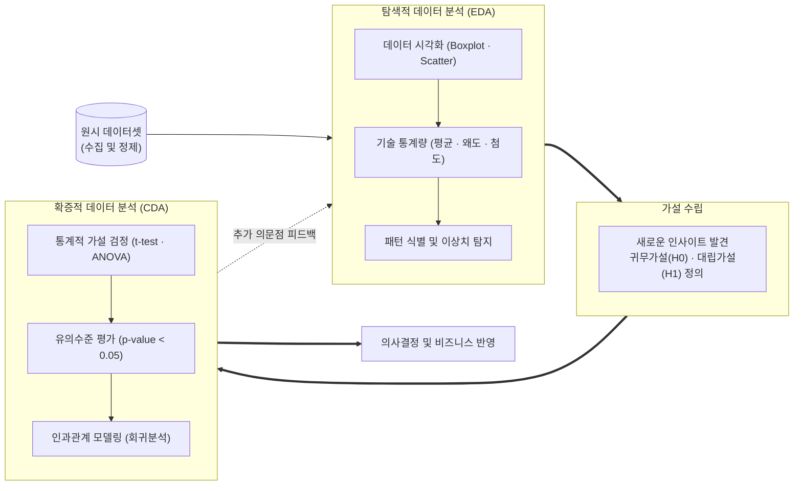

# 탐색적 데이터 분석과 확증적 데이터 분석 (EDA & CDA)

---

## I. 데이터 통찰 도출과 가설 검증의 상호보완 체계, EDA & CDA의 개요

### 가. 정의

- 데이터의 분포와 숨은 패턴을 시각적·직관적으로 파악하여 가설을 도출하는 **탐색적 데이터 분석(EDA)** 과, 통계적 추론 모델을 통해 설정된 가설의 타당성을 객관적으로 검증하는 **확증적 데이터 분석(CDA)의 상호보완적 분석 체계**

### 나. 특징 및 필요성

| 구분 | 내용 |
| --- | --- |
| 상호보완적 결합 | 탐색(귀납적 가설 도출, EDA)과 검증(연역적 가설 기각/채택, CDA)의 선순환 구조 형성 |
| 가설 편향 극복 | 엄격한 사전 가설에만 얽매이지 않고 원시 데이터 자체의 특성과 이상치를 자유롭게 발견(John Tukey) |
| 시각화와 통계 모델 | 직관적 차트(박스플롯, 산점도)를 통한 현상 이해와 통계적 유의성(p-value)을 통한 과학적 입증 결합 |
| MLOps 선행 필수 | 머신러닝 피처 엔지니어링 및 결측치/이상치 정제의 기초 단계로 EDA가 핵심 역할 수행 |

---

## II. 개념도 및 핵심 구성요소

### 가. 개념도 (선순환 분석 프로세스)

- 원시 데이터에서 EDA로 기술 통계 및 시각화를 통해 통찰을 얻고 가설을 세운 뒤, CDA를 통해 통계적 엄밀성을 입증하여 의사결정에 반영하는 반복 순환 구조

### 나. 핵심 기술 요소

| 구분 | 요소 | 설명 |
| --- | --- | --- |
| EDA (탐색) | 기술 통계 (Descriptive Stats) | 중심 경향성(평균, 중앙값, 최빈값) 및 산포도(분산, 표준편차, 사분위수) 산출 |
| | 시각화 (Visualization) | 히스토그램, 산점도, 박스 플롯(Box Plot)을 통한 데이터 분포 및 [[이상치]] 식별 |
| | 다변량 분석 및 차원 축소 | 주성분 분석(PCA), t-SNE 등을 통해 고차원 데이터의 복잡도를 낮추고 주요 변동성 파악 |
| CDA (확증) | 가설 설정 (Hypothesis) | 입증하고자 하는 대립가설(H1)과 반증 대상인 귀무가설(H0)의 통계적 정의 |
| | 유의확률 ([[유의확률\|p-value]]) | 귀무가설이 참일 때 현재 표본 이상이 관측될 확률 (통상 $\alpha=0.05$ 기준 판정) |
| | 신뢰구간 (Confidence Interval) | 모수가 일정 확률(예: 95%)로 포함될 것으로 기대되는 추정값의 범위 |
| | 가설 검정 기법 | 집단 간 평균 차이 검증(t-test, ANOVA) 및 범주형 독립성 검정($\chi^2$ 검정) |
| | 인과 추론 | 회귀분석(Regression)을 통해 변수 간 통계적 인과관계와 설명력 검증 |

---

## III. 분석 방식 비교 및 동향

### 가. EDA vs CDA

| 비교 항목 | 탐색적 데이터 분석 (EDA) | 확증적 데이터 분석 (CDA) |
| --- | --- | --- |
| 추론 방식 | **귀납적 (Inductive)** / 데이터 $\rightarrow$ 가설 도출 | **연역적 (Deductive)** / 가설 $\rightarrow$ 데이터 검증 |
| 주 목적 | 데이터의 숨은 패턴 발견 및 인사이트 도출 | 사전 설정된 가설의 통계적 유의성 입증 |
| 데이터 가정 | 모델의 엄격한 분포 가정 없이 자유롭게 분석 | 정규성, 독립성, [[등분산성]] 등 통계적 가정 충족 필수 |
| 주요 도구 | 데이터 시각화 차트, 상관계수 히트맵, 기술 통계표 | 유의확률(p-value), 신뢰구간, F값, t값 |
| 분석가 관점 | 형사(Detective) - 증거(데이터)에서 단서 추적 | 판사(Judge) - 증거를 바탕으로 유죄/무죄 판결 |

### 나. 동향

- **AutoEDA 도구의 대중화**: ydata-profiling(구 Pandas Profiling), Sweetviz 등을 통해 데이터 타입, 결측치, 상관관계 리포트 생성이 클릭 한 번으로 자동화
- **생성형 AI 기반 대화형 데이터 분석**: Code Interpreter 및 LLM 분석 에이전트와 연계하여 자연어로 "매출 이상치 패턴을 찾아 시각화하고 유의성을 검정해 줘"와 같은 복합 EDA/CDA 수행
- **MLOps 피처 파이프라인 통합**: 데이터 수집 파이프라인 상에서 실시간 데이터 품질 검증(Great Expectations)과 EDA 통계치 모니터링을 결합한 DataOps 체계 확립

---

### 🔗 연관 토픽

- **소속 도메인**: [[00_데이터베이스_MOC|🗄️ 데이터베이스]]
- **세부 분류**: `6. SQL 표준 문법 & 쿼리 성능 튜닝`
- **핵심 연관 토픽**:
  - [[이상치]]
  - [[회귀분석]]
  - [[분석 모델 평가 방법]]
  - [[데이터 가시화]]
  - [[차원 축소]]
