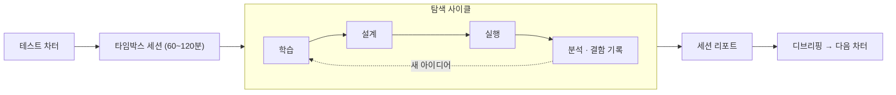

# 탐색적 테스트 (Exploratory Testing)

---

## I. 학습·설계·실행의 동시 수행, 탐색적 테스트의 개요

### 가. 정의

- 사전 정의된 테스트 케이스 없이 테스터가 **시스템을 학습하면서 테스트 설계와 실행을 동시에 수행**하는 경험 기반 테스트 기법 (Cem Kaner 명명)

### 나. 특징

| 구분 | 내용 |
| --- | --- |
| 등장 배경 | 명세 부족·잦은 변경, 짧은 일정, [[Agile]] 확산 |
| 동시성 | 학습·설계·실행·평가가 짧은 루프로 반복 |
| 결함 발견력 | 스크립트 테스트가 놓치는 예외·복합 결함 탐지 |
| 체계화 | 세션 기반 관리(SBTM)로 계획·추적성 확보 |
| 한계 | 테스터 역량 의존, 재현·커버리지 측정 곤란 |

---

## II. 수행 구조 및 구성요소

### 가. SBTM 기반 수행 구조

- 차터의 목표에 따라 정해진 시간 동안 탐색하고, 세션 리포트와 디브리핑으로 결과를 공유해 다음 차터를 계획

### 나. 구성요소

| 구분 | 요소 | 설명 |
| --- | --- | --- |
| 관리 | SBTM | 세션 단위로 탐색 활동을 계획·측정하는 관리 기법 (J. Bach, 2000) |
| | 테스트 차터 | 세션의 목표·범위·관점을 적은 짧은 지침 |
| | 타임박스 | 집중을 위해 세션 시간을 제한 |
| 수행 기법 | 휴리스틱 | 경험·도메인 지식으로 결함 가능성이 높은 영역 추정 |
| | 투어 기법 | 관광 비유로 관점을 정해 탐색 (가이드북·뒷골목·지역 주민 투어 등, J. Whittaker) |
| | 오류 추정 | 과거 결함 유형을 근거로 입력·경로 선택 |
| 기록 · 리뷰 | 세션 리포트 | 수행 내용, 발견 결함, 의문점 기록 |
| | 디브리핑 | 테스터와 관리자가 결과 검토, 후속 차터 결정 |

---

## III. 비교 및 동향

### 가. 스크립트 테스트 vs 탐색적 테스트

| 비교 항목 | 스크립트 테스트 | 탐색적 테스트 |
| --- | --- | --- |
| 접근 | 사전 정의된 케이스 실행 | 학습하며 동적으로 설계·실행 |
| 설계 · 실행 시점 | 설계 완료 후 실행 | 동시 수행 |
| 산출물 | 테스트 케이스 명세서, 결과 보고서 | 차터, 세션 리포트 |
| 장점 | 재사용·자동화·커버리지 측정 용이 | 빠른 결함 발견, 예상 밖 결함 탐지 |
| 단점 | 문서 부담, 창의성 제한 | 역량 의존, 객관적 측정 곤란 |
| 적합 영역 | [[리그레션 테스트\|회귀 테스트]], 규제 산업 | 신규 기능, 명세 부족, 시간 제약 |

### 나. 동향

- 정형 회귀 검증은 자동화하고, 사람의 판단이 필요한 신규·복잡 기능에 탐색적 테스트를 집중하는 혼합 전략
- 결함 이력·변경 이력을 분석해 위험 영역을 추천하는 AI 보조 탐색 테스트

---

### 🔗 연관 토픽

- **소속 도메인**: [[00_소프트웨어공학_MOC|🏗️ 소프트웨어공학]]
- **세부 분류**: `2. 애자일(Agile) & 지속적 통합/배포(CI/CD)`
- **핵심 연관 토픽**:
  - [[경험기반 테스트|경험기반 기법]]
  - [[소프트웨어 테스트|소프트웨어 테스트 (Software Test)]]
  - [[소프트웨어 테스트 원리|테스트 원리]]
  - [[블랙박스 테스트]]
  - [[리그레션 테스트|리그레션(회귀, Regression) 테스트]]
