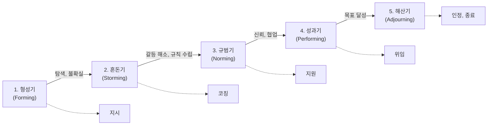

# 터크만 팀 개발 5단계 (Tuckman's Stages of Team Development)

---

## I. 팀이 성장하는 경로, 터크만 모델의 개요

### 가. 정의

- 팀이 구성되어 성과를 내고 해산하기까지 **형성·혼돈·규범·성과·해산**의 단계를 거친다고 설명하는 팀 발달 모델 (Tuckman 1965년 4단계, 1977년 Jensen과 해산기 추가)

### 나. 특징

| 구분 | 내용 |
| --- | --- |
| 갈등의 재해석 | 혼돈기 갈등을 성장에 필요한 자연스러운 과정으로 봄 |
| 비선형 가능 | 구성원 교체·목표 변경 시 이전 단계로 되돌아갈 수 있음, 일부 단계에 정체 가능 |
| 리더십 연계 | 단계별로 지시 → 코칭 → 지원 → 위임으로 리더십 조정 |
| PMBOK 반영 | 팀 개발 프로세스의 대표 모델 |

---

## II. 단계 구조와 리더 역할

### 가. 개념도

- 혼돈기에 성과가 일시 하락하나, 규범을 세우고 나면 성과기에서 자율적으로 높은 성과를 냄

### 나. 단계별 특징과 리더 역할

| 구분 | 요소 | 설명 |
| --- | --- | --- |
| 1. 형성기 | 팀 특징 | 서로 탐색, 목표·역할 불명확, 리더 의존 |
| | 리더 역할 | 목표·역할·기대치 명확히 제시 (지시) |
| 2. 혼돈기 | 팀 특징 | 업무 방식·권한을 둘러싼 갈등, 리더십에 대한 도전 |
| | 리더 역할 | 갈등 중재, 개방적 소통 유도 (코칭, [[갈등관리]]) |
| 3. 규범기 | 팀 특징 | 팀 규칙·협업 방식 정착, 신뢰 형성 |
| | 리더 역할 | 의사결정 참여 유도, 협업 촉진 (지원) |
| 4. 성과기 | 팀 특징 | 자율적 문제 해결, 높은 생산성 |
| | 리더 역할 | 권한 위임, 장애물 제거 (위임) |
| 5. 해산기 | 팀 특징 | 업무 종료, 팀 해체, 상실감 |
| | 리더 역할 | 성과 인정, 교훈 정리, 인력 재배치 지원 |

---

## III. 비교 및 동향

### 가. 터크만 모델과 상황적 리더십 (Hersey-Blanchard) 대응

| 터크만 단계 | 구성원 상태 | 리더십 스타일 | 지시·지원 수준 |
| --- | --- | --- | --- |
| 형성기 | 능력 낮음, 의욕 높음 | S1 지시형 (Telling) | 지시 높음, 지원 낮음 |
| 혼돈기 | 능력 낮음~중간, 의욕 낮음 | S2 설득·코칭형 (Selling) | 지시 높음, 지원 높음 |
| 규범기 | 능력 중간~높음, 의욕 변동 | S3 참여·지원형 (Participating) | 지시 낮음, 지원 높음 |
| 성과기 | 능력 높음, 의욕 높음 | S4 위임형 (Delegating) | 지시 낮음, 지원 낮음 |

### 나. 동향

- **애자일 팀 적용**: 장기 고정 팀을 유지해 성과기를 오래 유지, 잦은 인력 교체 지양
- **스크럼 마스터 역할**: 혼돈기 갈등을 회고·팀 규칙(Working Agreement)으로 규범기로 전환하는 촉진자 ([[SCRUM|스크럼]])
- **원격 팀**: 형성기 신뢰 형성을 위한 온보딩·대면 워크숍 강화

---

### 🔗 연관 토픽

- **소속 도메인**: [[00_프로젝트관리_MOC|📋 프로젝트관리]]
- **세부 분류**: `5. 애자일 프로젝트 관리 & 개발 운영 (Agile PM)`
- **핵심 연관 토픽**:
  - [[갈등관리]]
  - [[동기부여 이론]]
  - [[SCRUM|스크럼 (SCRUM)]]
  - [[PMBOK 7판 (Project Management Body of Knowledge 7th Ed.)]]
  - [[Agile]]
