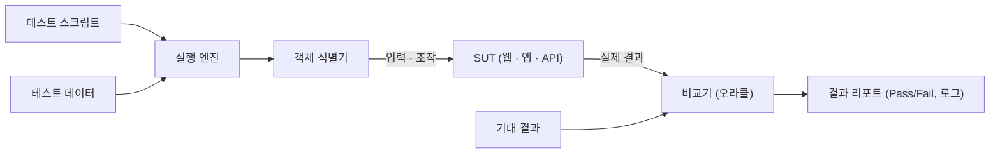

# 테스트 실행 도구 (Test Execution Tool)

---

## I. 스크립트로 반복 실행·판정, 테스트 실행 도구의 개요

### 가. 정의

- 테스트 스크립트에 따라 **테스트 대상(SUT)을 자동 실행하고 실제 결과를 기대 결과와 비교해 결과를 보고**하는 테스트 자동화 도구

### 나. 특징

| 구분 | 내용 |
| --- | --- |
| 등장 배경 | [[Agile]]·[[DevOps]]의 잦은 배포로 [[리그레션 테스트\|회귀 테스트]] 비용 증가 |
| 반복 효율 | 동일 테스트를 사람 개입 없이 반복 실행 |
| 프레임워크 지원 | 데이터 주도·키워드 주도 방식 지원 |
| 파이프라인 연동 | CI/CD에서 커밋마다 자동 실행 |

---

## II. 동작 구조 및 구성요소

### 가. 동작 구조

- 실행 엔진이 스크립트와 데이터를 해석해 SUT를 조작하고, 비교기가 실제 결과와 기대 결과를 대조해 리포트 생성

### 나. 구성요소

| 구분 | 요소 | 설명 |
| --- | --- | --- |
| 실행 | 실행 엔진 | 스크립트 해석, 순차·병렬 실행 |
| 입력 | 데이터 풀 | CSV·DB 등 외부 데이터로 파라미터 주입 |
| 객체 제어 | 객체 식별자 (Locator) | XPath·CSS Selector·ID로 UI 요소 식별 |
| 판정 | [[테스트 오라클]] · 비교기 | 실제 결과와 기대 결과 일치 여부 판정 |
| | 단언 (Assertion) | 조건 불만족 시 실패 처리 |
| 결과 | 리포터 | 실행 이력·통계·스크린샷·로그 제공 |
| 작성 지원 | 레코더 | 사용자 조작을 녹화해 스크립트 생성 |
| 연동 | CI 플러그인 | Jenkins·GitHub Actions에서 자동 실행 |

---

## III. 비교 및 동향

### 가. 자동화 스크립트 방식 비교

| 비교 항목 | 캡처 앤 플레이백 | 데이터 주도 | [[Keyword Driven Testing\|키워드 주도]] |
| --- | --- | --- | --- |
| 방식 | 사용자 조작 녹화 후 재생 | 하나의 스크립트에 여러 데이터셋 주입 | 키워드(동작 단어)와 데이터 조합 |
| 장점 | 프로그래밍 지식 없이 빠른 작성 | 스크립트 수 감소, 입력 다양화 | 비개발자도 표 형식으로 설계 |
| 한계 | UI 변경 시 재녹화 필요 | 데이터 관리 부담 | 초기 키워드 라이브러리 구축 비용 |

### 나. 동향

- UI 속성이 바뀌어도 AI가 요소를 다시 찾아 스크립트를 고치는 자가 치유(Self-Healing)
- 자연어로 테스트를 작성하는 코드리스·LLM 기반 도구 확산 (Playwright·Selenium 등 오픈소스 기반)
- 클라우드 디바이스 팜에서 브라우저·단말 조합을 병렬 실행

---

### 🔗 연관 토픽

- **소속 도메인**: [[00_소프트웨어공학_MOC|🏗️ 소프트웨어공학]]
- **세부 분류**: `2. 애자일(Agile) & 지속적 통합/배포(CI/CD)`
- **핵심 연관 토픽**:
  - [[테스트 오라클]]
  - [[테스트 하네스]]
  - [[테스트 통제 도구]]
  - [[Keyword Driven Testing]]
  - [[리그레션 테스트|리그레션(회귀, Regression) 테스트]]
