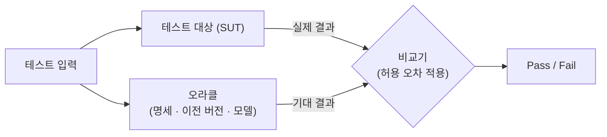

# 테스트 오라클 (Test Oracle)

---

## I. 테스트 결과의 참·거짓 판정 기준, 테스트 오라클의 개요

### 가. 정의

- 테스트 실행의 **실제 결과가 올바른지 판정하기 위해 기대 결과를 제공하거나 비교하는 기준·메커니즘** (명세서, 이전 버전, 계산 모델, 사람의 판단 등)

### 나. 특징

| 구분 | 내용 |
| --- | --- |
| 필요성 | 자동화된 대량 테스트에서 수동 판정의 병목·오류 제거 |
| 오라클 문제 | 모든 입력의 정답을 알기 어려워 완전한 오라클 구축이 현실적으로 곤란 |
| 절충 | 샘플링·휴리스틱·일관성 기준으로 비용과 정확도 균형 |
| 활용 | [[리그레션 테스트\|회귀 테스트]]의 자동 판정 기준 |

---

## II. 판정 구조 및 유형

### 가. 판정 구조

- 같은 입력을 SUT와 오라클에 적용해 실제 결과와 기대 결과를 비교하고, 허용 오차 내 일치 여부로 판정

### 나. 구성요소 및 유형

| 구분 | 요소 | 설명 |
| --- | --- | --- |
| 구성요소 | 기대 결과 | [[요구사항 명세서]]·기존 시스템 등에서 얻은 정답 값 |
| | 실제 결과 | SUT 실행 결과 |
| | 비교기 | 두 값을 대조하는 단언(Assertion)·도구 |
| | 허용 오차 | 부동소수점·시간 값 등의 허용 범위 |
| 유형 | 참 오라클 (True) | 모든 입력에 대해 기대 결과 제공 |
| | 샘플링 오라클 (Sampling) | 선정된 일부 입력에 대해서만 기대 결과 제공 |
| | 휴리스틱 오라클 (Heuristic) | 일부 입력은 정확히, 나머지는 경험 규칙으로 판정 |
| | 일관성 오라클 (Consistent) | 이전 버전 결과와 같은지 비교 (회귀·[[Back to Back 테스트\|Back-to-Back]]) |

---

## III. 비교 및 동향

### 가. 오라클 유형 비교

| 비교 항목 | 참 | 샘플링 | 휴리스틱 | 일관성 |
| --- | --- | --- | --- | --- |
| 판정 범위 | 전체 입력 | 일부 입력 | 일부 정확 + 나머지 추정 | 변경 전후 비교 대상 |
| 비용 | 매우 높음 | 낮음~중간 | 중간 | 중간 (자동화 의존) |
| 한계 | 구축 사실상 곤란 | 미선정 입력 결함 누락 | 추정 오판 가능 | 이전 버전이 틀리면 결함 승계 |
| 적용 예 | 고신뢰 계산 모듈 | 일반 업무 시스템 | 복잡 로직·대량 데이터 | 리팩토링·마이그레이션 |

### 나. 동향

- 정답을 알 수 없는 AI·과학 계산 시스템에 입력 변환과 출력 관계로 판정하는 메타모픽 테스팅 적용
- LLM이 명세·로그에서 기대 결과와 단언을 생성하는 자동 오라클 연구

---

### 🔗 연관 토픽

- **소속 도메인**: [[00_소프트웨어공학_MOC|🏗️ 소프트웨어공학]]
- **세부 분류**: `2. 애자일(Agile) & 지속적 통합/배포(CI/CD)`
- **핵심 연관 토픽**:
  - [[테스트 실행 도구]]
  - [[테스트 하네스]]
  - [[Back to Back 테스트]]
  - [[리그레션 테스트|리그레션(회귀, Regression) 테스트]]
  - [[소프트웨어 테스트|소프트웨어 테스트 (Software Test)]]
