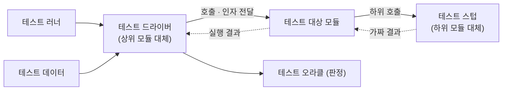

# 테스트 하네스 (Test Harness)

---

## I. 모듈을 홀로 실행시키는 시험 환경, 테스트 하네스의 개요

### 가. 정의

- 테스트 대상 모듈을 **독립적으로 실행·관찰·검증할 수 있도록 드라이버·스텁·테스트 데이터·러너 등을 묶어 구성한 테스트 환경**

### 나. 특징

| 구분 | 내용 |
| --- | --- |
| 필요성 | 상·하위 모듈이 미완성이어도 [[단위 테스트]]·[[통합 테스트]] 수행 |
| 격리 | 외부 의존을 대체 객체로 바꿔 대상만 검증 |
| 자동화 | 실행·판정을 자동화해 [[TDD]]·CI에서 반복 실행 |
| 재현성 | 같은 조건으로 언제든 동일하게 재실행 |

---

## II. 구조 및 구성요소

### 가. 구조

- 러너가 구동한 드라이버가 데이터를 넣어 대상을 호출하고, 미구현 하위 모듈은 스텁이 대신 응답하며, 결과는 오라클이 판정

### 나. 구성요소

| 구분 | 요소 | 설명 |
| --- | --- | --- |
| 모듈 대체 | 테스트 드라이버 | 대상을 호출하는 상위 모듈 대체, 입력 전달·결과 수신 |
| | 테스트 스텁 | 대상이 호출하는 하위 모듈 대체, 미리 정한 값 반환 |
| | 목 객체 (Mock) | 호출 여부·순서 등 상호작용(행위)까지 검증하는 대역 |
| 실행 | 테스트 러너 | 케이스를 순차·병렬 실행하고 흐름 제어 |
| 테스트 자산 | 테스트 케이스 · 스위트 | 입력·실행 조건·기대 결과, 목적별 케이스 묶음 |
| | 테스트 스크립트 | 실행 절차를 자동화 코드로 구현 |
| 판정 | [[테스트 오라클]] | 실제 결과의 참·거짓을 판단하는 기준 |

---

## III. 비교 및 동향

### 가. 테스트 드라이버 vs 테스트 스텁

| 비교 항목 | 테스트 드라이버 | 테스트 스텁 |
| --- | --- | --- |
| 대체 대상 | 호출하는 상위(제어) 모듈 | 호출받는 하위(종속) 모듈 |
| 동작 | 대상을 호출하고 인자 전달 | 호출받아 결과 반환 |
| 통합 방식 | 상향식(Bottom-up) 통합 | 하향식(Top-down) 통합 |
| 구현 난이도 | 입력 구성·결과 확인 로직으로 상대적으로 복잡 | 고정값 반환 위주로 단순 |

### 나. 동향

- 외부 API·레거시 시스템을 통째로 흉내 내는 서비스 가상화(WireMock 등)로 하네스 범위 확장
- Testcontainers·IaC로 테스트 환경을 코드로 생성·폐기하며 CI 파이프라인에 통합

---

### 🔗 연관 토픽

- **소속 도메인**: [[00_소프트웨어공학_MOC|🏗️ 소프트웨어공학]]
- **세부 분류**: `2. 애자일(Agile) & 지속적 통합/배포(CI/CD)`
- **핵심 연관 토픽**:
  - [[단위 테스트]]
  - [[통합 테스트]]
  - [[테스트 오라클]]
  - [[테스트 실행 도구]]
  - [[TDD|TDD (Test Driven Development)]]
