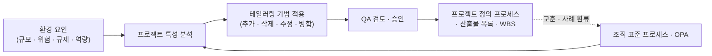

# 테일러링 (Tailoring)

---

## I. 표준 프로세스를 사업에 맞게, 테일러링의 개요

### 가. 정의

- 조직의 **표준 프로세스·방법론을 프로젝트 특성(규모·위험·복잡도 등)에 맞게 추가·삭제·수정하여 프로젝트 정의 프로세스로 조정**하는 활동

### 나. 필요성 및 특징

| 구분 | 내용 |
| --- | --- |
| 등장 배경 | 획일적 프로세스 적용 시 불필요한 문서·관리 부담 발생 |
| 균형 | 품질 확보와 생산성 사이의 균형 |
| 통제된 조정 | 조직 가이드라인의 허용 범위 안에서만 조정 |
| 지속 개선 | 적용 결과를 조직 프로세스 자산(OPA)에 환류 |

---

## II. 수행 절차 및 구성요소

### 가. 수행 절차

- 프로젝트 특성을 분석해 표준 프로세스를 조정하고, QA 승인을 거쳐 프로젝트 정의 프로세스로 확정한 뒤 결과를 조직 자산으로 환류

### 나. 구성요소

| 구분 | 요소 | 설명 |
| --- | --- | --- |
| 기준 | 규모 · 복잡도 | 예산·기간·인원·기술 난이도에 따라 관리 깊이 결정 |
| | 위험 · 규제 | 위험 수준·법규에 따라 검토·보안·감리 활동 조절 |
| 기법 | 삭제 | 불필요하거나 중복된 활동·산출물 제거 |
| | 추가 | 신기술·보안 요구에 따른 활동·산출물 신설 |
| | 수정 · 병합 | 순서 변경, 유사 검토·산출물 통합 |
| 통제 | 테일러링 가이드라인 | 허용 범위와 필수 준수 항목 정의 |
| | QA 검토 | [[CMMI]]·[[SP 인증]] 등 기준 부합 여부 확인 |
| 사후 관리 | OPA (조직 프로세스 자산) | 적용 사례·교훈을 축적해 표준 갱신 |

---

## III. 비교 및 동향

### 가. 테일러링 vs 커스터마이징

| 비교 항목 | 테일러링 | 커스터마이징 |
| --- | --- | --- |
| 대상 | 프로세스·방법론·관리 절차 | 제품·패키지·소스 코드 |
| 목적 | 사업 수행 효율과 품질 확보 | 고객 기능 요구 충족 |
| 주체 | PM, QA, 프로세스 담당 | 아키텍트, 개발자 |
| 시점 | 착수·계획 단계 (필요 시 재조정) | 설계·구현 단계 |
| 결과물 | 프로젝트 정의 프로세스, 산출물 목록, [[WBS]] | 맞춤 UI·기능, 수정된 패키지 |

### 나. 동향

- 계획·설계는 폭포수, 개발·테스트는 스프린트로 운영하는 Water-Scrum-Fall 등 하이브리드 테일러링 확산
- [[Agile]] 환경에서는 회고를 통해 진행 중에도 프로세스를 지속 조정
- [[ISO 29119]] 등 표준도 테일러링을 공식 적용 방식으로 인정

---

### 🔗 연관 토픽

- **소속 도메인**: [[00_소프트웨어공학_MOC|🏗️ 소프트웨어공학]]
- **세부 분류**: `2. 애자일(Agile) & 지속적 통합/배포(CI/CD)`
- **핵심 연관 토픽**:
  - [[소프트웨어 개발 방법론]]
  - [[CMMI]]
  - [[SP 인증]]
  - [[Agile]]
  - [[워터폴]]
