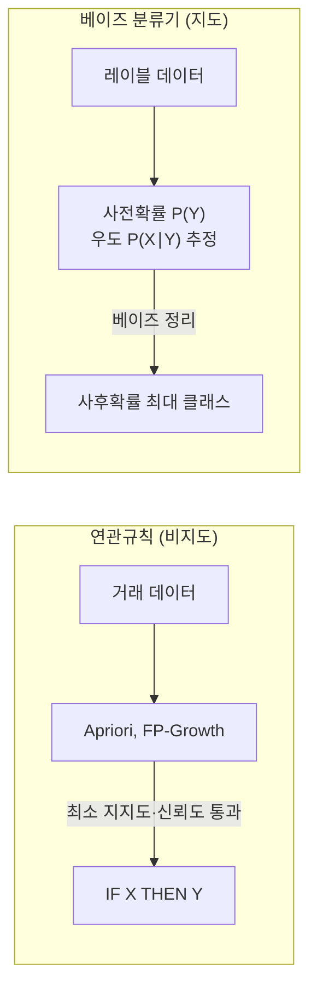

# 통계데이터마이닝 (연관규칙 & 베이즈)

---

## I. 동시 발생 규칙과 확률 분류, 통계 데이터마이닝의 개요

### 가. 정의

- 항목의 **동시 발생 빈도로 규칙을 찾는 연관규칙 분석**과 **조건부 확률로 범주를 예측하는 베이즈 분류기**를 활용하는 통계 기반 데이터마이닝 기법

### 나. 등장 배경 및 특징

| 구분 | 내용 |
| --- | --- |
| 배경 | 장바구니 분석(동시 구매 패턴), 스팸 필터·문서 분류 등 빠른 확률 기반 분류 요구 |
| 수리 기반 | 지지도·신뢰도·조건부 확률 등 단순한 확률 계산 |
| 해석력 | 규칙과 확률식이 명시적인 화이트박스 모델 |
| 경량성 | [[딥러닝]] 대비 학습·추론 비용이 작음 |

---

## II. 동작 구조 및 핵심 요소

### 가. 개념도

- 연관규칙은 빈발 항목집합에서 규칙을 만들고, 베이즈 분류기는 사후확률이 가장 큰 클래스를 선택

### 나. 핵심 요소

| 구분 | 요소 | 설명 |
| --- | --- | --- |
| 연관규칙 | [[지지도]] (Support) | $P(A \cap B)$, 전체 거래 중 A·B 동시 포함 비율 |
| | 신뢰도 (Confidence) | $P(B \mid A)$, A를 포함한 거래 중 B 포함 비율 |
| | 향상도 (Lift) | $P(B \mid A)/P(B)$, 1보다 크면 양의 연관, 1이면 독립 |
| | [[Apriori 알고리즘]] | 빈발하지 않은 집합의 상위 집합도 빈발하지 않다는 성질로 후보 가지치기 |
| | FP-Growth | FP-Tree로 후보 생성 없이 빈발 항목 탐색 |
| 베이즈 | 사전확률 | 클래스 $Y$의 기본 발생 확률 $P(Y)$ |
| | 우도 | 클래스가 $Y$일 때 특징 $X$가 관측될 확률 $P(X \mid Y)$ |
| | 사후확률 | $P(Y \mid X) \propto P(X \mid Y)P(Y)$ |
| | 나이브 가정 | 클래스가 주어지면 특징끼리 서로 조건부 독립, $P(X \mid Y) = \prod_i P(x_i \mid Y)$ |
| | 라플라스 스무딩 | 학습에 없던 특징의 확률이 0이 되는 문제 보정 |

---

## III. 비교 및 동향

### 가. 연관규칙 vs 나이브 베이즈

| 비교 항목 | 연관규칙 분석 | 나이브 베이즈 분류기 |
| --- | --- | --- |
| 목적 | 항목 간 연관 패턴 발견 | 범주 예측·분류 |
| 학습 유형 | [[비지도 학습]] | [[지도학습]] |
| 평가 | 지지도, 신뢰도, 향상도 | 정확도, 정밀도, 재현율, F1 |
| 산출물 | IF-THEN 규칙 집합 | 클래스 레이블과 확률 |
| 한계 | 항목 수 증가 시 후보 폭증, 무의미한 규칙 양산 | 조건부 독립 가정이 현실과 다름, 확률 보정이 부정확 |
| 적용 | 상품 진열, 교차 판매 추천 | 스팸 필터, 감성 분석, 문서 분류 |

### 나. 동향

- **해석 가능한 기준 모델**: 금융·의료처럼 설명이 필요한 분야에서 규칙·확률 기반 모델을 [[XAI]] 보완재·베이스라인으로 활용
- **추천 시스템 결합**: 연관규칙을 협업 필터링·임베딩 기반 추천과 결합해 콜드 스타트·교차 판매 보완

---

### 🔗 연관 토픽

- **소속 도메인**: [[00_인공지능_MOC|🤖 인공지능]]
- **세부 분류**: `1. 수학 · 통계학 & 데이터 전처리`
- **핵심 연관 토픽**:
  - [[지지도]]
  - [[Apriori 알고리즘]]
  - [[베이즈 정리|베이즈 정리 (이론)]]
  - [[비지도 학습]]
  - [[XAI]]
